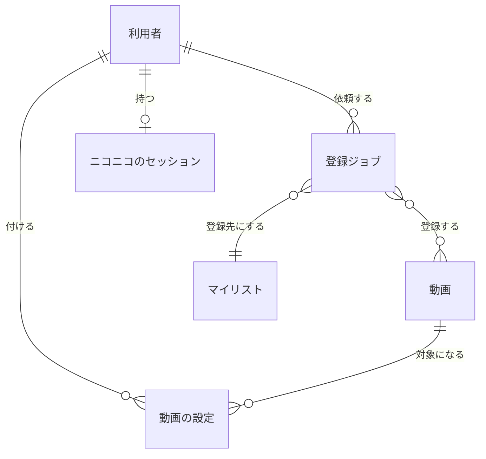

# ドメインモデル

利用者が、ニコニコ動画の動画を取り込み、自分用の設定を付け、条件に合うものをマイリストへ登録するまでに扱う概念。

## 概念

| 概念 | 意味 |
|---|---|
| 利用者 | このサービスを使う本人 |
| 動画 | ニコニコ動画の動画の基本情報。全利用者で共通する ([動画の基本情報](../specs/term/video-basic-info.md)、[動画 ID](../specs/term/video-id.md)) |
| 動画の設定 | 利用者が動画ごとに付ける、お気に入り・スキップ・メモ。利用者 × 動画で 1 つ ([動画の設定](../specs/term/video-setting.md)) |
| マイリスト | ニコニコ側にある動画の一覧。上限は 100 件 |
| 登録ジョブ | 動画をマイリストへ登録する 1 回の処理と、その結果 ([バッチジョブ](../specs/term/batch-job.md)) |
| ニコニコのセッション | 利用者がブラウザでログインして得た、ニコニコを操作するための情報 ([ニコニコセッション](../specs/term/user-session.md)) |

## 関係

- 1 人の利用者は、複数の動画に設定を付ける。1 つの動画には、利用者ごとに設定が 1 つだけ付く
- 動画は全利用者で共通で、設定は利用者ごとに分かれる。基本情報を重ねて持たず、設定だけを利用者ごとに持つため
- 1 人の利用者は、ニコニコのセッションを 0 または 1 つ持つ。登録ジョブはそのセッションでニコニコを操作する
- 1 つの登録ジョブは、最大 100 件の動画を 1 つのマイリストへ登録する。マイリストの上限が 100 件だからである
