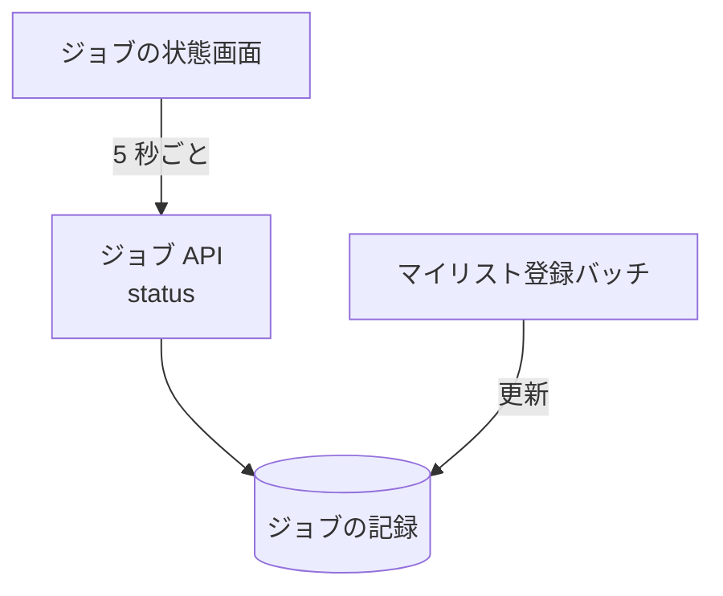

---
sources:
  - services/niconico-mylist-assistant/web/src/app/api/batch/status/[jobId]/route.ts
  - services/niconico-mylist-assistant/core/src/db/batch-jobs.ts
  - services/niconico-mylist-assistant/core/src/mappers/batch-job.mapper.ts
  - libs/nextjs/src/auth.ts
sources_hash: f38095eddc19d8af07c586384a1af2358e05d364d7ee7f2aedb49ffe39e45fe7
---

# ジョブ API

マイリスト登録の[ジョブ](../term/batch-job.md)の状態を読む API。

## エンドポイント

| メソッド | パス | 権限 |
|---|---|---|
| GET | `/api/batch/status/{jobId}` | ログイン |

## 入力と出力

状態の取得 (`GET /api/batch/status/{jobId}`) は、自分が作ったジョブだけを返す。

- 応答は `{ jobId, status, createdAt, updatedAt, result?, completedAt? }`。日時は ISO 8601 の文字列。`result` と `completedAt` は、あるときだけ付く
- ジョブの記録は作成の 7 日後以降に消えるので、消えたあとは 404 になる

## エラー

未ログインと想定外の失敗は形 C、ジョブがないときは形 A ([API のエラー応答](../term/api-error.md))。

| 条件 | 状態 | 応答 |
|---|---|---|
| 未ログイン | 401 | `error` が `UNAUTHORIZED`、`message` が「ログインが必要です」 |
| ジョブがない (ほかの利用者のジョブを含む) | 404 | `code` が `NOT_FOUND`、`message` が「バッチジョブが見つかりません」 |
| 想定外の失敗 | 500 | `error` が `INTERNAL_ERROR`、`message` が「内部エラーが発生しました」 |

## つながり

