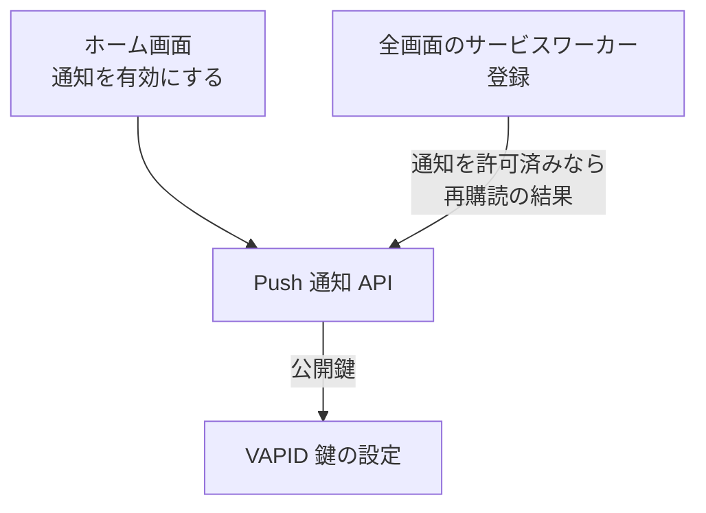

---
sources:
  - services/niconico-mylist-assistant/web/src/app/api/push/subscribe/route.ts
  - services/niconico-mylist-assistant/web/src/app/api/push/vapid-public-key/route.ts
sources_hash: 4602ea7ccf0468b12de46a7106e7ffa7a7a2acd5356262122605b2d373ac0e17
---

# Push 通知 API

マイリスト登録の完了通知を受け取るための Web Push の購読まわり。購読の情報は、サーバー側では保存しない。通知の宛先は、登録を依頼するときにジョブの記録へ書く ([マイリスト登録 API](./mylist-register.md))。

## エンドポイント

| メソッド | パス | 権限 |
|---|---|---|
| GET | `/api/push/vapid-public-key` | ログイン不要 |
| POST | `/api/push/subscribe` | ログイン |

## 入力と出力

- 二つのルートは、共通ライブラリの[Web Push のルート](../../../../platform/specs/lib/nextjs/push-routes.md)のとおりに動く。入力・出力・購読の検証 (`endpoint` の条件を含む) もそこにある
- 公開鍵の取得は、ブラウザが購読を作るときに使う VAPID 公開鍵を返す。値は環境変数 `VAPID_PUBLIC_KEY`
- 購読の情報は保存しない。受け取って検証し、ID を返すだけ (保存のフック `onSubscribe` を渡さない)
- 権限 (ロール) は問わない。ログインしていれば呼べる (`requiredPermission` を渡さないので、403 は返らない)

## エラー

形 C ([API のエラー応答](../term/api-error.md))。条件と応答は[Web Push のルート](../../../../platform/specs/lib/nextjs/push-routes.md)の表のとおり。

- 500 を返す直前に、Admin へ報告する ([エラー通知の経路](../../../../specs/admin/flow/error-notification.md))

## つながり

