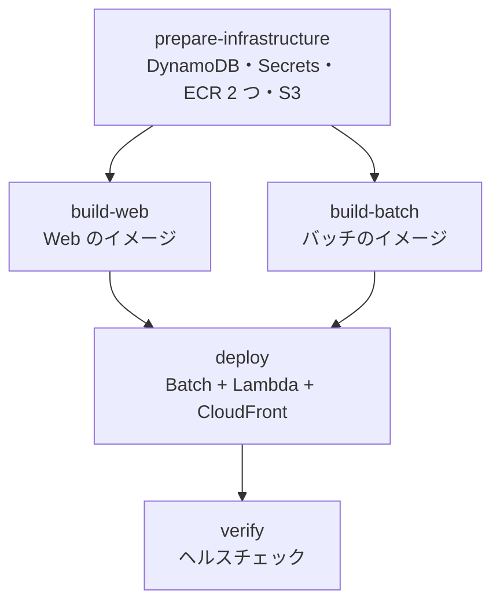

---
sources:
  - infra/niconico-mylist-assistant/bin/niconico-mylist-assistant.ts
  - infra/niconico-mylist-assistant/lib/cloudfront-stack.ts
  - infra/niconico-mylist-assistant/lib/batch-stack.ts
  - infra/niconico-mylist-assistant/lib/s3-stack.ts
  - .github/workflows/niconico-mylist-assistant-deploy.yml
sources_hash: 1ca1361389e7a4f5b8e64cae8e160bf94c4c29fa829a17c6313ecb306129c1c2
---

# niconico-mylist-assistant のデプロイ先

niconico-mylist-assistant は、Web アプリ (Lambda の Function URL を CloudFront で配信) と、マイリスト登録を行う AWS Batch のジョブを AWS に載せる。dev と prod の両方にデプロイする。

## ホスト名

| 環境 | ホスト名 |
|---|---|
| dev | `niconico-mylist-assistant.dev.nagiyu.com` |
| prod | `niconico-mylist-assistant.nagiyu.com` |

DNS レコードは、dev は CloudFront の基底スタックが、prod は shared の CNAME が作る。詳しくは [DNS レコードの作り方](../../../platform/specs/deploy.md#dns-レコードの作り方) を参照。

## スタック

`infra/niconico-mylist-assistant/bin/niconico-mylist-assistant.ts` が、次の順に作る。環境は CDK の context `env` (既定は `dev`) で決まり、`{Env}` は `Dev` または `Prod`。

| 順 | スタック | 役割 | 含む主なリソース |
|---|---|---|---|
| 1 | `NagiyuNiconicoMylistAssistantDynamoDB{Env}` | データの保存 | DynamoDB のテーブル (GSI を 1 つ持つ) |
| 2 | `NagiyuNiconicoMylistAssistantSecrets{Env}` | シークレット | Secrets Manager のシークレット (暗号化キー、VAPID) |
| 3 | `NagiyuNiconicoMylistAssistantS3{Env}` | スクリーンショットの保存 | S3 バケット |
| 4 | `NagiyuNiconicoMylistAssistantWebECR{Env}` | Web アプリのイメージの置き場 | ECR リポジトリ |
| 5 | `NagiyuNiconicoMylistAssistantBatchECR{Env}` | バッチのイメージの置き場 | ECR リポジトリ |
| 6 | `NagiyuNiconicoMylistAssistantBatch{Env}` | ジョブの実行 | AWS Batch のコンピューティング環境、ジョブキュー、ジョブ定義、セキュリティグループ、ロググループ、ジョブのロールと実行ロール。DynamoDB・Secrets・S3・Batch ECR のスタックに依存する |
| 7 | `NagiyuNiconicoMylistAssistantLambda{Env}` | Web アプリの実行 | Web の Lambda 関数 (コンテナイメージ、Function URL つき)、実行ロール。DynamoDB・Secrets・Web ECR・Batch のスタックに依存する |
| 8 | `NagiyuNiconicoMylistAssistantCloudFront{Env}` | Web アプリの配信 | CloudFront ディストリビューション (Lambda の Function URL がオリジン)、noindex、dev の ALIAS。prod の価格クラスは `PriceClass_All`。Lambda のスタックに依存する |

CloudFront のスタックは `us-east-1` に固定する (CloudFront の制約)。ほかのスタックのリージョンは、環境変数 `CDK_DEFAULT_REGION` で、未設定なら `us-east-1`。

## デプロイの流れ

`.github/workflows/niconico-mylist-assistant-deploy.yml` が行う。

| 項目 | 内容 |
|---|---|
| トリガー | develop・`integration/**`・master への push (`services/niconico-mylist-assistant/**`、`infra/niconico-mylist-assistant/**`、`infra/common/**`、`libs/**`、`configs/**`、`package.json`、`package-lock.json`、このワークフローとヘルスチェック・ECR push のアクションが変わったとき)。手動実行 (dev か prod を選ぶ) |
| デプロイ先の環境 | [dev と prod の切り替え](../../../platform/specs/deploy.md#dev-と-prod-の切り替え) の規則 |
| 並行実行 | 環境ごとに直列化する。実行中の run は止めず、待機中は最新だけ残す |
| イメージのタグ | コミットの SHA |

| ジョブ | 内容 |
|---|---|
| `prepare-infrastructure` | CDK の Bootstrap の後、DynamoDB・Secrets・Web ECR・Batch ECR・S3 のスタックをデプロイする |
| `build-web` | Web アプリをビルドし、イメージを ECR に push する |
| `build-batch` | バッチのワーカーのイメージを ECR に push する (`prepare-infrastructure` の後、`build-web` と並行) |
| `deploy` | Secrets Manager から認証用のシークレット (`nagiyu-auth-nextauth-secret-{env}`) と VAPID のキーを取り、上の 5 つを除く全スタック (Batch、Lambda、CloudFront) をデプロイする (`--all --exclude`) |
| `verify` | Lambda の Function URL に `/api/health` を GET し、200 を確認する |

CloudFront のキャッシュ削除は行わない。

## 理由

Lambda のスタックは、Batch のジョブキューとジョブ定義の ARN を、Batch のスタックの出力ではなく、命名規則から組み立てて受け取る。ジョブ定義はリビジョンが変わるたびに値が変わり、スタック間の Export の値が変わると CloudFormation が更新を拒否するため、Export と Import を使わない。
