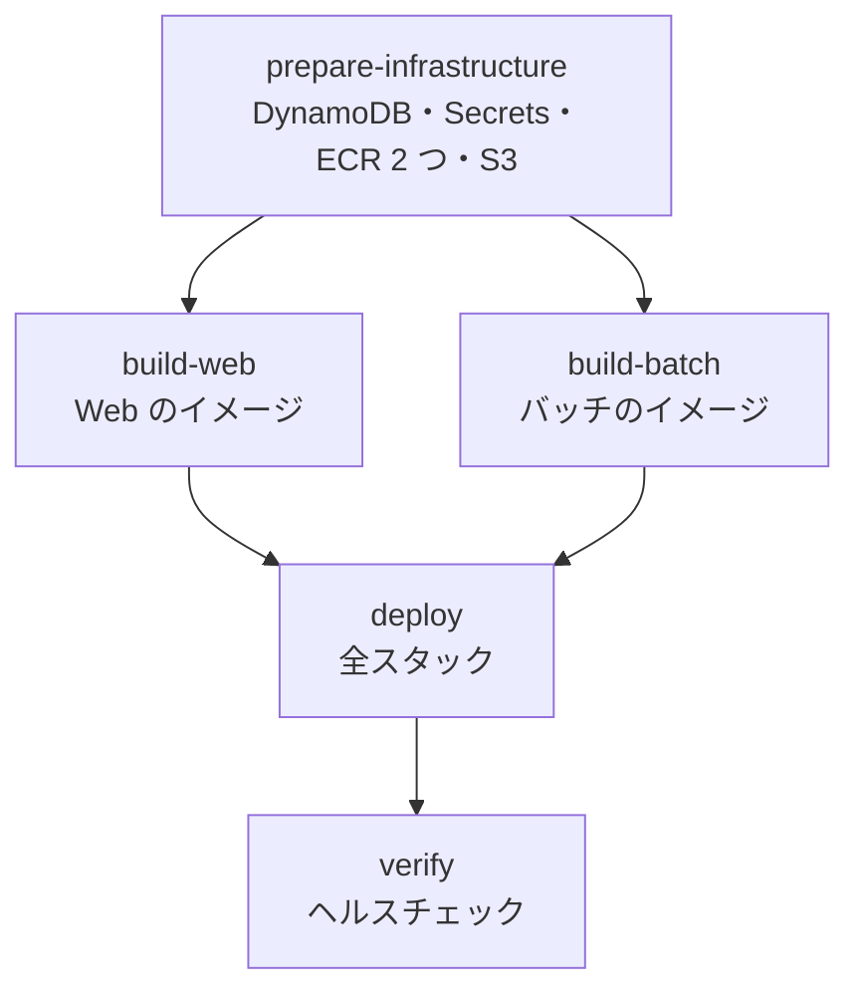

---
sources:
  - infra/niconico-mylist-assistant/bin/niconico-mylist-assistant.ts
  - infra/niconico-mylist-assistant/lib/cloudfront-stack.ts
  - .github/workflows/niconico-mylist-assistant-deploy.yml
sources_hash: ab81a75d2d69199342e3b061124b4043a1298a53ca6148b600dc7296ba889df5
---

# niconico-mylist-assistant のデプロイ先

niconico-mylist-assistant は、Web アプリ (Lambda の Function URL を CloudFront で配信) と、マイリスト登録を行う AWS Batch のジョブを AWS に載せる。dev と prod の両方にデプロイする。

## ホスト名

| 環境 | ホスト名 |
|---|---|
| dev | `niconico-mylist-assistant.dev.nagiyu.com` |
| prod | `niconico-mylist-assistant.nagiyu.com` |

DNS レコードは、dev は CloudFront の基底スタックが、prod は shared の CNAME が作る。詳しくは [DNS レコードの作り方](../../../platform/specs/deploy.md#dns-レコードの作り方) を参照。

## スタック

`infra/niconico-mylist-assistant/bin/niconico-mylist-assistant.ts` が、次の順に作る。環境は CDK の context `env` (既定は `dev`) で決まり、`{Env}` は `Dev` または `Prod`。

| 順 | スタック | 役割 | 含むリソース |
|---|---|---|---|
| 1 | `NagiyuNiconicoMylistAssistantDynamoDB{Env}` | データの保存 | DynamoDB テーブル |
| 2 | `NagiyuNiconicoMylistAssistantSecrets{Env}` | シークレット | Secrets Manager のシークレット |
| 3 | `NagiyuNiconicoMylistAssistantS3{Env}` | スクリーンショットの保存 | S3 バケット |
| 4 | `NagiyuNiconicoMylistAssistantWebECR{Env}` | Web アプリのイメージの置き場 | ECR リポジトリ |
| 5 | `NagiyuNiconicoMylistAssistantBatchECR{Env}` | バッチのイメージの置き場 | ECR リポジトリ |
| 6 | `NagiyuNiconicoMylistAssistantBatch{Env}` | ジョブの実行 | AWS Batch |
| 7 | `NagiyuNiconicoMylistAssistantLambda{Env}` | Web アプリの実行 | Lambda (Function URL つき) |
| 8 | `NagiyuNiconicoMylistAssistantCloudFront{Env}` | Web アプリの配信 | CloudFront、Route53 の ALIAS (dev のみ) |

CloudFront のスタックは `us-east-1` に固定する (CloudFront の制約)。ほかのスタックのリージョンは、環境変数 `CDK_DEFAULT_REGION` で、未設定なら `us-east-1`。

## デプロイの流れ

`.github/workflows/niconico-mylist-assistant-deploy.yml` が行う。

| 項目 | 内容 |
|---|---|
| トリガー | develop・`integration/**`・master への push (`services/niconico-mylist-assistant/**`、`infra/niconico-mylist-assistant/**`、`infra/common/**`、`libs/**`、`configs/**`、`package.json`、`package-lock.json`、このワークフローとヘルスチェック・ECR push のアクションが変わったとき)。手動実行 (dev か prod を選ぶ) |
| デプロイ先の環境 | [dev と prod の切り替え](../../../platform/specs/deploy.md#dev-と-prod-の切り替え) の規則 |
| 並行実行 | 環境ごとに直列化する。実行中の run は止めず、待機中は最新だけ残す |
| イメージのタグ | コミットの SHA |

| ジョブ | 内容 |
|---|---|
| `prepare-infrastructure` | CDK の Bootstrap の後、DynamoDB・Secrets・Web ECR・Batch ECR・S3 のスタックをデプロイする |
| `build-web` | Web アプリをビルドし、イメージを ECR に push する |
| `build-batch` | バッチのワーカーのイメージを ECR に push する (`prepare-infrastructure` の後、`build-web` と並行) |
| `deploy` | Secrets Manager の値を取り出し、全スタックをデプロイする (`--all`)。ワークフローは `--exclude` で `prepare-infrastructure` のスタックを除くつもりで渡しているが、CDK CLI は `--exclude` を受け付けず無視するため、先行の 5 つのスタックも含めた全スタックが対象になる |
| `verify` | CloudFront のスタックの出力からディストリビューションのドメイン名を取り出し、そのドメインでヘルスチェックを行う ([ヘルスチェック](../../../platform/specs/deploy.md#ヘルスチェック)) |

CloudFront のキャッシュ削除は行わない。

## 理由

Lambda のスタックには、Batch のジョブキューとジョブ定義の ARN を、Batch のスタックの出力ではなく、命名規則から組み立てて渡す。ジョブ定義はリビジョンが変わるたびに値が変わり、スタック間の Export の値が変わると CloudFormation が更新を拒否するため、Export と Import を使わない。
