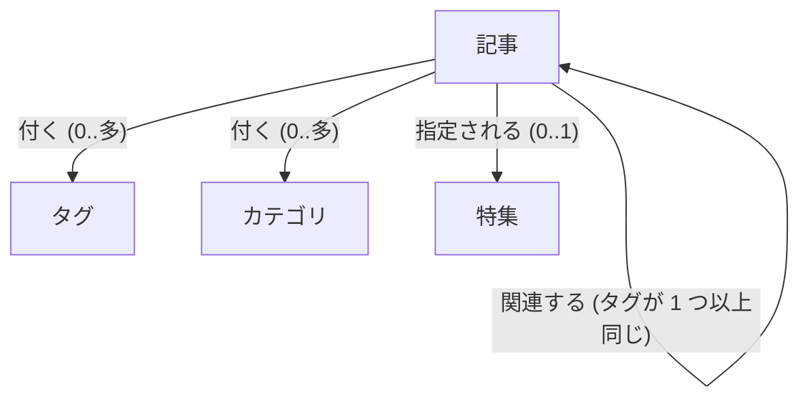

# ドメインモデル

Portal が扱う概念は、記事と、記事に付くタグ・カテゴリ、トップページで取り上げる特集。

## 概念

| 概念 | 意味 |
|---|---|
| 記事 | Portal が載せる技術記事 1 本 ([記事](../specs/term/article.md)) |
| タグ | 記事の話題を表す短い語。関連記事を選ぶ手がかりになる ([タグ](../specs/term/tag.md)) |
| カテゴリ | 記事の分類を示す表示用のラベル ([カテゴリ](../specs/term/category.md)) |
| 特集 | トップページで取り上げる記事の指定 ([特集記事](../specs/term/featured.md)) |

## 関係

- タグとカテゴリは、記事に付くラベルとしてだけ存在する。タグまたはカテゴリを単位にした集約ページは持たない ([目的](purpose.md)の「扱わない範囲」)
- 関連する記事は、タグが 1 つ以上同じ記事から選ぶ ([記事の閲覧](functional/articles.md))
