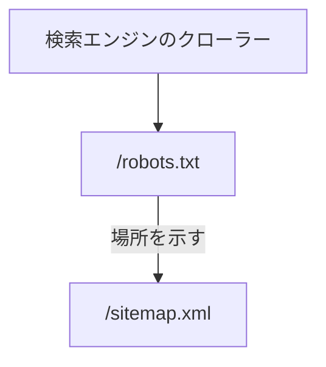

---
sources:
  - services/portal/web/src/app/robots.ts
sources_hash: 758d0a1c7223e8a2960afe18b5335611b17df53d52d7a2b168db2309c5081837
---

# robots.txt

検索エンジンのクローラーに、巡回してよい範囲とサイトマップの場所を伝えるテキスト。

## エンドポイント

| メソッド | パス | 権限 |
|---|---|---|
| GET | `/robots.txt` | なし |

## 入力と出力

- 入力はない。出力は固定で、次の 4 行
    - `User-Agent: *`
    - `Allow: /`
    - `Host: https://nagiyu.com`
    - `Sitemap: https://nagiyu.com/sitemap.xml`
- 巡回を禁じるパスはない。すべてのクローラーに全体を許す
- 内容はビルド時に決まる

## エラー

- ここで返すエラーを決めていない

## つながり

## 手順

Google Search Console で、検索エンジンが `robots.txt` を取得できていることを確かめる。Claude は Search Console を操作できないので、人が行う。

1. Search Console のプロパティ `nagiyu.com` で、「設定」の「robots.txt」のレポートを開く
2. `https://nagiyu.com/robots.txt` が取得できていることを確かめる

取得できないときは、`https://nagiyu.com/robots.txt` をブラウザで開き、上の内容が返るかを確かめる。サイトマップの登録は[サイトマップ](./sitemap.md)の「手順」にある。
