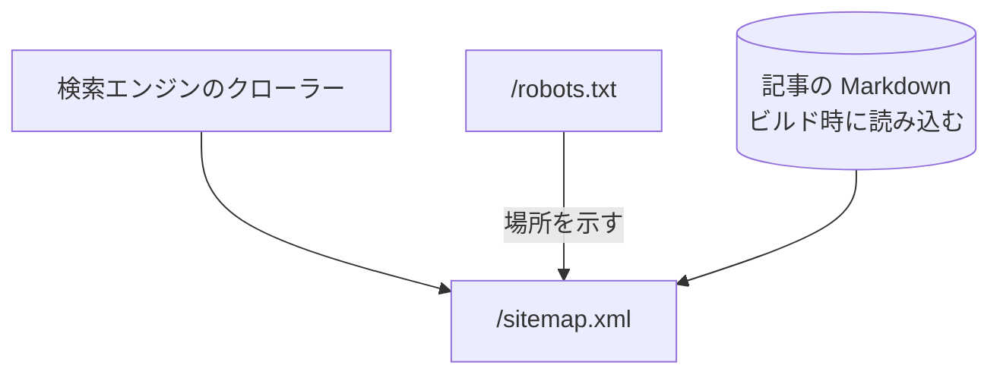

---
sources:
  - infra/shared/lib/route53-records-stack.ts
  - services/portal/web/src/app/sitemap.ts
  - services/portal/web/src/lib/content.ts
sources_hash: 75f7441922cce6c85c59ab0ce69907a499c323c6b6df8be87d56cd347df2e68b
---

# サイトマップ

検索エンジンに、公開しているページの一覧を渡す XML。画面と記事から作り、手で書いたものはない。

## エンドポイント

| メソッド | パス | 権限 |
|---|---|---|
| GET | `/sitemap.xml` | なし |

## 入力と出力

- 入力はない。次のページを、`https://nagiyu.com` を付けた URL で、表の順に並べる

| ページ | 更新頻度 (changefreq) | 優先度 (priority) | 更新日 (lastmod) |
|---|---|---|---|
| `/` | weekly | 1 | ビルドした日時 |
| `/about` | monthly | 0.7 | ビルドした日時 |
| `/contact` | yearly | 0.5 | ビルドした日時 |
| `/privacy` | yearly | 0.3 | ビルドした日時 |
| `/terms` | yearly | 0.3 | ビルドした日時 |
| `/tech` | weekly | 0.9 | ビルドした日時 |
| 記事 1 本ごとの `/tech/{slug}` | monthly | 0.7 | `updatedAt`、なければ `publishedAt` |

- 固定の 6 ページの後に、[記事](../term/article.md)を公開日の新しい順に並べる
- 内容はビルド時に決まり、記事を足しても、再ビルドするまで変わらない ([記事が公開されるまで](../flow/article-publishing.md))
- 固定のページの一覧は手で書いた定数で、ページを足してもここには自動で入らない

## エラー

- ここで返すエラーを決めていない

## つながり

## 手順

Google Search Console に、サイトマップを登録して検索エンジンへ渡す手順。Claude は Search Console を操作できないので、人が行う。

### ドメインプロパティの確認

Search Console には、`nagiyu.com` をドメインプロパティとして登録してある。ドメインプロパティは、サブドメインと HTTP / HTTPS をまとめて 1 つのプロパティで扱う。

所有権は、Google が指定した CNAME レコードで確かめている。レコードは `infra/shared/lib/route53-records-stack.ts` の `GOOGLE_SEARCH_CONSOLE_CNAME` がコードで持ち、`nagiyu.com` のゾーンに作る ([ドメインと証明書](../../../../platform/specs/resource/dns-certificate.md))。このレコードを消すと、所有権の確認が外れる。

登録し直すとき (プロパティを作り直した、確認の値が変わったなど) は、次のように行う。

1. [Google Search Console](https://search.google.com/search-console) で「プロパティを追加」を選び、「ドメイン」に `nagiyu.com` を入れる
2. 表示された確認用のレコードを、`route53-records-stack.ts` に反映して shared をデプロイする
3. DNS に反映されたあと、Search Console で「確認」を押す

### サイトマップの送信

1. Search Console でプロパティを選び、左のメニューの「サイトマップ」を開く
2. 「新しいサイトマップの追加」に `sitemap.xml` と入れて「送信」する。プロパティの URL に連結され、`https://nagiyu.com/sitemap.xml` として送られる

### 新しい記事のインデックス登録のリクエスト

記事を公開したら、Search Console の「URL 検査」に記事の URL (`https://nagiyu.com/tech/{slug}`) を入れ、まだインデックスされていなければ「インデックス登録をリクエスト」を押す。サイトマップの内容はビルド時に決まるので、記事を公開 (デプロイ) してから行う。

### 確かめること

- サイトマップのステータスが「成功しました」になっている
- 検出された URL の数が 0 でない
- `https://nagiyu.com/sitemap.xml` を開くと、XML が返る
