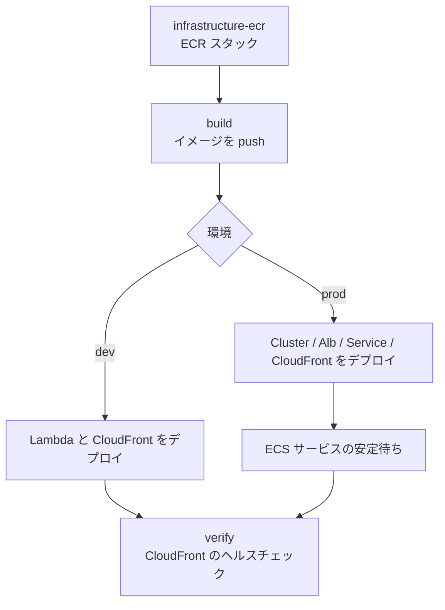

---
sources:
  - infra/bin/nagiyu-platform.ts
  - infra/root/ecr-stack.ts
  - infra/root/portal-lambda-stack.ts
  - infra/root/cloudfront-lambda-stack.ts
  - infra/root/ecs-cluster-stack.ts
  - infra/root/alb-stack.ts
  - infra/root/ecs-service-stack.ts
  - infra/root/cloudfront-stack.ts
  - .github/workflows/root-deploy.yml
sources_hash: 8beede464a2943dc9c4662801f1d68d601970e4d458a2c1565eb1996d799d655
---

# Portal のデプロイ先

Portal はルートドメイン (apex) で公開する。実行の形が環境で違い、dev は Lambda の Function URL を CloudFront の背後に置き、prod は ECS (Fargate) を ALB と CloudFront の背後に置く。インフラの定義は `infra/root/` にあり、CDK の app は `infra/bin/nagiyu-platform.ts` である。スタックはすべて `us-east-1` に作られる。

## ホスト名

| 環境 | ホスト名 |
|---|---|
| dev | `dev.nagiyu.com` |
| prod | `nagiyu.com` |

ホスト名は、サブドメインを付ける共通の組み立て関数を使わず、`infra/root/cloudfront-lambda-stack.ts` (dev) と `infra/root/cloudfront-stack.ts` (prod) が環境で書き分けている。どちらもサブドメインのない apex である。

DNS レコードは、dev は `NagiyuRootCloudFrontDev` がゾーンの頂点に ALIAS を作る。prod は shared が apex の ALIAS を直書きしており、`NagiyuRootCloudFrontProd` はレコードを作らない。共通のしくみは [デプロイ先 (platform)](../../../platform/specs/deploy.md) を参照する。

## スタック

環境は環境変数 `ENVIRONMENT` (既定は `dev`) で決まり、`{Env}` は `Dev` / `Prod` である。`infra/bin/nagiyu-platform.ts` は、ECR のスタックを両環境で作り、それ以外は環境で分岐する。

| 環境 | 順 | スタック | 役割 | 含む主なリソース |
|---|---|---|---|---|
| 共通 | 1 | `NagiyuPortalEcr{Env}` | イメージの置き場 | ECR リポジトリ |
| dev | 2 | `NagiyuPortalLambdaDev` | アプリの実行 | Lambda (1024 MB、タイムアウト 30 秒)、Function URL。ECR に依存する |
| dev | 3 | `NagiyuRootCloudFrontDev` | 公開の入口と DNS | CloudFront ディストリビューション (オリジンは Function URL)、Route53 の ALIAS。セキュリティヘッダーを付け、prod 以外は noindex にする。Lambda に依存する |
| prod | 2 | `NagiyuRootClusterProd` | 実行基盤 | ECS クラスタ (`nagiyu-root-cluster-prod`、Fargate と Fargate Spot) |
| prod | 3 | `NagiyuRootAlbProd` | アプリの入口 | 専用 ALB、ターゲットグループ (ポート 3000、ヘルスチェック `/api/health`)、セキュリティグループ |
| prod | 4 | `NagiyuRootServiceProd` | アプリの実行 | Fargate サービス (希望数 1、コンテナ `portal-app`)、タスク定義、ログ、IAM ロール。Cluster・ALB・ECR に依存する |
| prod | 5 | `NagiyuRootCloudFrontProd` | 公開の入口 | CloudFront ディストリビューション (オリジンは ALB の HTTP 80)、セキュリティヘッダー (noindex なし)。ALB に依存する |

dev の CloudFront スタックは、共通の CloudFront の基底スタックの上に作る。prod の CloudFront スタックは基底スタックを使わず、ALB の DNS 名と証明書を SSM から読んで直接組み立てる。

## デプロイの流れ

`.github/workflows/root-deploy.yml` が行う。

| 項目 | 内容 |
|---|---|
| トリガー | develop・`integration/**`・master への push (Portal・`infra/root/`・`infra/bin/`・libs・configs などのパスが変わったとき)。手動実行 (dev / prod を選ぶ) |
| デプロイ先の環境 | 手動実行は入力値。master への push は prod。それ以外は dev |
| 並行実行 | 環境ごとに直列化する。実行中の run は止めず、待機中は最新だけ残す |
| イメージのタグ | コミットの SHA |

| ジョブ | 内容 |
|---|---|
| `infrastructure-ecr` | ECR のスタックをデプロイする |
| `build` | イメージをビルドして ECR に push する |
| `infrastructure-app` | dev は Lambda と CloudFront のスタックをデプロイする。prod は Cluster・ALB・Service・CloudFront のスタックをデプロイし、ECS サービスが安定するまで待つ |
| `verify` | CloudFront のスタックの出力からディストリビューションのドメイン名を取り出し、`https://<ドメイン名>/api/health` のヘルスチェックを行う。環境の独自ドメインではなく CloudFront のドメインを叩く |
