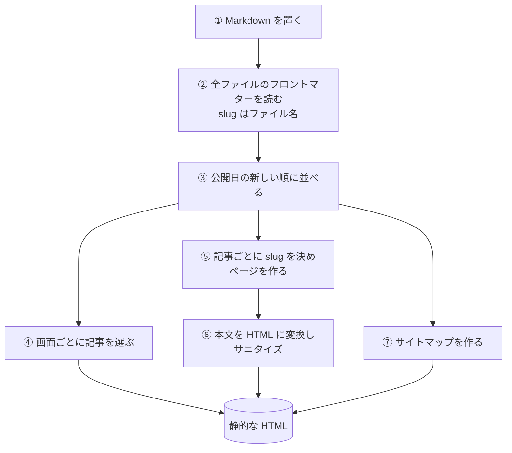
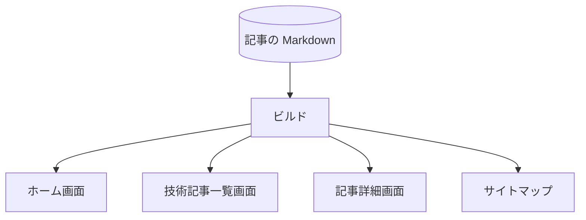

---
sources:
  - services/portal/web/src/lib/content.ts
  - services/portal/web/src/types/content.ts
  - services/portal/web/src/app/page.tsx
  - services/portal/web/src/app/tech/page.tsx
  - services/portal/web/src/app/tech/[slug]/page.tsx
  - services/portal/web/src/app/sitemap.ts
  - services/portal/web/scripts/check-internal-links.mjs
  - services/portal/web/src/lib/linkChecker.ts
  - .github/workflows/portal-verify.yml
sources_hash: 67789a18321f747c524444c7cfaa63029f5c3f8019490a17b8934d9d2a31a93d
---

# 記事が公開されるまで

Markdown で書いた[記事](../term/article.md)が、ビルドで静的な HTML になり、一覧・詳細・トップ・サイトマップに出るまでの経路。

## 起点

- `services/portal/web/src/content/tech/` に `{slug}.md` を置く (フロントマターの項目は[記事](../term/article.md))
- 画面を描くときにファイルを読むのはビルドだけ。起動したあとのサーバーは、記事のファイルを読まない。記事を足す・直すときは、ビルドし直して配信し直す

## 経路



| 段階 | 中身 |
|---|---|
| ② | `.md` で終わるファイルをすべて読む。`slug` はファイル名から決まり、フロントマターの `slug` は使わない。ディレクトリがなければ記事は 0 件 |
| ③ | `publishedAt` の降順。日付が同じ記事の順は、ファイルを読んだ順 |
| ④ | [ホーム画面](../screen/home.md): 特集は `featured: true` の記事から先頭の 3 件 ([特集記事](../term/featured.md))、最新は先頭の 6 件。[技術記事一覧画面](../screen/tech.md): 全件 |
| ⑤ | `generateStaticParams` が記事の slug の一覧を返す。この一覧にない slug は開けず、[404 画面](../screen/not-found.md)になる |
| ⑥ | Markdown (GFM) を HTML に変換し、DOMPurify でサニタイズする。生の HTML タグは出力に残らない。[記事詳細画面](../screen/tech-article.md)の関連記事は、この時点で全記事のタグから選ぶ |
| ⑦ | [サイトマップ](../api/sitemap.md)に、記事ごとの URL と更新日を並べる |

- カテゴリのラベル名は、`content.ts` の表で slug から引く。表にない slug は slug のまま表示する ([カテゴリ](../term/category.md))

## 届く先

- [ホーム画面](../screen/home.md)の「特集記事」と「最新の技術記事」
- [技術記事一覧画面](../screen/tech.md)
- [記事詳細画面](../screen/tech-article.md)
- [サイトマップ](../api/sitemap.md)

## 失敗・取りこぼしのとき

- フロントマターの必須項目 (題名、公開日、タグなど) の欠けを検査する仕組みはない
- 読み込めない記事を飛ばす仕組みもない。例外はそのままビルドの失敗になる
- 記事とページの内部リンクの切れは、公開の前に CI が止める。`integration/**` と develop 向けのプルリクエストで、Portal に関わるパスが変わったときに、`.github/workflows/portal-verify.yml` の `internal-links` ジョブが、下の「手順」の内部リンクの検査を流す。切れが 1 件でもあると、ジョブが失敗する
    - ジョブは、共通の CI イメージの上で、`npm ci` のあとに `npm run check:internal-links --workspace @nagiyu/portal-web` を流す
    - 再利用ワークフローに含めず、Portal のワークフローに置く。サービス固有の検査のため
    - 検査するのは静的に書かれたリンクだけ。外部リンク (`https://` など) と、実行時にテンプレートリテラルで組み立てるリンクは検査しない

## つながり



## 理由

- 記事は、プレーンな Markdown (`gray-matter` でフロントマターを読み、`remark` と `rehype` で HTML に変換) で書く。MDX は採らない。技術記事に JSX を混ぜる必要がなく、MDX より依存するライブラリが少なく、書き手が Markdown の知識だけで書けるため

## 手順

記事を足す・直すとき、またはページのリンクを変えたときは、公開の前に内部リンクの切れを手元で確かめられる。CI の `internal-links` ジョブと同じ検査である。

```bash
npm run check:internal-links --workspace @nagiyu/portal-web
```

切れがなければ「内部リンク切れなし」と出て、終了コードは 0。切れがあれば、件数と、切れたリンクごとの `ファイル:行  リンク` と理由を出し、終了コードは 1。

検査の内容は次のとおり。

| 項目 | 内容 |
|---|---|
| 対象のファイル | `src/content/` 配下の `.md` と `.mdx`、`src/app/` 配下の `.tsx` |
| 拾うリンク | Markdown の `[文字](/パス)` と、`href="/パス"` (シングルクォート、バッククォートも同じ)。`/` で始まり、`//` で始まらないものだけ。`href` のほうは、`://` を含むものも除く。`#` 以降は除く |

拾ったリンクは、次のどれかに当たれば有効で、どれにも当たらなければ切れとする。

| 順 | 規則 |
|---|---|
| ① | `/tech/{slug}` の形なら、`src/content/tech/{slug}.md` がある。ない場合は、ほかの規則を見ず、切れとする |
| ② | `/`、`/about`、`/privacy`、`/terms`、`/tech` のどれか |
| ③ | `src/app/{パス}/page.tsx` がある |
| ④ | `public/` の下にファイルがある。`?` 以降は除いて探す。`public/` の外へ出るパスは切れとする |

- 新しい形のルートを足したときは、`src/lib/linkChecker.ts` の `validateHref` の規則を見直す。① から ④ のどれにも当たらない形は、切れと判定される
- 入口の `scripts/check-internal-links.mjs` は、CI が `npm ci` だけで動かす。TypeScript をビルドせず、Node の型除去で `src/lib/linkChecker.ts` を直接読む。この条件では、拡張子を省いた相対 import が解決できない。共通ライブラリ (`@nagiyu/*`) にも、素の Node では読めないものがある (ESM 版の内部の import に拡張子がないもの、JSX を含むもの)。そのため `linkChecker.ts` はこれらを import しない。使うと、CI が落ちる
