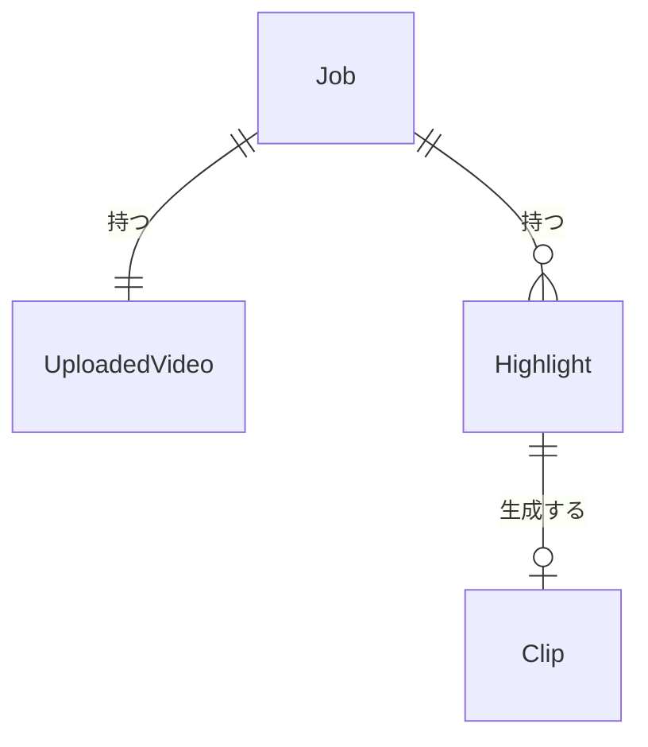

# さくっとクリップ (QuickClip) 外部設計書

この文書は、画面と概念データモデルを設計した理由・方針を書く。画面や API が今どう動くかは[仕様カード](../../specs/README.md)にある。

---

## 1. 画面設計

### 1.1 画面一覧

各画面の入口・表示するもの・操作・状態は、画面の仕様カードを参照する。

| 画面 ID | 画面名 (仕様カード) | 対応ユースケース |
|--------|--------|--------------|
| SCR-001 | [アップロード画面](../../specs/quick-clip/screen/upload.md) | UC-001 |
| SCR-002 | [処理状況画面](../../specs/quick-clip/screen/job-status.md) | UC-001, UC-004 |
| SCR-003 | [見どころ確認画面](../../specs/quick-clip/screen/highlights.md) | UC-002, UC-003 |

### 1.2 画面の設計方針

この文書には、画面を設計した理由と、画面をまたぐ方針だけを書く。

- 見どころ確認画面は、左に選んだ見どころの詳細、右に見どころの一覧を置くマスター/ディテール構成にする。一覧で全体を見ながら、1 件ずつプレビューして採否を決められるようにするため
- 処理状況画面は、ジョブが完了するまでの待ち時間に動画広告を出す。広告は完了ゲートの条件の一部で、広告に関わる失敗は常に広告が終わったものとして扱う (ADR-005、ADR-006、要件 3.6)
- 見どころ確認画面は、ジョブが完了していなければ一覧を取得しない。URL を直接開いた場合に、見どころが無いと誤解させないため

### 1.3 レスポンシブ方針

PC（デスクトップ）のみを対象とする。スマートフォン対応は行わない（`requirements.md` 3.5 節参照）。

### 1.4 アクセシビリティ方針

初版では特別な対応は行わない。

---

## 2. 概念データモデル

### 2.1 主要エンティティ一覧

| エンティティ | 説明 | 主要な属性（概念レベル） |
|------------|------|-------------------|
| Job | 動画処理ジョブ ([ジョブとステータス](../../specs/quick-clip/term/job.md)) | ジョブID、作成日時、有効期限 (ステータスは保存せず、Batch の状態から求める。ADR-011) |
| UploadedVideo | アップロード済み動画 | ファイル名、ファイルサイズ、形式、保存パス |
| Highlight | 見どころ区間 ([見どころとクリップの状態](../../specs/quick-clip/term/highlight.md)) | 開始時刻、終了時刻、採否ステータス、クリップ生成ステータス（clipStatus）、順序番号 |
| Clip | 分割クリップ | 対応するHighlight、ファイルパス |

### 2.2 エンティティ関係図

