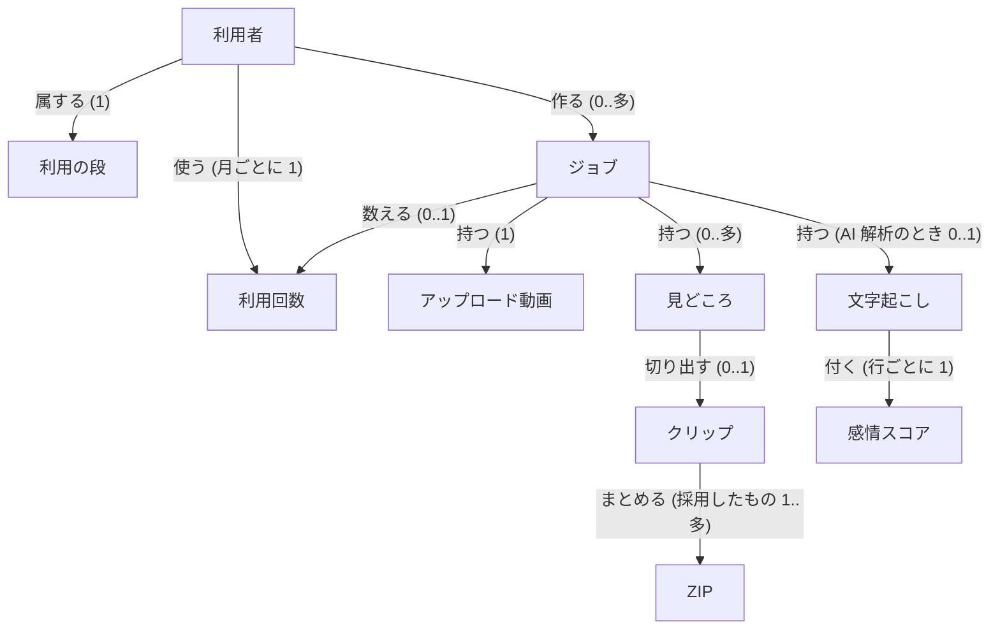

# ドメインモデル

利用者が動画をアップロードしてジョブを作り、抽出された見どころを確かめ、採用したクリップを ZIP で受け取るまでに扱う概念。

## 概念

| 概念 | 意味 |
|---|---|
| 利用者 | 動画をアップロードする人。ログインしていてもいなくても使える |
| 利用の段 | 利用者が使える量を決める区分。段ごとに、月の回数と 1 本の動画の長さの上限を持つ ([利用の段と上限](../specs/term/usage-tier.md)) |
| 利用回数 | 利用者が月ごとに使った回数。AI 解析ありとなしを別々に数える ([利用回数の数え方と戻し](../specs/flow/usage-metering.md)) |
| ジョブ | 1 本の動画のアップロードと見どころ抽出を表す単位 ([ジョブとステータス](../specs/term/job.md)) |
| アップロード動画 | 利用者がアップロードした元の動画 |
| 見どころ | 動画の中で、見る価値が高いと判定された区間。採否とクリップの状態を持つ ([見どころとクリップの状態](../specs/term/highlight.md)) |
| クリップ | 見どころの区間を切り出した動画 |
| AI 解析 | 文字起こしと感情分析をまとめた呼び名。見どころの根拠に感情を加える ([AI 解析](../specs/term/ai-analysis.md)) |
| 文字起こし | 動画の音声を、時刻つきの行にしたもの ([文字起こし](../specs/term/transcript.md)) |
| 感情スコア | 文字起こしの各行に付く、感情ごとの点数。`laugh`、`excite`、`touch`、`tension` の 4 つ |
| 感情フィルタ | 見どころの抽出で重視する感情の指定。4 つの感情と、すべてを対象にする `any` がある |
| ZIP | 採用した見どころのクリップと文字起こしのテキストをまとめたファイル |

## 関係

- 利用の段は、使える量の上限を決める。上限のない段では、利用回数を数えない ([利用回数の制限](functional/usage-limits.md))
- 1 つのジョブは、AI 解析をするかどうかを作るときに決める。AI 解析をするジョブだけが、文字起こしと感情スコアを持つ ([見どころの抽出](functional/highlight-extraction.md))
- 見どころは、映像の変化・音量・感情を根拠にする。別々の根拠の区間が重なると、1 件にまとまる ([見どころの抽出](functional/highlight-extraction.md))
- クリップは、見どころごとに 1 つ。見どころの開始や終了を調整すると、作り直される ([見どころの確認と調整](functional/highlight-review.md))
- ZIP にまとめるのは、採用した見どころのクリップだけ ([クリップのダウンロード](functional/clip-download.md))
