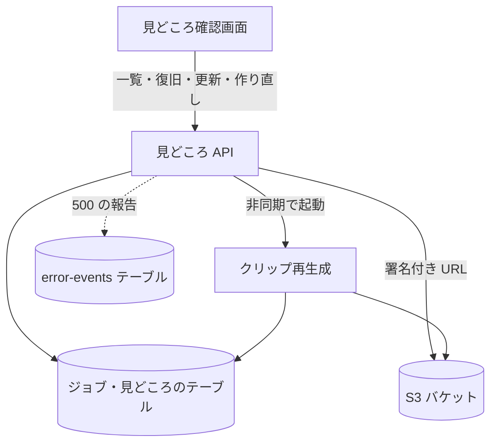

---
sources:
  - services/quick-clip/web/src/app/api/jobs/[jobId]/highlights/route.ts
  - services/quick-clip/web/src/app/api/jobs/[jobId]/highlights/recover/route.ts
  - services/quick-clip/web/src/app/api/jobs/[jobId]/highlights/[highlightId]/route.ts
  - services/quick-clip/web/src/app/api/jobs/[jobId]/highlights/[highlightId]/regenerate/route.ts
  - services/quick-clip/web/src/lib/server/highlight-recovery.ts
  - services/quick-clip/web/src/lib/server/domain-services.ts
  - services/quick-clip/web/src/lib/api-error-reporting.ts
  - services/quick-clip/core/src/libs/highlight.service.ts
  - services/quick-clip/core/src/libs/domain-error-messages.ts
  - libs/nextjs/src/request-body.ts
sources_hash: 69179ad2ab170c4744b8aeabeb97d9d761b370f070e807965c177bb60e9fa1d0
---

# 見どころ API

ジョブの[見どころ](../term/highlight.md)の一覧を返し、採否と開始・終了を更新し、クリップを作り直す。認証は要らず、ジョブ ID を知っていれば誰でも呼べる。

## エンドポイント

| メソッド | パス | 権限 | 役割 |
|---|---|---|---|
| GET | `/api/jobs/{jobId}/highlights` | なし | 見どころの一覧を返す |
| POST | `/api/jobs/{jobId}/highlights/recover` | なし | 止まったままの作り直しを `FAILED` にする |
| PATCH | `/api/jobs/{jobId}/highlights/{highlightId}` | なし | 採否か、開始・終了を更新する |
| POST | `/api/jobs/{jobId}/highlights/{highlightId}/regenerate` | なし | クリップを作り直す |

## 入力と出力

一覧 (`GET`)。

- 出力は 200 で `{ highlights }`。`order` の昇順。各要素は[見どころ](../term/highlight.md)の項目に、`clipUrl` を足したもの
- `clipUrl` は、`clipStatus` が `GENERATED` のものだけにある。クリップへの署名付き URL で、有効 3,600 秒
- ジョブがまだ処理中でも、見どころがなければ空の配列を返す。ジョブの状態は見ない
- 期限 (`expiresAt`) を過ぎたジョブは、TTL で消える前でも、ジョブがないときと同じ 404 にする。TTL の削除は遅れ、期限後は S3 のファイルも消えているため、削除の前後で見え方を変えない。期限を過ぎた見どころは一覧に出さない

復旧 (`POST .../recover`)。本文はない。

- `GENERATING` のまま、`clipGeneratingStartedAt` から 360 秒を過ぎた見どころを `FAILED` にする。`clipGeneratingStartedAt` がない見どころは対象にしない。出力は 200 で `{ recoveredHighlightIds }`。対象がなければ空の配列
- 画面は、一覧を取るたびに、先にこれを呼ぶ

更新 (`PATCH`)。本文は JSON オブジェクトで、次の項目のうち 1 つ以上。

| 項目 | 条件 |
|---|---|
| `status` | `accepted`、`unconfirmed`、`rejected` のどれか |
| `startSec`、`endSec` | 数値。0 以上の有限の数。更新後の開始が終了より小さい。終了を保存済みの値から動かすときは、ジョブの `durationSec` 以下 (ジョブに `durationSec` がないときは、上限を見ない) |

- ジョブがない、または期限を過ぎているときは、採否だけの更新も含めて 404 にして、何も更新しない。時刻の更新は、ジョブの `durationSec` を終了の上限にするため、ジョブが必須である
- 出力は 200 で更新後の見どころ。`clipUrl` は付かない
- `status` だけの更新は、そのまま保存する。作り直し中 (`GENERATING`) でも受ける
- `startSec` か `endSec` を含む更新は、クリップを作り直す。受け付けると次を行う
    1. 見どころを読む。ないか、期限を過ぎているときは 404
    2. `clipStatus` が `GENERATING` なら 409。作り直しを重ねない
    3. 採否が `accepted` か `rejected` なら `unconfirmed` に戻す
    4. `clipStatus` を `GENERATING` にし、`clipGeneratingStartedAt` を今にして保存する
    5. [クリップ再生成](../batch/clip-regenerate.md)の Lambda を、結果を待たずに (非同期で) 起動する。渡すのは `jobId`、`highlightId`、保存後の `startSec`、`endSec`
- 起動に失敗したときは、`clipStatus` を `FAILED` にして、保存した見どころを 200 で返す。Admin へ報告する (題名は「Web API: クリップ再生成起動エラー」)

作り直し (`POST .../regenerate`)。本文はない。

- ジョブがない、または期限を過ぎているときは 404 にして、何もしない
- 見どころを読み (ないか、期限を過ぎていれば 404)、`clipStatus` が `GENERATING` なら 409。そうでなければ、起動より先に `GENERATING` にして `clipGeneratingStartedAt` を今にし、Lambda を非同期で起動する。渡すのは保存済みの `startSec` と `endSec`。出力は 200 で `GENERATING` になった見どころ
- `clipStatus` が `GENERATED` のものでも作り直せる。採否は変えない
- 起動に失敗したときは、`clipStatus` を `FAILED` にして、例外を 500 にする

## エラー

本文は `{ error, message }` ([API のエラー応答](../term/api-error.md))。

| 条件 | 状態 | `error` | `message` |
|---|---|---|---|
| 一覧、復旧、更新、作り直し: ジョブがない、または期限を過ぎている | 404 | `JOB_NOT_FOUND` | 指定されたジョブが見つかりません |
| 更新、作り直し: 見どころがない、または期限を過ぎている | 404 | `HIGHLIGHT_NOT_FOUND` | 指定された見どころが見つかりません |
| 更新: 本文が JSON のオブジェクトでない、項目の型が違う、`status` が許可外 | 400 | `INVALID_REQUEST` | 更新内容が不正です |
| 更新: `startSec` と `endSec` が両方あり、開始が終了以上 | 400 | `INVALID_REQUEST` | 更新内容が不正です |
| 更新: 項目が 1 つもない、時刻が負か有限でない、保存済みの時刻と合わせて開始が終了以上、終了を動かして動画の長さを超える | 400 | `INVALID_REQUEST` | 更新内容が不正です |
| 更新、作り直し: すでに作り直している最中 (時刻の更新と作り直しだけ) | 409 | `CLIP_GENERATING` | クリップを作り直している最中のため、変更できません |
| 一覧: 想定外の例外 | 500 | `INTERNAL_SERVER_ERROR` | 見どころ一覧の取得に失敗しました |
| 復旧: 想定外の例外 | 500 | `INTERNAL_SERVER_ERROR` | 見どころの復旧に失敗しました |
| 更新: 想定外の例外 | 500 | `INTERNAL_SERVER_ERROR` | 見どころの更新に失敗しました |
| 作り直し: 想定外の例外 (起動の失敗を含む) | 500 | `INTERNAL_SERVER_ERROR` | クリップ再生成の開始に失敗しました |

- 見どころの 404 は、`status` だけの更新ではドメインの検査 (保存済みの見どころを読む) で、時刻を含む更新では先に見どころを読む段で返す。どちらも同じ本文
- 「更新」は、先にジョブを読む。ジョブに `durationSec` があれば終了の上限にし、なければ上限を見ない。超過は作り直しの起動より前に断る。見どころは `jobId` と `highlightId` の組で探す
- 作り直しの状態の見方は[見どころとクリップの状態](../term/highlight.md)にある。`GENERATING` かの確認と書き込みは別々の操作で、条件付きの書き込みにはしていないので、別のタブなどから同時に呼ぶと、重なりうる

## つながり

## 理由

- 作り直しの最中の見どころには、時刻の更新も作り直しも重ねず、409 で断る。作り直しが重なると、同じ S3 のキーへの書き込みが競合し、古い内容が最後に残りうるため。採否だけの更新は、クリップを作り直さないので、作り直しの最中でも受ける
- 作り直しの Lambda は、完了のときに `GENERATED` へ更新する。そのため、起動より先に `GENERATING` にする。起動のあとに更新すると、短い作り直しでは、Lambda の完了を `GENERATING` で上書きしかねない
- Lambda の起動に失敗したときは、`FAILED` にする。`GENERATING` のまま残すと、誰も完了させず、以降の変更も 409 で受け付けられなくなるため。時刻の更新では、保存した見どころを 200 で返して Admin に報告し、作り直しでは 500 にする
- 復旧の 360 秒は、Lambda のタイムアウト (300 秒) に 60 秒を足した値。非同期の起動はキューで待ってから動き出し、`GENERATING` の時刻は Web が起動を頼んだ時点で記録するため、Lambda が実際に動き始めるのはそれより後になる。タイムアウトちょうどで見切ると、まだ動いている作り直しを失敗扱いにしかねない
- `clipGeneratingStartedAt` がない見どころは、復旧の対象にしない。いつから `GENERATING` なのか分からず、作り直しの最中のものを誤って失敗扱いにしかねないため
- 終了を動かさない更新は、動画の長さの上限を見ない。保存済みの終了がジョブの `durationSec` を超えている見どころがありうるが、その採否や開始の調整まで止めないため
