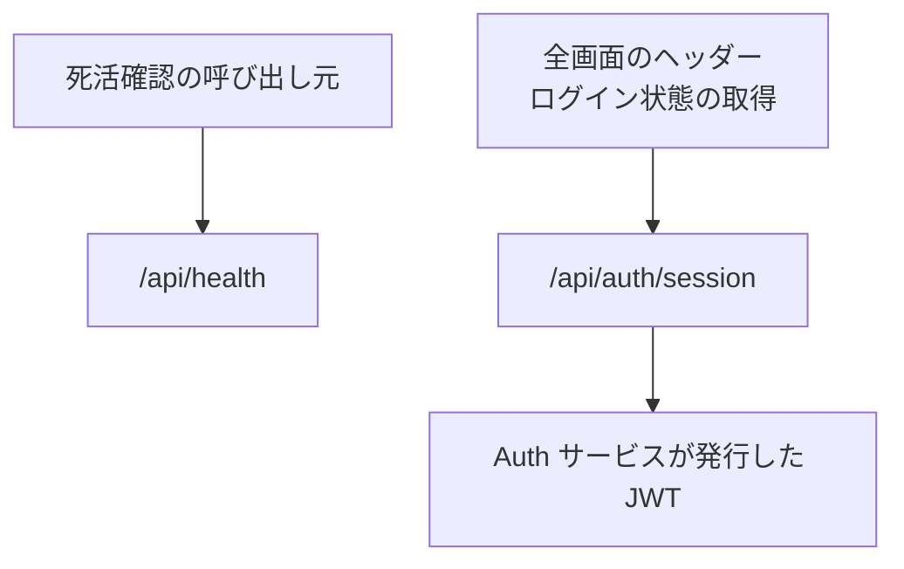

---
sources:
  - services/quick-clip/web/src/app/api/health/route.ts
  - services/quick-clip/web/src/app/api/auth/[...nextauth]/route.ts
  - services/quick-clip/web/src/auth.ts
  - services/quick-clip/web/src/lib/auth/session.ts
sources_hash: 70d16e1cf67883d1865a27a54fe14bb5f10a2c4adee65b87e046f45a8137a5a7
---

# システム系の API

業務の機能ではない 2 つの API。死活確認と、画面のヘッダーが使う認証セッション。

## エンドポイント

| メソッド | パス | 権限 |
|---|---|---|
| GET | `/api/health` | なし |
| GET | `/api/auth/*` (画面が使うのは `/api/auth/session`) | なし (ログインの状態を返す) |

## 入力と出力

- 死活確認の応答の形は[ヘルスチェックのルート](../../../../platform/specs/lib/nextjs/health-route.md)のとおり。`service` は `quick-clip`、`version` は環境変数 `APP_VERSION`、なければ `1.0.0`。DynamoDB、S3、Batch への接続は確かめない
- 認証は next-auth の GET だけを公開する。POST は公開しない (サインアウトは Auth サービスの URL へ遷移する)。Quick Clip には認証の提供元 (プロバイダー) がなく、Auth サービスが発行した JWT を検証するだけ ([NextAuth の設定](../../../../platform/specs/lib/nextjs/auth-config.md))。JWT を検証する鍵 `AUTH_SECRET` は、[Auth のシークレット](../../../auth/specs/resource/secrets.md)にある
- ログインしていなくても、すべての画面と API を使える。ログインの有無で変わるのは、利用の[段](../term/usage-tier.md)だけ
- サーバー側の処理がセッションを読むとき、`AUTH_SECRET` が未設定や、壊れた Cookie でセッションの検証が例外になっても、未ログインとして扱い、落とさない
- 環境変数 `SKIP_AUTH_CHECK` が `true` のテスト用の設定では、`/api/auth/session` が認証せずにテスト用のセッションを返し、サーバー側のセッションもテスト用になる。ロールは、リクエストヘッダ `x-test-user-roles`、環境変数 `TEST_USER_ROLES`、既定の空の順で決まる ([セッション取得とテストセッション](../../../../platform/specs/lib/nextjs/session.md))

## エラー

- どちらも、ここで返すエラーを決めていない
- ログインを要求する画面や API はない。ミドルウェアによるリダイレクトもない

## つながり

## 理由

- サインアウトの POST は公開しない。サインアウトは Cookie の発行元の Auth サービスに集約しており、ローカルで受けると、内部のホスト名へのリダイレクトで名前解決に失敗するため
- ログインは任意なので、セッションを読む処理は、検証の失敗を未ログインとして扱う。`AUTH_SECRET` が未設定の環境や壊れた Cookie でも、匿名の利用を妨げないため
