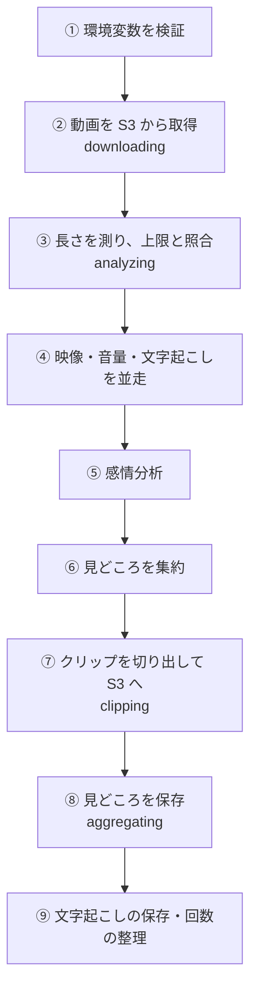
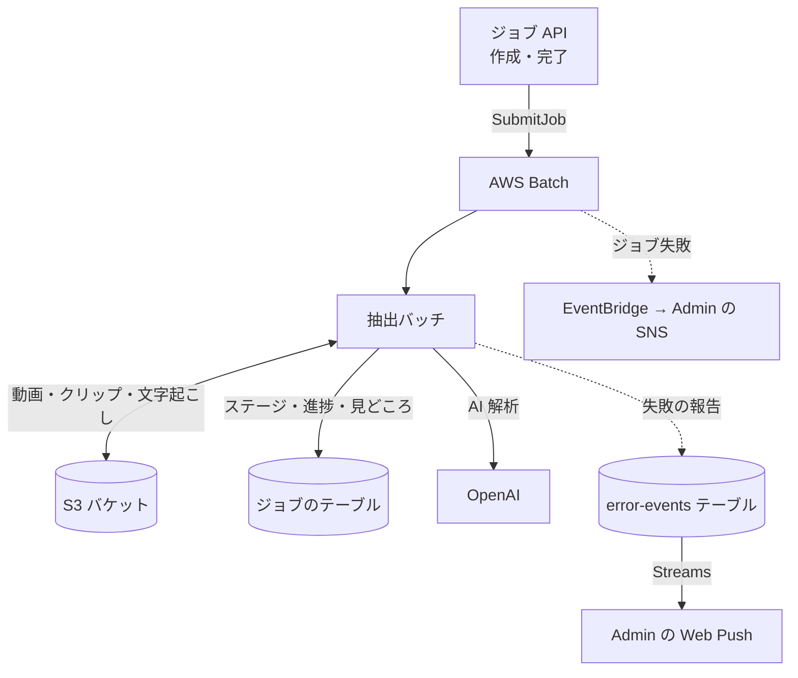

---
sources:
  - services/quick-clip/batch/src/index.ts
  - services/quick-clip/batch/src/entrypoint.ts
  - services/quick-clip/batch/src/lib/environment.ts
  - services/quick-clip/core/src/libs/quick-clip-batch-runner.ts
  - services/quick-clip/core/src/libs/batch-job-input.ts
  - services/quick-clip/core/src/libs/ffmpeg-video-analyzer.ts
  - services/quick-clip/core/src/libs/motion-highlight.service.ts
  - services/quick-clip/core/src/libs/volume-highlight.service.ts
  - services/quick-clip/core/src/libs/highlight-aggregation.service.ts
  - services/quick-clip/core/src/libs/transcription.service.ts
  - services/quick-clip/core/src/libs/emotion-highlight.service.ts
  - services/quick-clip/core/src/libs/usage.service.ts
  - services/quick-clip/core/src/repositories/dynamodb-highlight.repository.ts
  - libs/aws/src/error-events/with-error-reporting.ts
  - libs/aws/src/error-events/report.ts
sources_hash: 0000000000000000000000000000000000000000000000000000000000000000
---

# 抽出バッチ (extract)

S3 に置かれた動画を分析して[見どころ](../term/highlight.md)を決め、クリップを切り出して S3 に書き、見どころを保存するコンテナ。1 回の起動で 1 [ジョブ](../term/job.md)を処理する。

## 起点

- スケジュールはない。[ジョブ API](../api/jobs.md) が、AWS Batch にジョブを 1 件投入して起動する。100 MiB 未満の動画は作成のときに、それ以上は分割アップロードの完了のときに投入する
- 起動ごとに渡す値は、環境変数の 4 つ。ほかは Batch のジョブ定義が持つ ([Batch の実行環境](../resource/batch-runtime.md))

| 環境変数 | 出どころ | 内容 |
|---|---|---|
| `BATCH_COMMAND`、`JOB_ID` | 投入時の指定 | 前後の空白を除いて読む。`BATCH_COMMAND` は `extract` だけ。`JOB_ID` は英数字、`_`、`-` だけ。外れると起動時に例外 |
| `EMOTION_FILTER` | 投入時の指定 | `any`、`laugh`、`excite`、`touch`、`tension`。未設定か空白なら `any`。許可外なら例外 ([AI 解析](../term/ai-analysis.md)) |
| `AI_ANALYSIS` | 投入時の指定 | `true` か `false`。未設定か空白なら `true`。ほかの値は例外 |
| `DYNAMODB_TABLE_NAME`、`S3_BUCKET`、`AWS_REGION` | ジョブ定義 | 必須。なければ、足りない名前をまとめて起動時に例外 |
| `OPENAI_API_KEY` | ジョブ定義 | 空なら、[AI 解析](../term/ai-analysis.md)をしない |
| `ERROR_EVENTS_TABLE_NAME` | ジョブ定義 | エラー履歴の報告先。なければ報告だけができない |

- ジョブ定義のサイズは、ファイルサイズと動画の長さから選ぶ ([ジョブ定義のサイズ](../term/job-definition-size.md))。試行は 1 回で、再試行しない ([Batch の実行環境](../resource/batch-runtime.md))

## 処理

ステージ (`downloading`、`analyzing`、`clipping`、`aggregating`) は、②、③、⑦、⑧ の開始でジョブに書く。画面はこれを段階の名前として出す。

| 手順 | 内容 |
|---|---|
| ② 取得 | `uploads/{JOB_ID}/input.mp4` を `/tmp/quick-clip/{JOB_ID}/input.mp4` に保存する。S3 に見つからなければ、3 秒おきにやり直す。ほかの失敗は「動画ファイルのダウンロードに失敗しました」の前置きで例外 |
| ③ 長さ | ジョブを読む (なければ例外)。FFmpeg の出力から動画の長さを読む。読めなければ、解析には仮の 10 秒を使い、ジョブには書かない。ジョブに `maxDurationSec` があり、長さがそれを超えていれば、文字起こしの前に止める (下の「失敗したとき」)。続ける場合は、長さを読めていればジョブの `durationSec` をその長さで上書きし (見どころの時刻の上限に使うため)、解析の内訳 (`analysisProgress`) の初期値を書く |
| ④ 映像 | 10 分ごとのチャンクに分け、4 並列で FFmpeg の `scene` が 0.2 を超えるフレームを取る。`scene` は前後のフレームの差の大きさ (0 から 1) で、これを映像の「変化量」と呼ぶ。1 点が (秒、変化量)。チャンクの結果は、秒を足し直さずそのまま結合する。暗転と白転 (`blackdetect`、画素のしきい値 0.10、継続時間の下限なし) は、動画全体に対して 2 本の FFmpeg を同時に走らせて検出し、その区間にある点は捨てる |
| ④ 音量 | 10 分ごとのチャンクに分け、4 並列で FFmpeg の `astats` から、フレームごとの RMS を取る。振幅 (`10^(RMS/20)`) を強さとする。秒が取れないものは捨てる。チャンクの結果は、映像と同じく秒を足し直さずそのまま結合する。暗転・白転の区間は除かない |
| ④ 文字起こし | [AI 解析](../term/ai-analysis.md)のときだけ。音声を 16 kHz の mono、32 kbps の MP3 にし、FFmpeg の無音検出 (-35 dB 以下が 0.5 秒以上) で発話の区間に分ける。0.3 秒未満の区間は捨て、前後に 0.2 秒の余白を足し、30 秒を超える区間は等分する。区間ごとに `gpt-transcribe` (日本語) で行にし、区間の開始と終了を行の時刻にする ([文字起こし](../term/transcript.md))。同時に送るのは 5 区間まで。1 回の呼び出しは、タイムアウト 60 秒、再試行 3 回 (間隔は 1 秒から倍ずつ。[リトライとタイムアウト](../../../../platform/specs/lib/common/retry.md)の既定)。1 区間でも失敗したら、残りの区間は送らず、走っている区間の終わりを待って文字起こしを失敗にする |
| ⑤ 感情分析 | 文字起こしが 1 行以上あるときだけ。50 行ごとに分け、3 並列で `gpt-5.6-luna` に渡す。1 回の呼び出しは、タイムアウト 600 秒、再試行 3 回 (タイムアウトは再試行しない)。感情フィルターが `any` なら 4 つの感情の最大値、それ以外はその感情の値を強さ (感情スコア) とし、一番高い感情を `dominantEmotion` にする |
| ⑥ 集約 | 次の手順で見どころを決める。`order` は開始時刻の昇順で 1 から振る |
| ⑦ 切り出し | 見どころをすべて並列で、`ffmpeg -ss {開始} -t {長さ} -i {入力} -c copy` (再エンコードなし) で切り出し、`outputs/{JOB_ID}/clips/{highlightId}.mp4` に保存する。1 件でも失敗すれば例外 |
| ⑧ 保存 | 見どころを、採否 `unconfirmed`、クリップの状態 `GENERATED`、期限はジョブと同じで保存する。すでにあれば上書きする |
| ⑨ 後始末 | 文字起こしが 1 行以上あれば、`outputs/{JOB_ID}/transcript.json` に保存する。AI 解析ありで数えたのに、AI 解析をしなかったか途中で飛ばしたジョブは、利用回数を AI 解析なしの 1 回に付け替える ([利用回数の流れ](../flow/usage-metering.md)) |

⑥ 集約の手順。映像・音量・感情の根拠を 1 件ずつ交互に取る方式 (ラウンドロビン) で決める。

1. 映像、音量、(あれば) 感情の候補を、それぞれ強さの降順に並べる
2. 映像、音量、感情の順に、1 件ずつ取る。感情の候補がないときは、映像と音量を交互に取る。候補が尽きた根拠は飛ばす
3. 取った点の前後 10 秒 (動画の範囲内) を区間にする。すでに採った区間と少しでも重なれば、1 つにまとめる。まとめた区間は、範囲を広げ、強さは大きいほうを採り、根拠は別なら `both`、`dominantEmotion` は強いほうの区間のものにする。接するだけ (終了と開始が同じ) では重ならない
4. 採った件数が 20 件になるか、候補が尽きるまで繰り返す。開始時刻の昇順に並べる

- 文字起こしと感情分析が失敗してもジョブは失敗にしない ([AI 解析](../term/ai-analysis.md))。映像と音量の分析が失敗したときは、ジョブが失敗する
- 解析の進み具合は、完了のたびに DynamoDB のジョブへ書く。文字起こしは区間が、感情分析はチャンクが 2 つ以上のときだけ、完了数と全体数を添える

## 上限

- 見どころは 20 件まで
- 入力が S3 に見つからないとき、3 秒おきに最大 600 回 (30 分) 待つ。100 MiB 未満の動画は、アップロードの完了を待たずに投入するため、この待ちがある
- ジョブ定義のタイムアウトで、Batch が止める ([ジョブ定義のサイズ](../term/job-definition-size.md)、[Batch の実行環境](../resource/batch-runtime.md))

## 失敗したとき

処理 (②〜⑨) のどこかで例外になると、次を行う。

| 順 | 内容 | 報告 |
|---|---|---|
| 1 | 数えた利用回数を戻す。失敗しても処理を妨げない | 戻せなければ報告 (warning、題名は「QuickClip 利用回数を整えられませんでした」) |
| 2 | ジョブの `errorMessage` に例外のメッセージを保存する | なし |
| 3 | 動画の長さの超過なら、ここで終わる。成功として終了する (終了コード 0) | なし |
| 4 | それ以外は、例外を投げ直す | 抽出の失敗を報告 (error、題名は「QuickClip 抽出処理が失敗しました」。`jobId` と `command` つき) |

- 動画の長さの超過は、利用者の側の理由で、障害ではない。メッセージは「動画の長さがご利用の上限を超えているため、処理できませんでした」。Batch は成功で終えるが、`errorMessage` があるので、画面は失敗として見せる ([ジョブとステータス](../term/job.md))
- 例外を投げ直したあと、起動の骨格がもう一度報告 (critical、題名は「QuickClip バッチ処理が失敗しました」) し、終了コード 1 でプロセスを終える。このため、1 回の失敗につき、アプリの報告が 2 件 (error と critical) 残る。起動時の検証の失敗 (環境変数の不足など) は、後者だけで、`errorMessage` は保存しない
- 終了コードが 1 になった Batch ジョブは `FAILED` になり、インフラの EventBridge のルールが検知して、Admin の集約 SNS に流す ([Batch の実行環境](../resource/batch-runtime.md)、[エラー通知の経路](../../../admin/specs/flow/error-notification.md))。Admin には `batch-event` (critical) の履歴も残る
- タイムアウトによる停止など、プロセスが即死する失敗は、例外の処理に入らない。`errorMessage` は保存されず、数えた利用回数も戻らない。報告は Batch の失敗を拾うルールだけが行う
- 文字起こしの失敗は、ログだけで飛ばす。感情分析の失敗は、報告 (warning、題名は「QuickClip 感情分析に失敗しスキップしました」) を残して飛ばす。`transcript.json` の保存の失敗は、警告のログだけで続ける
- 報告の書き込みに失敗しても、例外は伝えない。ログだけを残す ([エラーの報告](../../../../platform/specs/lib/aws/error-reporting.md))

## つながり

## 理由

- **近いピークを 1 件にまとめる**: 前後 10 秒の区間が重なる候補を 1 つに統合する。時間的に近いピークが別々のクリップになり、細切れになるのを防ぐため
- **根拠を交互に取る**: 映像・音量・感情を 1 件ずつ交互に取る。強さの降順に 1 つの根拠だけを取ると、その根拠のクリップに偏る。交互に取ると、3 つの根拠が均等に選ばれる
- **初回のクリップの切り出しをバッチの中でする**: 動画がバッチのコンテナの手元にあり、`-c copy` なら 1 本数秒で切り出せる。このため、見どころ確認画面を開いた時点で、全クリップが再生できる。専用の Lambda に任せると、画面を開いても全クリップが生成中の状態になり、再生まで待つことになる。時間の調整とリトライのときだけ、[クリップ再生成](./clip-regenerate.md)の Lambda が作り直す
- **暗転・白転は専用のフィルターで除く**: 演出の暗転 (黒への切り替え) や白転 (白への切り替え) は、前後のフレームの差が大きく、`scene` が約 1.0 になる。しきい値 (0.2) を上げても、約 1.0 の点は消せない。黒いフレームの区間を `blackdetect`、白いフレームの区間を色を反転した `blackdetect` で検出し、その区間にある点を除く。FFmpeg の機能を使うので、しきい値の調整より精度が高く安定する。映像の解析とは並走させ、処理時間の増加を抑える
- **音量は暗転・白転で除かない**: 暗転・白転の区間にも音声があれば、有効な見どころになりうるため
- **感情分析を 50 行ごとに分ける**: 1 回の呼び出しで採点する行を増やすと、スコアの粒度と品質が変わる。50 行は、この採点の粒度から選んだ値で、入力のトークンの上限から選んだ値ではない。並列を 3 にとどめるのは、OpenAI のレート制限に触れるのと、トークンの消費が一時に集中するのを避けるため
- **映像・音量・文字起こしを並走させる**: 長い動画は、直列では解析に時間がかかる。3 つの処理は互いに入力を必要としないので並走させる。感情分析は文字起こしの結果が要るので、3 処理が終わってから始める。映像と音量は 10 分ごとのチャンクに分けて 4 並列で動かす。このとき FFmpeg が最大 10 本並ぶ ([ジョブ定義のサイズ](../term/job-definition-size.md))
- **失敗したら、走っているチャンクを待ってから失敗にする**: チャンクを並列に処理しているとき、1 つが失敗しても、新しいチャンクは始めず、実行中のチャンクが終わるのを待つ ([同時実行数を制限したタスクの実行](../../../../platform/specs/lib/common/concurrency.md))。文字起こしも同じ振る舞いにしている。失敗を返した時点で裏に処理が残らず、失敗の状態が最後の状態として残る。代わりに、失敗の表示とジョブの失敗の記録が、実行中の呼び出しが終わる分だけ遅れる (感情分析では、最悪でタイムアウトまで)
- **進捗は完了した件数で報告する**: 並列ではチャンクの完了順が入れ替わる。チャンクの番号で報告すると、進捗が戻ったり、ほかのチャンクが走っているのに完了と見えたりするため
- **文字起こしの区間の決め方**: 区間が長いと 1 行が粗くなり、感情スコアの単位 (1 行) が大きくなりすぎるため、30 秒で等分する。0.3 秒未満の音は物音で発話にならないので送らない。区間の前後に 0.2 秒の余白を足すのは、語頭・語尾が切れて認識されなくなるのを防ぐため。無音のしきい値 (-35 dB) は、BGM や環境音を拾いすぎず、発話の間の息継ぎを無音として切れる値
