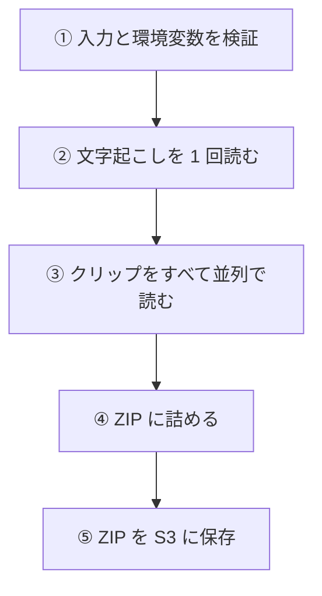
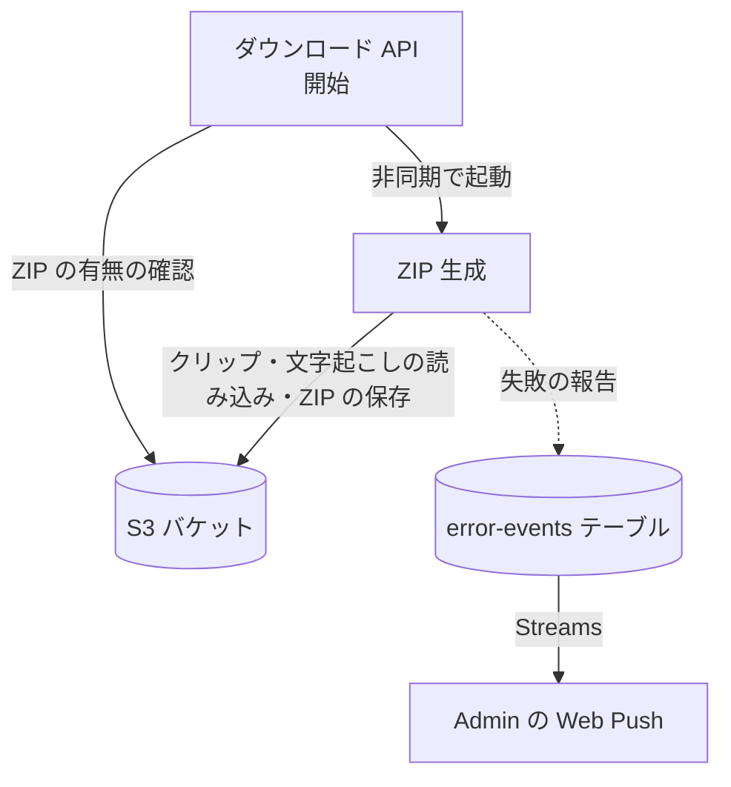

---
sources:
  - services/quick-clip/lambda/zip/src/handler.ts
  - infra/quick-clip/lib/lambda-stack.ts
  - infra/quick-clip/lib/monitoring-stack.ts
  - libs/aws/src/error-events/with-error-reporting.ts
  - libs/aws/src/error-events/report.ts
sources_hash: a53be08a6435ee6c703b753bcd7ef3adf49829115924ee8f4a39c42d37260338
---

# ZIP 生成 (zip-generate)

採用した[見どころ](../term/highlight.md)のクリップを集め、[文字起こし](../term/transcript.md)のテキストを添えて、1 つの ZIP にして S3 に置く Lambda。1 回の起動で 1 ジョブ分を処理する。

## 起点

- スケジュールはない。[ダウンロード API](../api/download.md) の開始 (`POST`) が、結果を待たずに (非同期で) 起動する
- 入力は `{ jobId, clips }`。`clips` は、採用した見どころごとの `{ highlightId, order, startSec, endSec }`。`jobId` が空、`clips` が配列でない、または空なら例外 (入力値が不正です)
- 環境変数 `S3_BUCKET`、`AWS_REGION` が必須。なければ例外
- DynamoDB には触れない。非同期起動の再試行は指定せず、Lambda の既定に従う。メモリとタイムアウトは[ワーカーの実行環境](../resource/worker-runtime.md)にある

## 処理

| 手順 | 内容 |
|---|---|
| ② 文字起こし | `outputs/{jobId}/transcript.json` を読む。ファイルがなければ「なし」として続ける。ほかの失敗は例外 |
| ③ クリップ | `outputs/{jobId}/clips/{highlightId}.mp4` を、採用した見どころの数だけ並列で読む。読めなければ例外 |
| ④ 詰める | クリップごとに `clip-{order を 2 桁にゼロ埋め}.mp4` を入れる。文字起こしがあり、そのクリップの区間に重なる行があれば、行を改行でつないだ `clip-NN.txt` も入れる。圧縮は DEFLATE |
| ⑤ 保存 | `outputs/{jobId}/clips.zip` に、`application/zip` で上書きする |

- 重なる行の決め方は[文字起こし](../term/transcript.md)にある。区間は、API が起動のときに渡した `startSec` と `endSec` で、DynamoDB は読まない
- 結果として `{ downloadUrl }` (有効 300 秒の署名付き URL) を返すが、非同期の起動なので、呼び出し元は受け取らない。利用者は[ダウンロード API](../api/download.md) の取得で、ZIP の有無を見る

## 失敗したとき

- 入力や環境変数の検証の失敗は、報告もしない
- ② 〜 ⑤ のどこかで例外になると、Admin へ報告して例外を投げ直す。報告は error で、題名は「QuickClip ZIP 生成に失敗しました」。`jobId`、`clips`、ZIP の S3 キーつき。再試行のたびに報告するので、1 回の依頼で報告が複数残りうる
- ZIP は作られず、ジョブにも失敗の印は残らない。[ダウンロード API](../api/download.md) の取得は `PROCESSING` を返し続ける。画面は 300 秒で待つのをやめて、エラーを出す ([見どころ確認画面](../screen/highlights.md))
- 前の ZIP は、API が開始のときに消す ([ダウンロード API](../api/download.md))
- Lambda の失敗を拾う CloudWatch Alarm や EventBridge のルールは、quick-clip のインフラには定義されていない。報告できるのは、アプリが例外を受けられたときだけ
- 報告の書き込みに失敗しても、例外は伝えない。ログだけを残す ([エラーの報告](../../../../platform/specs/lib/aws/error-reporting.md))

## つながり

## 理由

- ZIP の組み立てを、Web の API ではなく専用の Lambda にする。クリップ再生成と同じく、画面の操作から Web の API が直接、非同期に起動できるため ([クリップ再生成](./clip-regenerate.md)の「理由」)
- ZIP の中のファイル名は、見どころの番号に連動した `clip-NN` にそろえる ([文字起こし](../term/transcript.md)の「理由」)
