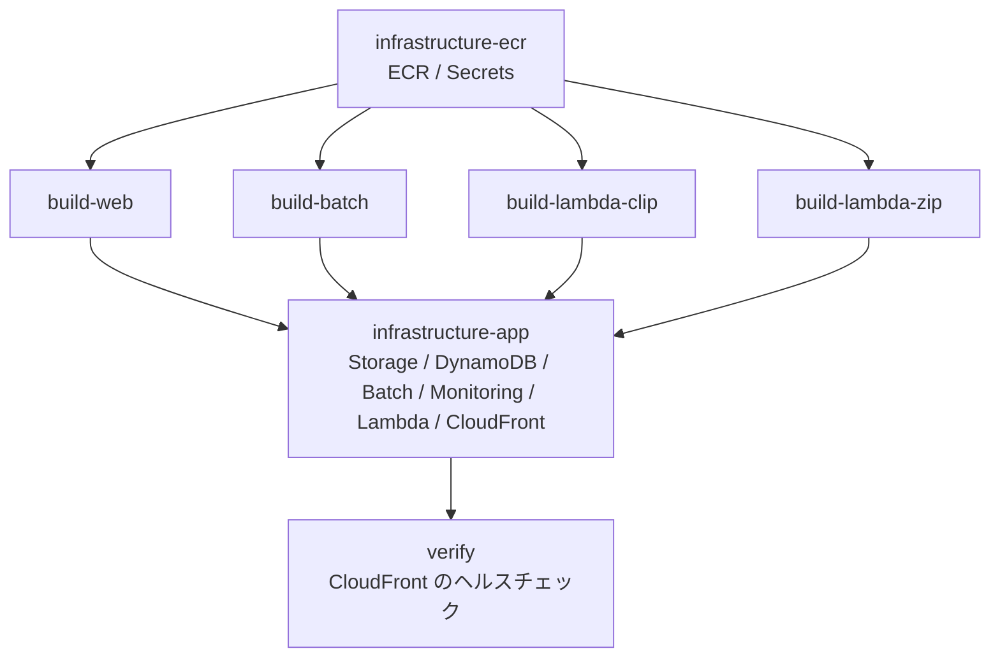

---
sources:
  - infra/quick-clip/bin/quick-clip.ts
  - infra/quick-clip/lib/cloudfront-stack.ts
  - .github/workflows/quick-clip-deploy.yml
sources_hash: a79aa8d338e1f01964cd4dde3bfa4925b94becadcc1c832b7846127f008c26b7
---

# QuickClip のデプロイ先

QuickClip の Web は Lambda (コンテナイメージ) の Function URL を CloudFront の背後に置いて公開する。動画の切り出しなど重い処理は AWS Batch と、専用の Lambda が受け持つ。

## ホスト名

| 環境 | ホスト名 |
|---|---|
| dev | `quick-clip.dev.nagiyu.com` |
| prod | `quick-clip.nagiyu.com` |

ホスト名は共通の組み立て関数 (`getCloudFrontDomainName('quick-clip', environment)`) で決まり、`infra/quick-clip/lib/cloudfront-stack.ts` が CloudFront に渡す。

DNS レコードは、dev は CloudFront の基底スタックが、prod は shared の CNAME が作る。詳しくは [DNS レコードの作り方](../../../platform/specs/deploy.md#dns-レコードの作り方) を参照。

## スタック

`infra/quick-clip/bin/quick-clip.ts` が、次の順に作る。環境は CDK の context `env` (既定は `dev`) で決まり、`{Env}` は `Dev` / `Prod` である。CloudFront 以外は `us-east-1` を既定のリージョンにする。CloudFront は `us-east-1` に固定し、Lambda の Function URL をリージョンをまたいで参照する。

| 順 | スタック | 役割 | 含むリソース |
|---|---|---|---|
| 1 | `NagiyuQuickClipSecrets{Env}` | シークレット | Secrets Manager のシークレット |
| 2 | `NagiyuQuickClipStorage{Env}` | ファイルの保存先 | S3 バケット |
| 3 | `NagiyuQuickClipDynamoDB{Env}` | ジョブの保存先 | DynamoDB テーブル |
| 4 | `NagiyuQuickClipECR{Env}` | イメージの置き場 | ECR リポジトリ |
| 5 | `NagiyuQuickClipBatch{Env}` | 動画処理の実行 | AWS Batch |
| 6 | `NagiyuQuickClipMonitoring{Env}` | Batch の失敗の通知 | EventBridge ルール |
| 7 | `NagiyuQuickClipLambda{Env}` | アプリの実行 | Lambda (Function URL つき) |
| 8 | `NagiyuQuickClipCloudFront{Env}` | 公開の入口と DNS | CloudFront |

## デプロイの流れ

`.github/workflows/quick-clip-deploy.yml` が行う。

| 項目 | 内容 |
|---|---|
| トリガー | develop・`integration/**`・master への push (サービス・infra・libs・configs などのパスが変わったとき)。手動実行 (dev / prod を選ぶ) |
| デプロイ先の環境 | [dev と prod の切り替え](../../../platform/specs/deploy.md#dev-と-prod-の切り替え) の規則 |
| 並行実行 | 環境ごとに直列化する。実行中の run は止めず、待機中は最新だけ残す |
| イメージのタグ | コミットの SHA |

| ジョブ | 内容 |
|---|---|
| `infrastructure-ecr` | ECR と Secrets のスタックをデプロイする。Secrets は次のジョブ以降で値を取り出すため先に作る |
| `build-web` `build-batch` `build-lambda-clip` `build-lambda-zip` | それぞれのイメージをビルドして対応する ECR リポジトリに push する (並行) |
| `infrastructure-app` | Secrets Manager の値を取り出し、Storage・DynamoDB・Batch・Monitoring・Lambda・CloudFront を 1 回の CDK のデプロイで作る |
| `verify` | CloudFront のスタックの出力からディストリビューションのドメイン名を取り出し、そのドメインでヘルスチェックを行う ([ヘルスチェック](../../../platform/specs/deploy.md#ヘルスチェック)) |

## 理由

Batch の ARN は命名規則から組み立てて Lambda と Monitoring に渡す。スタック間の Export / Import を作らないのは、ジョブ定義のリビジョンが変わったときに Export の値が変わり、CloudFormation が更新を拒否するためである。
