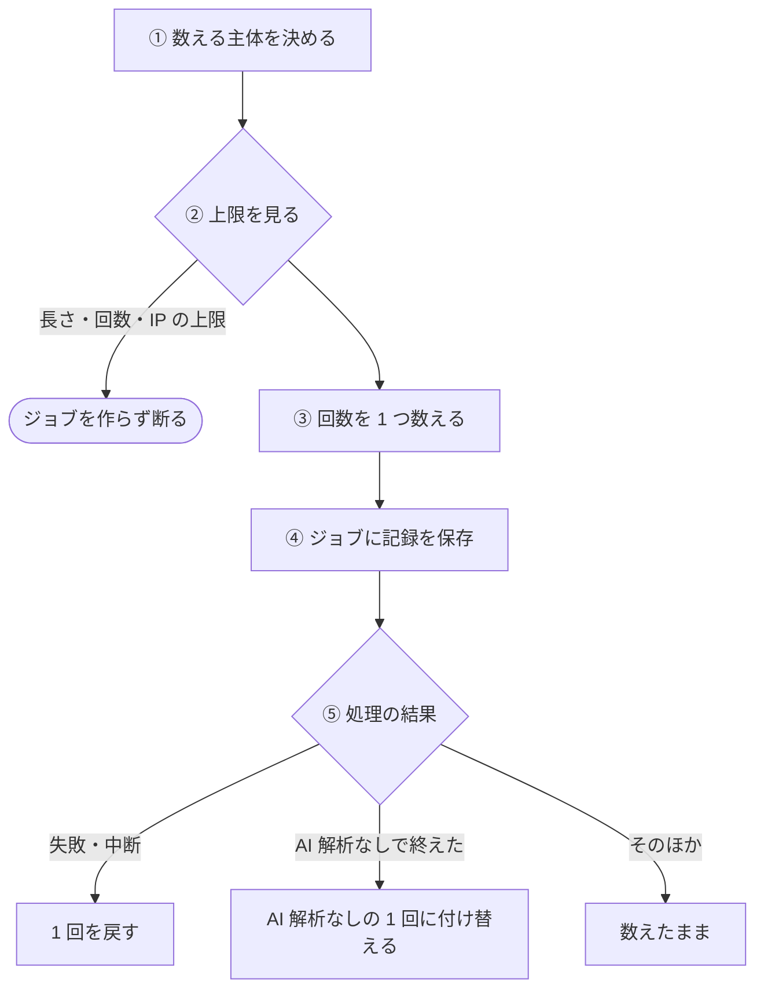
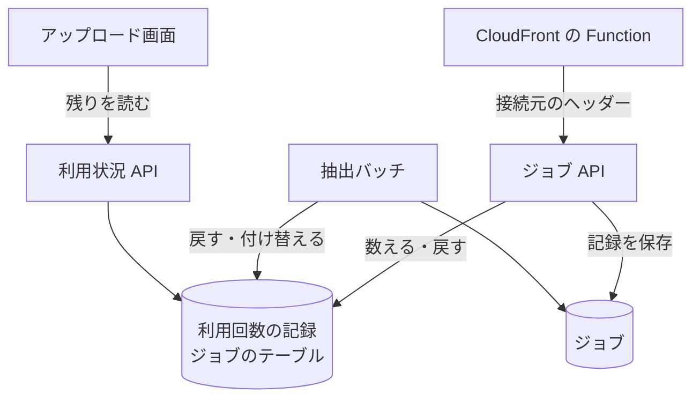

---
sources:
  - services/quick-clip/web/src/app/api/jobs/route.ts
  - services/quick-clip/web/src/app/api/jobs/[jobId]/complete-upload/route.ts
  - services/quick-clip/web/src/app/api/jobs/[jobId]/abort-upload/route.ts
  - services/quick-clip/web/src/lib/server/usage-flow.ts
  - services/quick-clip/web/src/lib/server/usage-context.ts
  - services/quick-clip/web/src/lib/server/client-ip.ts
  - services/quick-clip/core/src/libs/usage.service.ts
  - services/quick-clip/core/src/libs/usage-plan.ts
  - services/quick-clip/core/src/libs/quick-clip-batch-runner.ts
  - services/quick-clip/core/src/repositories/counting-usage.repository.ts
  - services/quick-clip/core/src/repositories/dynamodb-usage.repository.ts
  - services/quick-clip/core/src/repositories/dynamodb-job.repository.ts
  - services/quick-clip/core/src/mappers/usage-keys.ts
  - services/quick-clip/core/src/mappers/daily-salt.mapper.ts
  - infra/quick-clip/lib/cloudfront-stack.ts
sources_hash: a95fd17b74bce3a82f2783f21be9b41e1a3565b84bbe69891f26e6a79915580d
---

# 利用回数の数え方と戻し

ジョブを作るときに、月の回数を 1 つ数え、処理に失敗したときなどに戻す流れ。費用がかかる処理 (Batch と [AI 解析](../term/ai-analysis.md)) の使いすぎを、利用の[段](../term/usage-tier.md)ごとの上限で抑える。

## 起点

- 利用者が「アップロードして処理開始」を押すと、`POST /api/jobs` が回数を数える ([ジョブ API](../api/jobs.md))
- 残りは、アップロード画面が開くときに `GET /api/usage` で読む ([利用状況 API](../api/usage.md))。残りを読むだけで、数えない

## 経路

1. **主体**: ログイン中はユーザー ID、未ログインは Cookie `qc_anon_id` の匿名 ID。回数の記録のキーでは、それぞれ `USER#`、`ANON#` を前に付けた値になる ([ジョブのテーブル](../data/jobs-table.md))。Cookie がなければ、UUID を新しく発行して、レスポンスで渡す。端末の情報からの推定は使わない
    - Cookie は `HttpOnly`、`SameSite=Lax`、有効期間 1 年。`NODE_ENV` が `production` のときに `Secure` を付ける。`NODE_ENV` は Next.js のビルドで `production` になるので、デプロイした dev でも付き、付かないのはローカルの開発だけ。`Domain` は付けず、Quick Clip のホストだけに置く
2. **上限**
    - 動画の長さ: ブラウザが申告した長さが、段の上限を超えていれば断る (400)。申告がなければ判定しない
    - 月の回数: AI 解析ありとなしを別々に数える。上限なしの段 (使い放題) は、数えず、記録も残さない
    - 接続元 (未ログインだけ): 同じ接続元から、日本時間の 1 日に作れるジョブは 20 件まで
3. **数える**: 主体と月ごとの記録 ([ジョブのテーブル](../data/jobs-table.md)の「利用回数」) に、上限を超えないときだけ 1 を足す。足し方と、上限 0 回の扱いは[回数カウンター](../../../../platform/specs/lib/aws/usage-counter.md)、月の区切りは[日本時間の期間](../../../../platform/specs/lib/common/jst-period.md)にある。どちらを数えるかは次のとおり

| `aiAnalysis` | 数え方 |
|---|---|
| `false` | AI 解析なしだけ。なければ断る |
| `true` | AI 解析ありだけ。なければ断る |
| 省略 | AI 解析あり。なければ AI 解析なし。両方なければ断る |

4. **記録**: 数えた主体、月、種類、AI 解析なしの月の上限を、ジョブに保存する。戻すときの手がかりになる。回数の記録は、ジョブと同じテーブルに置く ([ジョブのテーブル](../data/jobs-table.md))
5. **結果**: 次の表のとおり。戻しと付け替えは、ジョブの戻し済み・付け替え済みの印を、条件つきの書き込みで先に付けられた側だけが行う。API と Batch が重なっても、二重には戻らない。戻す対象の月は、数えた月

| 事象 | 扱い |
|---|---|
| ジョブを作る前の失敗 | 戻す (ジョブの印は介さない) |
| 作成の応答が 500 以上、または例外 | 戻す |
| 分割アップロードの完了の失敗 | 戻す |
| 分割アップロードの中断 (S3 の中断が成功し、ジョブを Batch へ投入する前のときだけ) | 戻す |
| Batch の処理の失敗 (理由を問わない。動画の長さの超過を含む) | 戻す |
| AI 解析ありで数えたのに、AI 解析をしなかったか途中で飛ばした | AI 解析ありを戻し、AI 解析なしを 1 つ数える。AI 解析なしの上限に達していれば、戻すだけ |

- 戻しが引くのは 1 回分で、0 未満にならず、記録を新しく作らない ([回数カウンター](../../../../platform/specs/lib/aws/usage-counter.md))
- 戻す処理の失敗は、元の処理を妨げず、Admin へ報告する (warning)

## 接続元の数え方

- 接続元は、専用のヘッダー `x-nagiyu-viewer-ip` で取る。CloudFront の viewer-request の Function が、利用者の IP を毎回書き込み、利用者が送った同名のヘッダーは上書きする。ヘッダーがなければ、接続元の上限は数えない
- IPv6 は先頭 64 ビットにまとめる。IPv4 を写した IPv6 (`::ffff:a.b.c.d`) は IPv4 にする
- IP はそのまま保存しない。日ごとに作る乱数 (塩) との HMAC-SHA256 で記録する。塩は日付ごとに 1 つ、接続元の数は日付と IP のハッシュごとの記録に持つ ([ジョブのテーブル](../data/jobs-table.md))
- 回数を数えたあとに接続元を確かめる。断った申し込みが、接続元の数を使わないようにするため。接続元で断るときは、数えた回数を戻す
- Function URL は CloudFront の署名つきの呼び出しだけを受け、直接呼ぶと 403 になる ([Lambda 関数の共通部品](../../../../platform/specs/resource/lambda-function.md))。このため、専用のヘッダーは、必ず CloudFront の Function が書いた値になる

## 届く先

- **アップロード画面**: 断られたときのメッセージと、ログインやプランへの案内。数えたあとの残りは、`GET /api/usage` で読み直す ([アップロード画面](../screen/upload.md))
- **ジョブ**: 数えた記録。戻しと付け替えの手がかりになる ([ジョブとステータス](../term/job.md))

## 失敗・取りこぼしのとき

- 記録先 (DynamoDB) の障害で数えられないときは、報告 (error、題名は「Web API: 利用回数の確認エラー (バイパス)」) して、数えずに通す。このとき AI 解析はなしにする
- 月ごとの記録と日ごとの記録 (塩と接続元) は TTL で消える ([ジョブのテーブル](../data/jobs-table.md))。DynamoDB の削除は遅れることがあるので、削除を前提にした判定はしない
- Batch のプロセスが即死する失敗 (タイムアウトなど) は、戻す処理に入らず、回数は戻らない ([抽出バッチ](../batch/extract.md))
- 分割アップロードの途中でタブを閉じるなど、中断も完了も呼ばれなかったときは、戻す処理が走らず、回数は戻らない。Batch への投入は完了の API だけが行うので、この動画は処理されない
- アップロード画面には、利用者が分割アップロードをやめる操作がない。中断の API を呼ぶのは、部分の `PUT` が失敗したときだけで、S3 の中断が失敗すると、回数は戻らない

## つながり

## 理由

- **ジョブを作るとき (アップロードの前) に数える**: 大きな動画をアップロードさせてから断らないため。長さは、そのときにはブラウザの申告値で判定する。申告は偽れるので、Batch が測った実際の長さで照合し、超えていれば文字起こしの前に止める。申告を偽っても、費用の高い OpenAI の呼び出しは発生しない
- **失敗は理由を問わず戻す**: わざと失敗させて回数を増やしても、こちらの損はほぼない。失敗の原因を切り分ける仕組みより単純にできる。AI 解析が失敗したときは、AI 解析なしの 1 回に付け替える
- **戻しと付け替えは、印を先に付けた側だけが行う**: 条件つきの書き込みで先に印を付けられた側だけが行うので、API と Batch が重なっても、二重に戻さない。印を先に付けるので、戻す処理の途中で失敗したときは、戻し損ねる側に倒れる
- **回数の記録が使えないときは、数えずに通す**: 記録の障害で全員が使えなくなるより、AI 解析なしの Batch の分の費用だけを許容するほうがよい。ただし AI 解析ありの申し込みも、AI 解析なしとして処理する。障害の間に、OpenAI の費用が上限なしにかかるのを避けるため
- **未ログインは、Cookie の匿名 ID で数える**: サーバーが発行する、推測できないランダムな ID を、`HttpOnly` の Cookie で渡す。シークレットモードやブラウザを変えた回避は許容する。端末の情報からのハッシュ (フィンガープリント) は、精度の割にプライバシー上の負担が大きいため使わない。未ログインは AI 解析ありが 0 回なので、回避されても、費用は Batch の分に限られる
- **接続元の上限を補助に置き、緩くする**: 携帯回線では大勢が同じ IP になるため。IPv6 を先頭 64 ビットでまとめるのは、同じ回線の中でアドレスを変えられるため。IP は塩との HMAC で記録し、数日で消える。そのまま保存しない
- **接続元は、専用のヘッダーで取る**: `X-Forwarded-For` は、先頭を利用者が偽れるので使わない。ディストリビューションの管理ポリシー (`AllViewerExceptHostHeader`) は、CloudFront が付ける `CloudFront-Viewer-Address` をオリジンへ送らない。そこで、viewer-request の Function で、利用者の IP を専用のヘッダーに載せる
- **回数を数える部分は共通ライブラリを使う**: 条件つきの加算と戻しは[回数カウンター](../../../../platform/specs/lib/aws/usage-counter.md)、日本時間の日・月のキーと TTL の計算は[日本時間の期間](../../../../platform/specs/lib/common/jst-period.md)にある。Quick Clip が持つのは、段・AI 解析あり / なし・接続元・塩の扱いだけ
