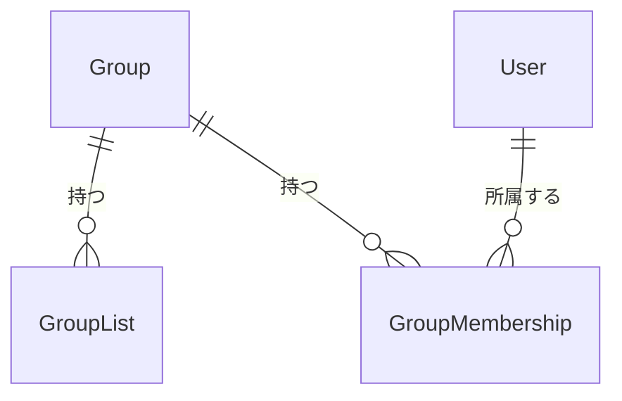

# Share Together 外部設計書

この文書は、画面を設計した理由・方針と概念データモデルを書く。画面や API が今どう動くかは[仕様カード](../../specs/README.md)にある。

## 1. 画面設計

### 1.1 画面一覧

各画面の入口・表示するもの・操作・状態は、画面の仕様カードを参照する。この文書には、画面を設計した理由と、画面をまたぐ方針だけを書く。

| 画面 ID | 画面名 (仕様カード) | パス | 対応ユースケース | 優先度 |
| ------- | ------ | ---- | -------------- | ------ |
| SCR-001 | [リスト一覧（共有スコープ）](../../specs/share-together/screen/lists.md) | /lists | UC-001, UC-002 | 高 |

### 1.2 画面の設計方針

#### SCR-001: リスト一覧（共有スコープ）サイドバー

リスト一覧画面のサイドバー部分を拡張し、共有スコープの各共有リストに、個人スコープと同じ編集・削除の操作を置く。個人スコープの既存の挙動は変えない。

### 1.3 レスポンシブ方針

- モバイル（スマートフォン）: 既存のサイドバーの縦積みレイアウトを踏襲する
- デスクトップ: サイドバー幅内に収まるよう、アイコンボタンを小サイズで配置する

### 1.4 アクセシビリティ方針

- アイコンボタンには、操作と対象のリスト名が分かる `aria-label` を付与する (文言は[リスト画面](../../specs/share-together/screen/lists.md)を参照)

---

## 2. 概念データモデル

### 2.1 主要エンティティ一覧

| エンティティ | 説明 | 主要な属性（概念レベル） |
| ----------- | ---- | -------------------- |
| GroupList | グループに紐づく共有 ToDo リスト | リスト名、グループ ID、作成日時 |
| GroupMembership | ユーザーとグループの紐付け | ユーザー ID、グループ ID、ステータス |

### 2.2 エンティティ関係図

