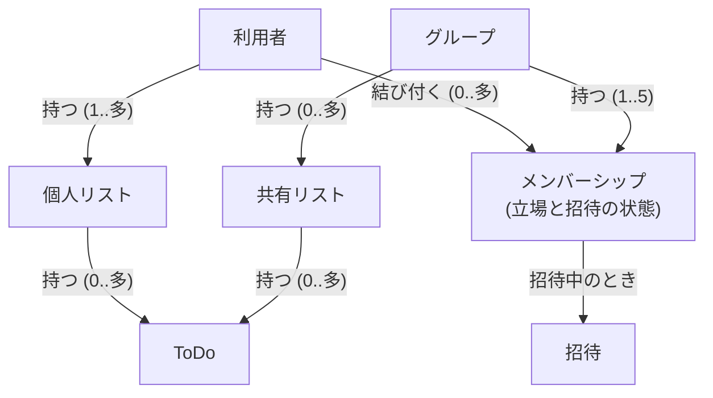

# ドメインモデル

利用者が個人リストで ToDo を管理し、グループを作って人を招き、承認したメンバーと共有リストで ToDo を分け合うまでに扱う概念。

## 概念

| 概念 | 意味 |
|---|---|
| 利用者 | Share Together にログインした人。初めて使うときに登録される ([サインインと利用者の登録](functional/sign-in.md)) |
| 個人リスト | 利用者本人だけが見られる ToDo のリスト。利用者ごとにデフォルトのリストが 1 つある ([個人リスト](../specs/term/personal-list.md)) |
| グループ | 利用者が共有リストを分け合うための集まり。作った利用者がオーナーになる |
| メンバーシップ | 利用者とグループの結び付き。グループでの立場 (オーナーかメンバーか) と、招待の状態 (招待中・承認済み・拒否済み) を持つ ([グループの立場](../specs/term/group-role.md)) |
| 招待 | オーナーが利用者をグループへ誘う記録。招待中のメンバーシップとして持つ ([招待](../specs/term/invitation.md)) |
| 共有リスト | グループに属する ToDo のリスト。承認済みのメンバーなら誰でも使える ([共有リスト](../specs/term/shared-list.md)) |
| ToDo | リストの中の 1 件のやること。個人リストにも共有リストにも属せる |

## 関係

- 1 人の利用者は、デフォルトの個人リストを必ず 1 つ持つ。デフォルトのリストは削除できない ([個人リスト](functional/personal-list.md))
- グループの人数は、オーナーを含めて 5 名まで。作った利用者が、承認済みのオーナーとして最初のメンバーシップになる ([グループ](functional/group.md))
- 招待は独立したデータを持たず、招待中のメンバーシップが招待の役を務める。応じると承認済み、断ると拒否済みになる ([招待](functional/invitation.md))
- 共有リストを操作できるのは、承認済みのメンバーシップを持つ利用者だけである。立場 (オーナーかメンバーか) による違いはない ([共有リスト](functional/shared-list.md))
