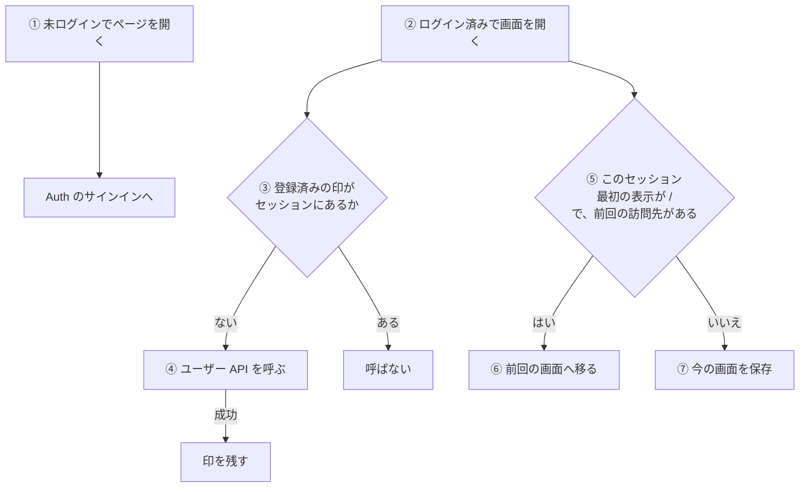
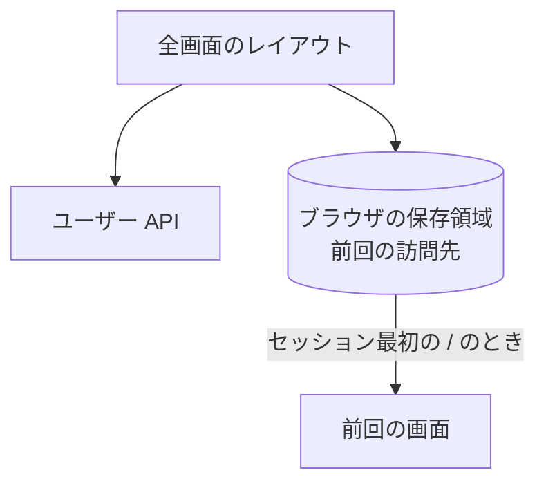

---
sources:
  - services/share-together/web/src/app/layout.tsx
  - services/share-together/web/src/components/UserRegistrationInitializer.tsx
  - services/share-together/web/src/components/LastVisitedPathController.tsx
  - services/share-together/web/src/lib/lastVisitedPath.ts
  - services/share-together/web/src/middleware.ts
  - services/share-together/web/src/app/api/users/route.ts
  - services/share-together/web/public/manifest.json
  - services/share-together/web/public/sw.js
sources_hash: 5e4ebe2d23ce09797e7d8f10283718ac03fa6ee04312ab846c117541d15e5240
---

# 起動時の流れ (利用者登録と前回の画面の復元)

ログイン後に画面を開いたときに、全画面のレイアウトが行う 2 つの処理。利用者の登録と、前回開いていた画面への復元。あわせて、アプリとして入れられる PWA の構成 (manifest と Service Worker) もここに書く。

## 起点

- どの画面でも、レイアウトが描かれたとき (ブラウザのセッションごと。タブや PWA のウィンドウを閉じるまで)

## 経路

| 段階 | 内容 |
|---|---|
| ① 未ログイン | ミドルウェアが Auth のサインインへ送る。戻り先は開いたパスとクエリ。`/api` は対象外で、API は 401 を返す |
| ③④ 登録 | 画面ごとに、ブラウザのセッションに印があるかを見る。なければ [ユーザー API](../api/users.md) を呼び、成功したら印を残す。失敗した場合は印を残さず、次の画面の表示で再び呼ぶ。失敗は `console.error` に出すだけで、利用者には知らせない |
| ⑤⑥ 復元 | セッションの最初の表示で、パスが `/` で、保存された前回の訪問先が `/` 以外ならそこへ移る (履歴は置き換える)。移るときは保存しない |
| ⑦ 保存 | それ以外のとき、パスとクエリを 1 つの文字列にして、ブラウザに保存する (`/` で始まるものだけ)。リスト画面のクエリ (`scope`、`groupId`、`listId`) も含めて保存するので、選んでいたリストへ戻れる |

- 保存先はブラウザ (端末ごと)。ほかの端末やブラウザには引き継がれない
- 復元は、`/` を一度描いてから移る。トップ画面が一瞬見える
- 2 回目以降の `/` (ヘッダーのタイトルを押すなど) では移らない

## 届く先

- ユーザー API が作る利用者とデフォルトの個人リスト ([個人リスト](../term/personal-list.md))
- 前回の訪問先 (ブラウザの保存領域)

## PWA

Share Together は PWA として、ホーム画面に追加して単独のアプリのように開ける。レイアウトが `ServiceWorkerRegistration` を置いて Service Worker を登録し、`manifest.json` をページに結び付ける。

| 項目 | 値 |
|---|---|
| 名前 | `Share Together - みんなでシェアリスト` (短い名前は `Share Together`) |
| 開始 URL | `/` |
| 表示 | `standalone` |
| 背景色・テーマ色 | `#ffffff`、`#1976d2` |
| アイコン | `/icon-192x192.png` (192x192) と `/icon-512x512.png` (512x512)。どちらも `any maskable` |

Service Worker (`/sw.js`) の挙動。

| 場面 | 挙動 |
|---|---|
| インストール | `/`、`/manifest.json`、2 つのアイコンをキャッシュ (`share-together-v1`) に入れる。1 つでも失敗するとインストールが失敗する。待たずに有効にする |
| 有効化 | 名前が `share-together-v1` でない古いキャッシュを消し、開いているページをすぐ制御する |
| GET | ネットワーク優先。ステータス 200 の同一オリジンの応答だけをキャッシュに入れて返す。ネットワークに失敗したら、キャッシュにあるものを返す (なければ取得に失敗する) |
| GET 以外 | キャッシュせず、そのままネットワークへ渡す |

- Push 通知は持たない (`push` のイベントは扱わない)
- `/manifest.json`、2 つのアイコン、`/sw.js` は、ログインの判定 (ミドルウェア) の対象外
- 登録の部品の挙動は[Push 購読の React 部品](../../../../platform/specs/lib/react/push-subscription.md)にある。Share Together は再購読を使わず、登録だけをする
- Service Worker を経由した通信は、E2E で扱いにくい ([E2E の規約](../../../../platform/rules/e2e.md))

## つながり

## 理由

- 保存と復元を 1 つの effect にまとめる。別のコンポーネントに分けると、どちらも画面のパスの変化に反応し、兄弟の effect の発火順とナビゲーションの非同期性で競合する。初回の表示で保存が先に走ると、前回の値が `/` で上書きされる。1 つの effect の中で「読んでから書く」順にすれば、順序が決まる。最初の effect かどうかは、セッションの印で見分ける
- `/` も保存する。トップ画面で離れたときは、次回もトップ画面から始められる
- 復元から `/` を除く条件は復元の側に閉じ、保存の側は `/` で始まるかだけを見る
- 復元は `/` を描いてから移るので、トップ画面が一瞬見える。描画を止めるには effect の中で状態を更新することになり、React のルール (`react-hooks/set-state-in-effect`) に合わない。PWA の起動で一瞬見えるだけなので許す
- Cookie とミドルウェアで描画の前に移す方式は採らない。一瞬見えるのを避けられるが、Cookie が毎回のリクエストに乗る。Cookie は、サーバー側の描画で値が決まっている必要があるもの (認証など) に限る方針に合わない
- サーバー側 (DB) に保存する方式は採らない。端末をまたいで引き継げるが、そこまでは求めていない
