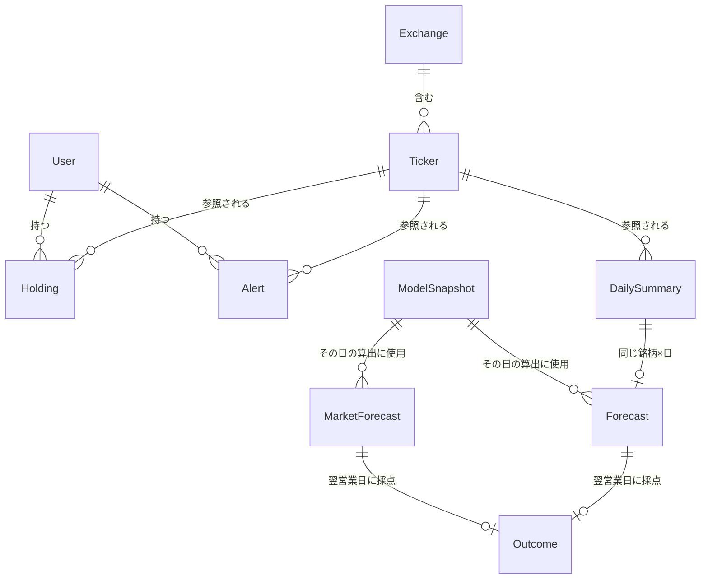

# Stock Tracker 外部設計書

この文書は、画面と概念データモデルを設計した理由・方針を書く。画面や API が今どう動くかは[仕様カード](../../specs/README.md)にある。

## 1. 画面設計

### 1.1 画面一覧

各画面の入口・表示するもの・操作・状態は、画面の仕様カードを参照する。この文書には、画面を設計した理由と、画面をまたぐ方針だけを書く。

| 画面 ID | 画面名 (仕様カード) | 対応ユースケース | 備考 |
|--------|--------|--------------|------|
| SCR-001 | [トップ画面（チャート表示）](../../specs/stock-tracker/screen/home.md) | UC-001, UC-006, UC-009 | — |
| SCR-002 | [保有株式画面](../../specs/stock-tracker/screen/holdings.md) | UC-003 | — |
| SCR-003 | [アラート一覧画面](../../specs/stock-tracker/screen/alerts.md) | UC-002, UC-007 | — |
| SCR-004 | [サマリー画面](../../specs/stock-tracker/screen/summaries.md) | UC-004, UC-006 | 詳細ダイアログを SCR-001 と共用する |
| SCR-005 | [取引所管理画面](../../specs/stock-tracker/screen/exchanges.md) | — | 管理者専用 |
| SCR-006 | [ティッカー管理画面](../../specs/stock-tracker/screen/tickers.md) | — | 管理者専用 |
| SCR-007 | [判断軸の成績画面](../../specs/stock-tracker/screen/axis-performance.md) | UC-012 | — |

### 1.2 画面の設計方針

#### 確度の表示の共通ルール

確度は SCR-001・SCR-004・詳細ダイアログ・SCR-007 にまたがって出るため、表記を揃える。ラベルと確率の対応は[確度](../../specs/stock-tracker/term/forecast.md)を参照する。

- ラベルは文字だけのチップにし、確率は別に数字で出す (ADR-014)。基準値は画面上「ふだん NN%」と書き、基準値との差 (±pt) は出さない (ADR-014)
- 荒れの下側 (平常より穏やか) は「平常」にまとめる。穏やかであることは判断材料として求められていない
- 中立・平常は控えめな色にする。強含み・弱含み・荒れそうは色を付けるが、色だけに頼らずラベル文字で区別する
- 確率は大半の銘柄でふだん付近に集まり、「中立」「平常」が多くなる。中立が多いこと自体を「手がかりが少ない」という正しい情報として扱う
- 確度は「その日の引け時点で出した、翌営業日についての確率」である。基準日を必ず出し、「明日」の意味を取り違えないようにする
- 確度がない日付・算出できなかった銘柄は「—」にして理由を示す。OHLCV・チャート・アラート作成は確度の有無にかかわらず使える

#### 詳細ダイアログ（SCR-001・SCR-004 共通）

内訳の中身は[サマリー画面](../../specs/stock-tracker/screen/summaries.md)と[確度 API](../../specs/stock-tracker/api/forecasts.md)を参照する。

- 判断軸の成績画面 (SCR-007) への導線は置かない。軸ごとの過去成績は内訳テーブルに出ているため
- 各軸の寄与の合計は「確率 − ふだんの割合」に一致する (`architecture.md` ADR 2.24)

#### 判断軸の成績画面（SCR-007）

- 確度が「実際にその確率で当たっている」かを、継続的に確かめる場所として置く。`stocks:read` で閲覧でき、ナビゲーションにも `/summaries` と同じ条件で出す (ADR-012)

### 1.3 レスポンシブ方針

スマートフォンファーストで設計する（[プラットフォーム全体の開発ガイドライン](../../development/rules.md) に準拠）。

- モバイル（スマートフォン）: 縦スクロールを基本とし、チャートや各パネルを縦方向に積み重ねて表示する
- デスクトップ: 横方向のレイアウトを活用し、チャートと各パネルを並列配置できる幅を確保する
- 列の多い表は、幅が足りないときの見せ方を画面ごとに決める。今の挙動は各画面の仕様カードを参照する

### 1.4 アクセシビリティ方針

Material UI（MUI）コンポーネントが提供する標準的なアクセシビリティ機能（ARIA 属性・キーボード操作・フォーカス管理）を活用する。カスタム実装が必要な箇所では MUI の方針に倣い、適切なラベルとロール指定を行う。

---

## 2. 概念データモデル

### 2.1 主要エンティティ一覧

| エンティティ | 説明 | 主要な属性（概念レベル） |
|------------|------|-------------------|
| Exchange（取引所） | 株式が取引される市場 | 名称、識別コード |
| Ticker（ティッカー） | 個別銘柄を識別するシンボル | シンボル、銘柄名、所属取引所 |
| Holding（保有株式） | ユーザーが保有する銘柄の情報 | 銘柄、数量、平均取得価格 |
| Alert（アラート） | 価格条件に基づく通知設定。Web Push サブスクリプション情報を内包する | 銘柄、条件リスト、通知頻度、有効フラグ、Web Push エンドポイント・キー |
| DailySummary（日次サマリー） | その日の足と、足から決まる判定 | 日付、始値・高値・安値・終値・出来高、パターン分析結果 |
| 判断軸 (Axis) | 機械的に算出できる条件または値。コードで定義し、DB には持たない | 名前、種類 (点灯型・数値型)、対象の問い |
| 確度 (Forecast) | 銘柄 × 日の予測。予測時点の値として保存し、書き換えない | 軸の値、問いごとの確率・ふだんの割合・中立帯・寄与 |
| 市場の確度 (MarketForecast) | 市場 × 日の予測 | 市場レベル軸の値、市場の荒れの確率・ふだんの割合・中立帯 |
| 採点結果 (Outcome) | 翌営業日の実績と、問いごとの当否。確度に付く | 超過リターン、値幅の平常比、当否 |
| 重みのスナップショット (ModelSnapshot) | その日の算出に使った重み・ふだんの割合・中立帯・軸ごとの成績 | 問い、算出した市場、日付 |

### 2.2 エンティティ関係図

---

## 3. 設計上の決定事項（ADR）

欠番は、旧予測精度ダッシュボードを撤去したときに役目を終えた判断である (`architecture.md` ADR 2.21)。

### ADR-001: チャート・サマリー・保有株式・アラートの統合表示

**背景・問題**

株価チャートを確認する際、ユーザーは同じ銘柄の保有状況・アラート設定・最新サマリーを同時に参照したいケースが多い。これらを別々の画面に配置した場合、画面遷移のたびにコンテキストが失われ、銘柄ごとの全体像を把握しにくくなる。

**決定**

トップ画面（チャート表示）に、選択銘柄の日次サマリー・保有株式・アラートの各情報パネルを統合表示する。

**根拠・トレードオフ**

- 銘柄選択という単一の操作で関連情報がすべて更新されるため、銘柄ごとの投資判断に必要な情報を一画面で把握できる
- 保有株式管理・アラート一覧は独立した専用画面（SCR-002, SCR-003）にも存在し、一覧操作・編集はそちらで行う設計とすることで、トップ画面の責務を「閲覧・確認」に絞る
- トップ画面の情報量が増えるため、モバイルでは縦スクロールが長くなる可能性があるが、最も利用頻度の高い情報を集約することを優先した

**その後の変更**

トップ画面の保有株式・アラートのパネルから、追加・編集・削除ができるようになった (`architecture.md` ADR 2.9)。今の挙動は[トップ画面](../../specs/stock-tracker/screen/home.md)を参照する。

---

### ADR-010: 同市場平均と荒れ予報の単位を「市場 (JP / US)」にする

**背景・問題**

方向は「同じ単位の登録銘柄の平均を上回るか」で測り、市場全体の荒れも単位ごとに予報する。当初は取引所を単位としていたが、登録銘柄は TSE 67・NYSE 36・NASDAQ 33・AMEX 1 で、AMEX では同市場平均との差が常に 0 になり、AMEX 単独の荒れ予報も意味を持たない。

**決定**

JP (TSE) と US (NASDAQ・NYSE・AMEX) の 2 市場を単位とする。市場は取引所マスタの市場属性で決める。

**根拠・トレードオフ**

- 同じ営業日カレンダーで同じ時刻に引ける取引所をまとめれば、平均が安定する
- 取引所ごとの差 (NASDAQ にハイテクが多い等) は区別できなくなるが、取引所単位では銘柄数が少なく平均が不安定になる

---

### ADR-011: 詳細ダイアログの内訳は開いたときに取る

**背景・問題**

内訳は銘柄ごとに約 35 軸 (方向 29・荒れ 6) あり、一覧の全銘柄分を載せるとレスポンスが大きくなる。

**決定**

サマリー一覧は確度の要約だけを受け取り、内訳は詳細ダイアログを開いたときに銘柄ごとに取る。

**根拠・トレードオフ**

ダイアログを開くたびに 1 往復増えるが、一覧の表示速度を優先する。トップ画面からも同じ取り方で使える。

---

### ADR-012: 確度と成績を `stocks:read` で見せ、`stocks:read-evaluation` を廃止する

**背景・問題**

旧予測精度ダッシュボードは、管理者だけが見る実験的な画面だったため、専用の権限 `stocks:read-evaluation` を設けていた。確度は一般ユーザーが見る判断材料になり、その根拠となる成績も同じ人が見られるべきである。

**決定**

判断軸の成績画面は `stocks:read` で閲覧できるようにし、`stocks:read-evaluation` は権限の定義とロールから削除する。

**根拠・トレードオフ**

使われない権限が残ると、ロール設計を読む人が混乱する。将来、管理者向けの分析機能を分けたくなったら、そのときに改めて権限を設ける。

---

### ADR-013: 「点灯数」は単一パターンの合致数とする

**背景・問題**

一覧の点灯列は、点灯している軸の数を示す。ただし数値型軸 (値幅・出来高比) は毎日値を持つため、「点灯」の概念がない。

**決定**

点灯列は合致した単一パターンだけを数え、買い/売りの内訳を添える。複合パターン軸と数値型軸は数えない。これらの効き具合は、確度と詳細ダイアログの内訳で見せる。

**根拠・トレードオフ**

- 複合軸 (買い合致数 ≥ 2) を数えると、構成パターンと二重に数えてしまう
- 数値型軸にしきい値を設けて「点灯」とみなす案は、しきい値が恣意的になる
- 結果として、旧来の買い/売りシグナル数をまとめた形になり、利用者にとっても連続性がある

---

### ADR-014: 確率とふだんの割合を、ラベルとは別に同じ書き方で出す

**背景・問題**

当初は「弱含み 58%」のようにラベルにそちら向きの確率を付け、「基準 36% / −6pt」と基準値との差を併記していた。dev で画面を確かめたところ、次の問題があった。

- 「基準 36% / −6pt」では、何の基準で、確率がいくつなのかが初見でわからなかった
- JP・US の 2 枚のカードに同じ基準値と同じ注記が繰り返し出ており、本当に別々に計算しているのかと不審に見えた

**決定**

- ラベル (強含み・弱含み・中立・荒れそう・平常) は文字だけにする
- 確率は常に数字で、問いの向きを固定して出す (方向は「上回る確率」、荒れは「荒れる確率」)
- 基準値は「ふだん NN%」と書き、差の pt は出さない
- 市場の荒れ予報は 1 枚のカードにまとめ、両市場に共通の「ふだんの荒れる割合」と参考値の注記は 1 回だけ出す。市場ごとに値が違うときだけ、その行に添える

**根拠・トレードオフ**

- 「ふだん」は、どの軸も効いていないときの割合という意味を、用語の説明なしに伝えられる
- 向きを固定すると、弱含みの銘柄は「上回る確率 42%」のように 50% を下回る値になる。向きによって数字の意味が変わるより、全画面で同じ読み方ができることを優先した
- 差の pt は、確率とふだんの割合を並べれば読める
- ふだんの割合は JP・US を合算したサンプルから出す (`architecture.md` ADR 2.25) ため、両市場でほぼ同じ値になる。同じ値なら 1 回だけ出せば足りる
