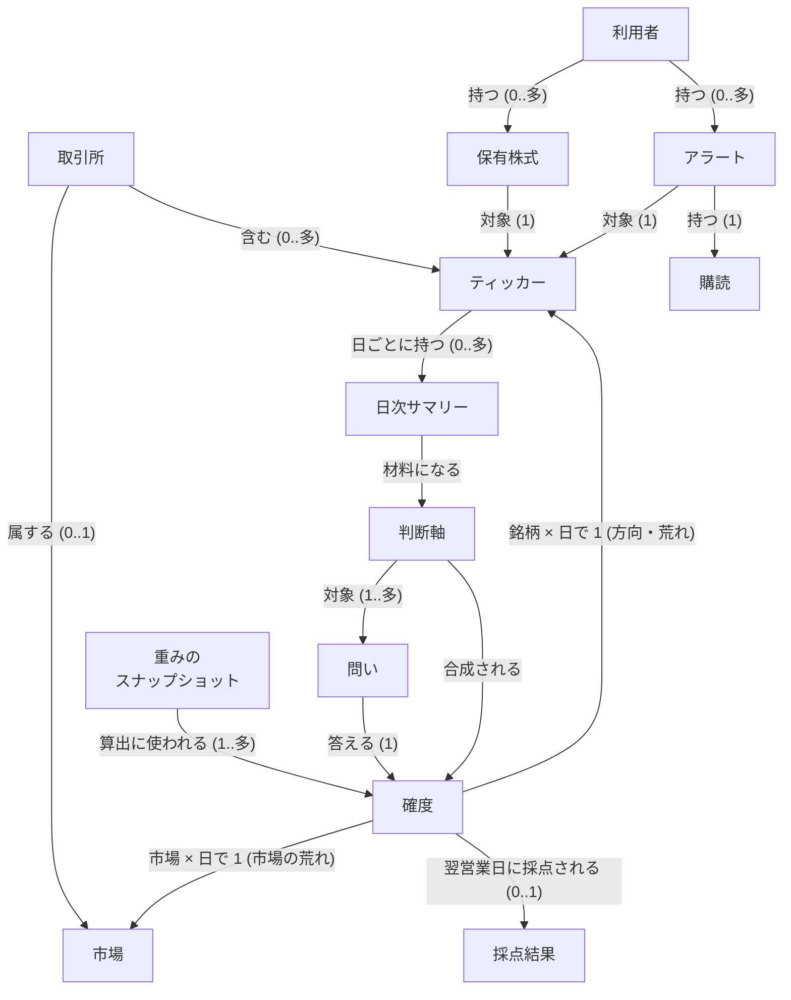

# ドメインモデル

利用者が、取引所とティッカーを選んでチャートを見て、アラートと保有株式を管理し、判断軸から合成した確度と、その採点の成績を確かめるまでに扱う概念。

## 概念

| 概念 | 意味 |
|---|---|
| 利用者 | このサービスを使う本人。ロールが持つ権限で、できる操作が分かれる ([権限とロール](../specs/term/permission.md)) |
| 取引所 | 株式が取引される場。タイムゾーン、取引時間、価格の取得元、市場を持つ ([取引時間](../specs/term/trading-hours.md)、[価格の取得元](../specs/term/price-source.md)) |
| 市場 | 日本 (JP) と米国 (US)。同市場平均と市場の荒れの単位。取引所が属する ([問い](../specs/term/question.md)) |
| ティッカー | 個別銘柄。取引所に属し、取引所の key とシンボルで識別する ([ティッカー ID](../specs/term/ticker-id.md)) |
| 保有株式 | 利用者が持つ銘柄の、数量と平均取得価格。ティッカーにつき 1 件 |
| アラート | 利用者が決める価格条件の通知設定。購読を 1 つ持つ。一時通知にもできる ([一時通知](../specs/term/temporary-alert.md)) |
| 購読 | 利用者の端末が Web Push を受け取る宛先。アラートが持つ ([Web Push の購読](../specs/term/push-subscription.md)) |
| 日次サマリー | ティッカー × 取引日の、その日の足と、足から決まるパターンの判定 ([日次サマリー](../specs/term/daily-summary.md)) |
| 判断軸 | 当日までの足だけから機械的に算出できる、確度の材料。コードで定義する ([判断軸](../specs/term/axis.md)) |
| 問い | 確度が答える対象。方向、荒れ、市場の荒れの 3 つ ([問い](../specs/term/question.md)) |
| 確度 | 翌営業日についての問いに答える確率。銘柄 × 日 (市場の荒れは市場 × 日) で 1 件。予測時点の値として残す ([確度](../specs/term/forecast.md)) |
| 採点結果 | 翌営業日の実績と、問いごとの当たり外れ。確度に付く |
| 重みのスナップショット | その日の確度の算出に使った、軸の重み・ふだんの割合・中立帯・軸ごとの成績 |

## 関係

- 保有株式は、利用者 × ティッカーで 1 件だけ
- アラートの購読は、アラート 1 件につき 1 つ。画面を開くと、利用者のアラートの購読がまとめて新しい端末のものに書き換わる ([アラート通知の経路](../specs/flow/alert-notification.md))
- 保有株式とアラートは利用者ごとに分かれ、ほかの利用者のものは読み書きできない ([アクセス制御](functional/access-control.md))
- 日次サマリーには確度を入れない。確度は別に持ち、予測時点の値を書き換えない。答え合わせは、確度に追記する ([確度](functional/forecast.md))
- 確度は、銘柄 × 日の方向と荒れ、市場 × 日の市場の荒れの 3 種類を持つ。市場が未設定の取引所のティッカーには、確度を出さない ([取引所・ティッカーの管理](functional/master-data.md))
- 判断軸は DB に持たず、コードで定義する。軸ごとに、使う問いが決まっている ([判断軸](../specs/term/axis.md))
