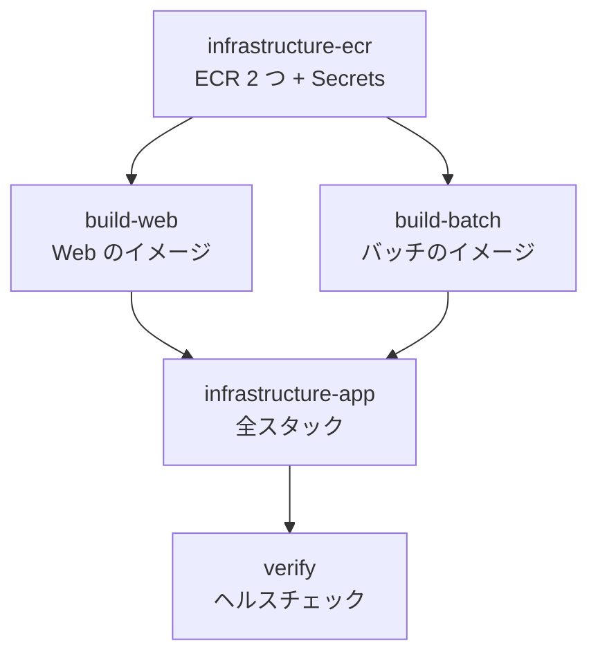

---
sources:
  - infra/stock-tracker/bin/stock-tracker.ts
  - infra/stock-tracker/lib/cloudfront-stack.ts
  - .github/workflows/stock-tracker-deploy.yml
sources_hash: 2defc7a24e603ad0165246108ae67b12f0130cdcbb1d1bc969070ee87d783691
---

# Stock Tracker のデプロイ先

Stock Tracker は、Web アプリ (Lambda の Function URL を CloudFront で配信) と、EventBridge のルールで定期的に起動するバッチ Lambda を AWS に載せる。dev と prod の両方にデプロイする。

## ホスト名

| 環境 | ホスト名 |
|---|---|
| dev | `stock-tracker.dev.nagiyu.com` |
| prod | `stock-tracker.nagiyu.com` |

DNS レコードは、dev は CloudFront の基底スタックが、prod は shared の CNAME が作る。詳しくは [DNS レコードの作り方](../../../platform/specs/deploy.md#dns-レコードの作り方) を参照。

## スタック

`infra/stock-tracker/bin/stock-tracker.ts` が、次の順に作る。環境は CDK の context `env` (既定は `dev`) で決まり、`{Env}` は `Dev` または `Prod`。

| 順 | スタック | 役割 | 含むリソース |
|---|---|---|---|
| 1 | `NagiyuStockTrackerSecrets{Env}` | シークレット | Secrets Manager のシークレット |
| 2 | `NagiyuStockTrackerWebECR{Env}` | Web アプリのイメージの置き場 | ECR リポジトリ |
| 3 | `NagiyuStockTrackerBatchECR{Env}` | バッチのイメージの置き場 | ECR リポジトリ |
| 4 | `NagiyuStockTrackerDynamoDB{Env}` | データの保存 | DynamoDB テーブル |
| 5 | `NagiyuStockTrackerSNS{Env}` | アラームの通知先 | SNS トピック |
| 6 | `NagiyuStockTrackerLambda{Env}` | Web アプリとバッチの実行 | Lambda (Web は Function URL つき) |
| 7 | `NagiyuStockTrackerCloudFront{Env}` | Web アプリの配信 | CloudFront、Route53 の ALIAS (dev のみ) |
| 8 | `NagiyuStockTrackerEventBridge{Env}` | バッチの起動 | EventBridge のルール |
| 9 | `NagiyuStockTrackerAlarms{Env}` | 監視 | CloudWatch アラーム |

CloudFront のスタックは `us-east-1` に固定する (CloudFront の制約)。ほかのスタックのリージョンは、環境変数 `CDK_DEFAULT_REGION` で、未設定なら `us-east-1`。

## デプロイの流れ

`.github/workflows/stock-tracker-deploy.yml` が行う。

| 項目 | 内容 |
|---|---|
| トリガー | develop・`integration/**`・master への push (`services/stock-tracker/**`、`infra/stock-tracker/**`、`infra/common/**`、`infra/tsconfig.json`、`libs/**`、`configs/**`、`package.json`、`package-lock.json`、`.node-version`、このワークフローと、使う composite action・それが呼ぶスクリプトが変わったとき)。手動実行 (dev か prod を選ぶ) |
| デプロイ先の環境 | [dev と prod の切り替え](../../../platform/specs/deploy.md#dev-と-prod-の切り替え) の規則 |
| 並行実行 | 環境ごとに直列化する。実行中の run は止めず、待機中は最新だけ残す |
| イメージのタグ | コミットの SHA |

| ジョブ | 内容 |
|---|---|
| `infrastructure-ecr` | `NagiyuStockTrackerWebECR{Env}`、`NagiyuStockTrackerBatchECR{Env}`、`NagiyuStockTrackerSecrets{Env}` をデプロイする |
| `build-web` | Web アプリをビルドし、イメージを ECR に push する |
| `build-batch` | バッチのイメージを ECR に push する (`infrastructure-ecr` の後、`build-web` と並行) |
| `infrastructure-app` | Secrets Manager の値を取り出し、全スタックをデプロイする (`--all`)。ワークフローは `--exclude` で 2 つの ECR のスタックを除くつもりで渡しているが、CDK CLI は `--exclude` を受け付けず無視するため、ECR のスタックも含めた全スタックが対象になる |
| `verify` | CloudFront のスタックの出力からディストリビューションのドメイン名を取り出し、そのドメインでヘルスチェックを行う ([ヘルスチェック](../../../platform/specs/deploy.md#ヘルスチェック)) |

CloudFront のキャッシュ削除は行わない。
