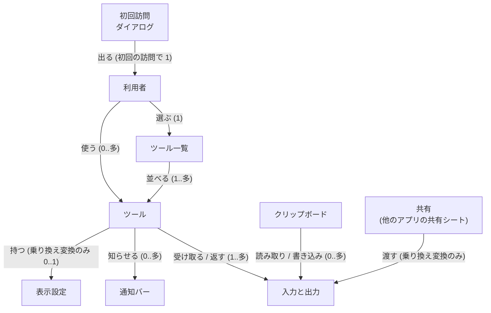

# ドメインモデル

利用者が、ツールの一覧から使いたいツールを選び、入力を変換して、結果をクリップボードへ写すまでに扱う概念。

## 概念

| 概念 | 意味 |
|---|---|
| 利用者 | Tools を使う人。ログインしない |
| ツール | 1 つの変換や生成を行う独立したページ。乗り換え変換、JSON 整形、Base64、URL、ハッシュ、タイムスタンプ、VAPID キー生成がある |
| ツール一覧 | ツールをカードで並べ、選んだツールへ移る入口 ([ツール一覧](functional/tool-list.md)) |
| 入力と出力 | ツールが受け取る文字列と、変換して返す文字列。ブラウザの中だけにあり、サーバーへ送らない (VAPID キーの出力を除く) |
| クリップボード | 端末の貼り付け先。入力を読み取り、出力を書き込む ([共通の操作](functional/common-actions.md)、[クリップボード操作](../specs/term/clipboard-actions.md)) |
| 通知バー | 操作の結果を一時的に知らせる帯 ([通知バー](../specs/term/snackbar.md)) |
| 表示設定 | 乗り換え変換ツールで、出力に含める項目の選択。ブラウザに保存する ([乗り換え変換ツール](functional/transit-converter.md)) |
| 共有 | 他のアプリの共有シートから、乗り換え案内を Tools へ渡すこと ([乗り換え変換ツール](functional/transit-converter.md)) |
| 初回訪問ダイアログ | 初めて訪れた利用者へ、旧バージョンからの移行を案内するもの ([初回訪問ダイアログ](functional/migration-dialog.md)) |
| VAPID キー | Web Push の送信元を示す公開鍵と秘密鍵のペア ([VAPID キー](../specs/term/vapid-key.md)) |

## 関係

- ツールは互いに独立していて、あるツールの出力を別のツールへ引き継ぐことはない
- 入力と出力は保存しない。保存するのは、乗り換え変換ツールの表示設定と、初回訪問ダイアログを見せたかどうかだけで、どちらもブラウザの中にある
