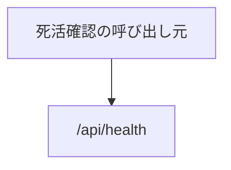

---
sources:
  - services/tools/src/app/api/health/route.ts
sources_hash: b1a088aa8889b75d4feecad512f5406427107ffb1fae1ed8fb73cffd9a4130bf
---

# システム系の API

業務の機能ではない API。死活確認だけがある。

## エンドポイント

| メソッド | パス | 権限 |
|---|---|---|
| GET | `/api/health` | なし |

## 入力と出力

- [ヘルスチェックのルート](../../../../platform/specs/lib/nextjs/health-route.md)で、`service` は `tools`。`version` は環境変数 `APP_VERSION`、なければ `1.0.0` ([Web の実行環境](../resource/web-runtime.md))
- 入力はない。サーバーが応答できるかだけを示す

## エラー

- ここで返すエラーを決めていない

## つながり

