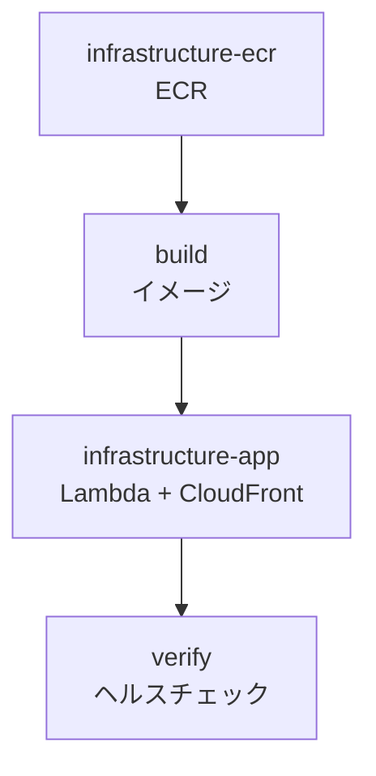

---
sources:
  - infra/tools/bin/tools.ts
  - infra/tools/lib/cloudfront-stack.ts
  - .github/workflows/tools-deploy.yml
sources_hash: 3a65c69d374b87b5b327928b8f438c39e0bc7a52d3caeeba915cb256a5249928
---

# Tools のデプロイ先

Tools は、Web アプリ (Lambda の Function URL を CloudFront で配信) を AWS に載せる。dev と prod の両方にデプロイする。

## ホスト名

| 環境 | ホスト名 |
|---|---|
| dev | `tools.dev.nagiyu.com` |
| prod | `tools.nagiyu.com` |

DNS レコードは、dev は CloudFront の基底スタックが、prod は shared の CNAME が作る。詳しくは [DNS レコードの作り方](../../../platform/specs/deploy.md#dns-レコードの作り方) を参照。

## スタック

`infra/tools/bin/tools.ts` が、次の順に作る。環境は CDK の context `env` (既定は `dev`) で決まり、`{Env}` は `Dev` または `Prod`。

| 順 | スタック | 役割 | 含むリソース |
|---|---|---|---|
| 1 | `NagiyuToolsEcr{Env}` | イメージの置き場 | ECR リポジトリ |
| 2 | `NagiyuToolsLambda{Env}` | Web アプリの実行 | Lambda (Function URL つき) |
| 3 | `NagiyuToolsCloudFront{Env}` | Web アプリの配信 | CloudFront、Route53 の ALIAS (dev のみ) |

CloudFront のスタックは `us-east-1` に固定する (CloudFront の制約)。ほかのスタックのリージョンは、環境変数 `CDK_DEFAULT_REGION` で、未設定なら `us-east-1`。

## デプロイの流れ

`.github/workflows/tools-deploy.yml` が行う。

| 項目 | 内容 |
|---|---|
| トリガー | develop・`integration/**`・master への push (`services/tools/**`、`infra/tools/**`、`infra/common/**`、`infra/tsconfig.json`、`libs/**`、`configs/**`、`package.json`、`package-lock.json`、`.node-version`、このワークフローと、使う composite action・それが呼ぶスクリプトが変わったとき)。手動実行 (dev か prod を選ぶ) |
| デプロイ先の環境 | [dev と prod の切り替え](../../../platform/specs/deploy.md#dev-と-prod-の切り替え) の規則 |
| 並行実行 | 環境ごとに直列化する。実行中の run は止めず、待機中は最新だけ残す |
| イメージのタグ | コミットの SHA |

| ジョブ | 内容 |
|---|---|
| `infrastructure-ecr` | `NagiyuToolsEcr{Env}` をデプロイする |
| `build` | Web アプリをビルドし、イメージを ECR に push する |
| `infrastructure-app` | `NagiyuToolsLambda{Env}` と `NagiyuToolsCloudFront{Env}` をデプロイする |
| `verify` | CloudFront のスタックの出力からディストリビューションのドメイン名を取り出し、そのドメインでヘルスチェックを行う ([ヘルスチェック](../../../platform/specs/deploy.md#ヘルスチェック)) |

CloudFront のキャッシュ削除は行わない。
