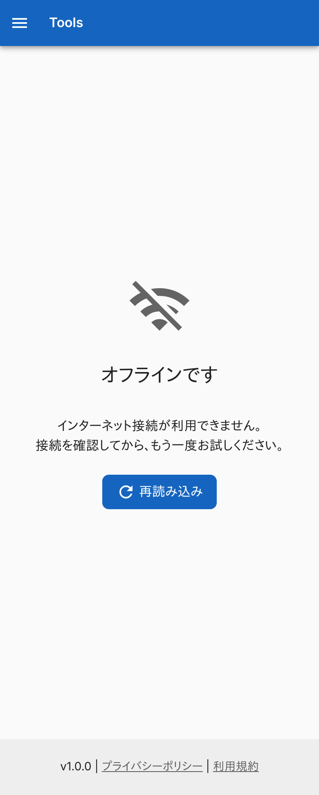
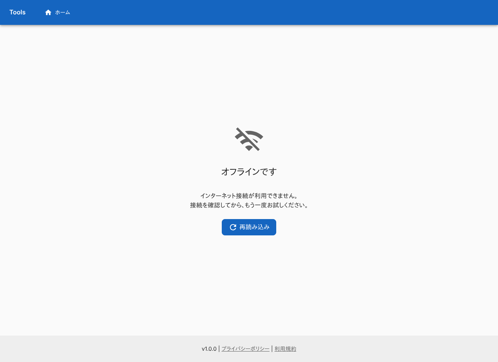
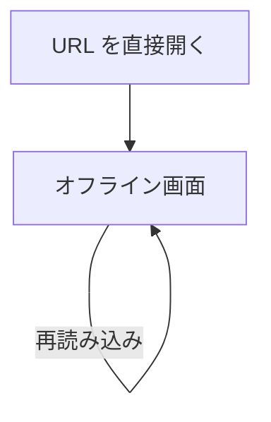

---
sources:
  - services/tools/src/app/offline/page.tsx
sources_hash: 8193952d1dab6fcd1e314b594854d9d4dc0f06502c3e359f221922aa3b441d76
---

# オフライン画面

接続が使えないことを知らせ、再読み込みを促す画面。ログインは要らない。

## 入口

- パスは `/offline`
- 接続が切れたときにこの画面へ切り替わることはない。Service Worker を登録するコードがなく、ページのキャッシュもないため、オフラインで開く経路がない。ほかの画面からのリンクもなく、URL を直接開いたときだけ見える (オフライン対応は未実装)

## 表示の条件

- 初回の訪問では、[初回訪問ダイアログ](../term/migration-dialog.md)が前面に出て、閉じるまでこの画面は操作できない

## 表示するもの

| 部分 | 内容 |
|---|---|
| アイコン | 電波が切れたことを示すアイコン |
| 見出し | 「オフラインです」 |
| 説明 | 「インターネット接続が利用できません。」「接続を確認してから、もう一度お試しください。」 |
| 再読み込み | ボタン |

ヘッダーとフッターは、ほかの画面と同じものが付く。

## 操作

| 操作 | 結果 |
|---|---|
| 「再読み込み」 | ブラウザで今のページ (`/offline`) を読み込み直す。直前に使っていたツールの画面へは戻らない |

API は呼ばない。

## 画面の見た目

### 通常表示

見出しと再読み込みのボタンだけが出る。

| スマホ | PC |
|---|---|
|  |  |

## つながり

