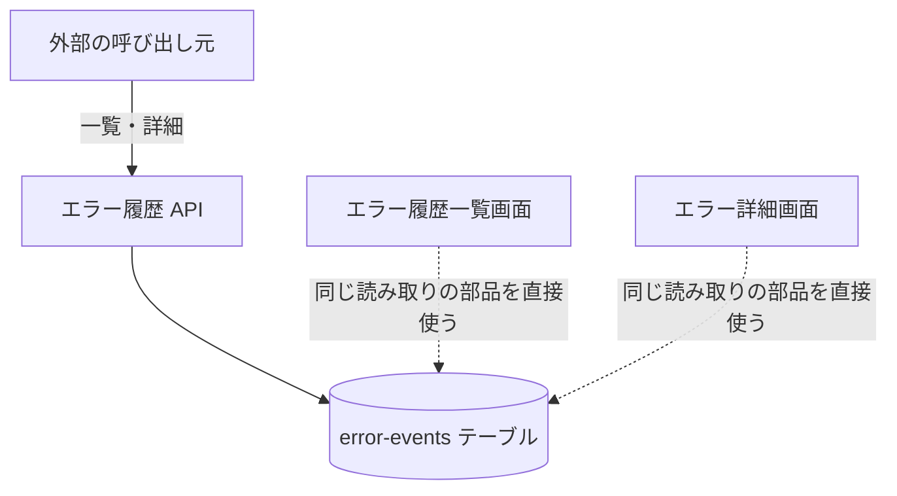

# エラー履歴 API

error-events テーブルに保存された [ErrorEvent](../../platform/term/error-event.md) の一覧と、1 件の取得。読み取り専用で、書き込みと削除はない。

## エンドポイント

| メソッド | パス | 権限 |
|---|---|---|
| GET | `/api/errors` | `errors:read` |
| GET | `/api/errors/{eventId}` | `errors:read` |

## 入力と出力

一覧 (`GET /api/errors`) の問い合わせ。

| 項目 | 条件 |
|---|---|
| `serviceId` | 任意。指定すると、そのサービスの履歴だけを返す。空なら指定なし |
| `from`、`to` | 任意。ISO 8601 で読める日時。その時刻を含む範囲に絞る。`from` が `to` より後ならエラー |
| `limit` | 任意。1〜100、省略すると 50 |
| `lastKey` | 任意。前のページの応答でもらった `pagination.lastKey` をそのまま渡す |

- 発生時刻の新しい順に返す。同じ時刻のものは並びキー (`OCCURRED#{ISO 8601}#{eventId}`) の降順
- 出力は `{ items, pagination: { count, lastKey? } }`。`items` は ErrorEvent (`eventId`、`serviceId`、`source`、`severity`、`title`、`message`、`context`、`occurredAt`)。`context` は JSON の文字列で、`occurredAt` は epoch ミリ秒
- `lastKey` は、`limit` 件に達したときに付く。ちょうど `limit` 件で終わるときも付くことがあり、その次のページは空になる
- 保存されている項目が読めない (必須の項目がない、`source` や `severity` が許可外) と、そのページの取得全体が 500 になる

詳細 (`GET /api/errors/{eventId}`) の問い合わせ。

| 項目 | 条件 |
|---|---|
| `at` | 必須。発生時刻。epoch ミリ秒か ISO 8601 ([エラー詳細のキー](../term/error-event-key.md)) |
| `serviceId` | 必須 |

- 3 つ組で 1 件を引き、ErrorEvent をそのまま返す

## エラー

| 条件 | 状態 | `error` |
|---|---|---|
| 未ログイン | 401 | `UNAUTHORIZED` |
| 権限がない | 403 | `FORBIDDEN` |
| `from` か `to` が日時として読めない (空文字を含む) | 400 | `INVALID_REQUEST` |
| `from` が `to` より後 | 400 | `INVALID_REQUEST` |
| `limit` が数字として読めない、または 1〜100 の範囲外 | 400 | `INVALID_REQUEST` (本文は「limit は 1 から 100 の間で指定してください」) |
| `lastKey` が読めない | 400 | `INVALID_REQUEST` |
| 詳細で `at` が読めない、`serviceId` がない | 400 | `INVALID_REQUEST` |
| 詳細で該当の履歴がない (期限切れで消えたものを含む) | 404 | `NOT_FOUND` |
| 取得の失敗 (テーブル名の環境変数がない、保存データが読めないなど) | 500 | `INTERNAL_ERROR` |

- 500 の本文は、一覧が「エラー履歴の取得に失敗しました」、詳細が「エラー詳細の取得に失敗しました」。形は[API のエラー応答](../term/api-error.md)
- `limit` は先頭の数字を読むので、`10abc` は 10 として通る

## つながり

