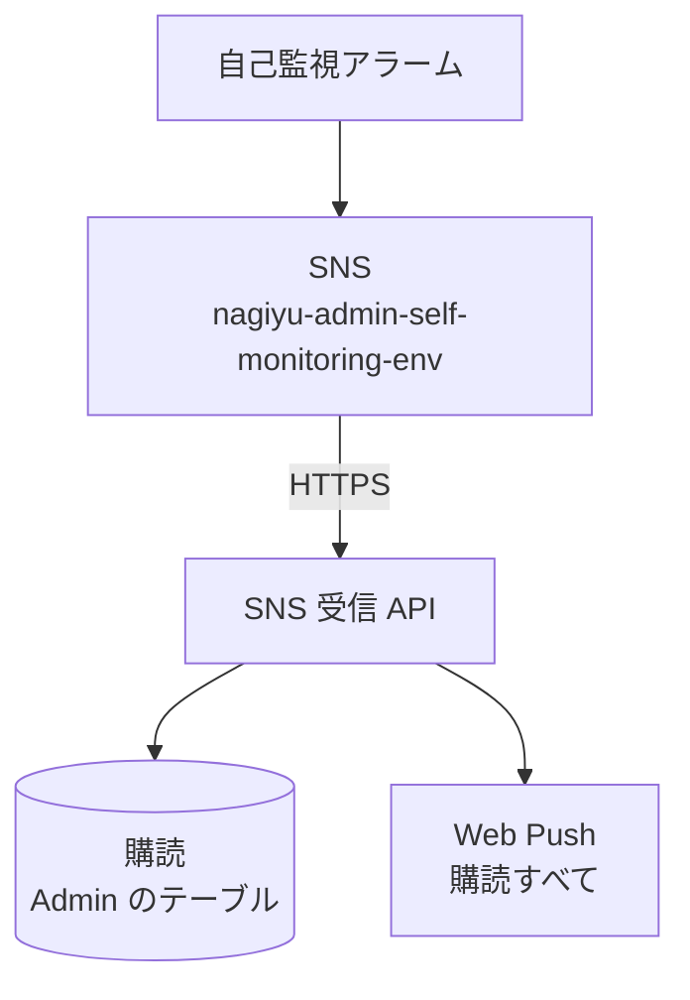

# SNS 受信 API

エラー通知の仕組み自身の障害を知らせる、自己監視の SNS トピックからのメッセージを受け、[購読](../term/push-subscription.md)すべてに Web Push を送る。履歴には残さない。経路の全体は[エラー通知の経路](../flow/error-notification.md)にある。

## エンドポイント

| メソッド | パス | 権限 |
|---|---|---|
| POST | `/api/notify/sns` | なし。ログインは要らず、SNS の署名と送信元のトピックで受け付けるかを決める |

## 入力と出力

- 入力は SNS が HTTPS で送るメッセージ (JSON のオブジェクト)。`Type` は `SubscriptionConfirmation`、`Notification`、`UnsubscribeConfirmation` のいずれか
- 受け付ける順に判定する
    1. 本文が JSON のオブジェクトであること
    2. SNS の署名が正しいこと
    3. 送信元のトピック (`TopicArn`) が、環境変数 `SNS_ALLOWED_TOPIC_ARN` と同じであること。環境変数が空でも拒否する
- `SubscriptionConfirmation` は、`SubscribeURL` が AWS SNS の確認用 URL のときだけ取得して 200 を返す。確認用 URL の条件は、`https`、ホストが `sns.{リージョン}.amazonaws.com`、ポート・ユーザー情報なし。取得ではリダイレクトを許さない
- `UnsubscribeConfirmation` は、何もせず 200 を返す
- `Notification` は、保存されている購読すべてに Web Push を送り、200 で `{ success: true, sent, invalid, failed }` を返す。件数の意味は[購読](../term/push-subscription.md)にある
    - CloudWatch Alarm のメッセージ (`AlarmName`・`NewStateValue`・`NewStateReason` がそろう) なら、題名が `{AlarmName} ({NewStateValue})`、本文が `NewStateReason`
    - それ以外は、題名が SNS の `Subject` (空なら「CloudWatch Alarm 通知」)、本文が `Message` (空なら「アラーム通知を受信しました」)
    - 通知をタップすると、`/dashboard` が開く

## エラー

| 条件 | 状態 | `error` |
|---|---|---|
| 本文が JSON のオブジェクトでない | 400 | `INVALID_REQUEST` |
| `SubscribeURL` が AWS SNS の確認用 URL でない | 400 | `INVALID_REQUEST` |
| 署名の検証に失敗、または `Type` がない | 401 | `UNAUTHORIZED` |
| `SNS_ALLOWED_TOPIC_ARN` がない、またはトピックが違う | 403 | `FORBIDDEN` |
| 確認用 URL の取得の失敗、購読の読み込みや送信の準備の失敗 (テーブル名・VAPID 鍵の不足など) | 500 | `INTERNAL_ERROR` |

- 形は[API のエラー応答](../term/api-error.md)。ただしこの API の 500 は、履歴へ報告しない。報告すると、監視対象の仕組みに依存してしまい、SNS の再送で重複もするため
- 送信先の購読が無効だった分は、送信の中で購読を削除する。購読の削除に失敗しても、応答は成功のまま

## つながり

