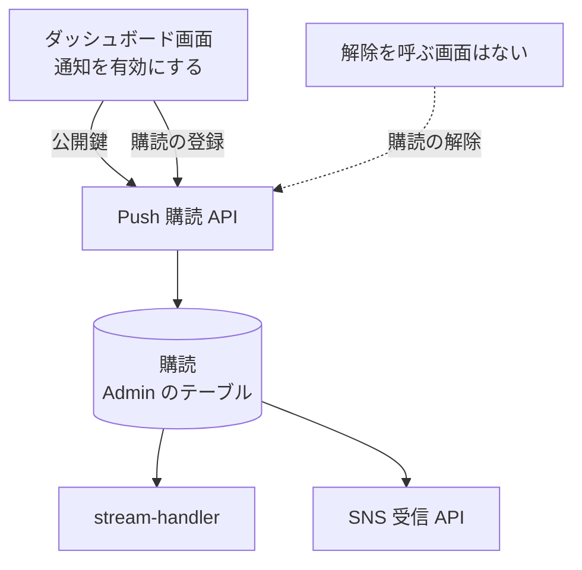

# Push 購読 API

管理者のブラウザが Web Push を受け取るための、[購読](../term/push-subscription.md)の登録と解除、VAPID 公開鍵の取得。

## エンドポイント

| メソッド | パス | 権限 |
|---|---|---|
| GET | `/api/notify/vapid-key` | なし (ログイン不要) |
| POST | `/api/notify/subscribe` | `notifications:write` |
| DELETE | `/api/notify/subscribe` | `notifications:write` |

## 入力と出力

- 公開鍵の取得は `{ publicKey }` を返す。値は環境変数 `VAPID_PUBLIC_KEY`。ブラウザが購読を作るときに使う
- 登録 (POST) の入力は購読そのもの。`{ subscription: ... }` で包まず、`endpoint` と `keys` をそのまま本文に置く
    - 検証は、`endpoint` が URL として読めることと、`keys.p256dh`・`keys.auth` が空でない文字列であること
    - 通ると、セッションの利用者 ID を付けて保存し、200 で `{ success: true, subscriptionId }` を返す。同じ `endpoint` はすでにあれば上書きで、件数は増えない
- 解除 (DELETE) の入力は `{ endpoint }` (空でない文字列)。その `endpoint` の購読をすべて消し、200 で `{ success: true, deletedCount }` を返す。該当がなければ `deletedCount` は 0 で、エラーにはならない
- 登録も解除も、購読は利用者に関係なく全体で 1 つの集まりとして扱う。解除は、登録した利用者かどうかを確かめない

## エラー

| 条件 | 状態 | `error` |
|---|---|---|
| 未ログイン | 401 | `UNAUTHORIZED` |
| `notifications:write` がない | 403 | `FORBIDDEN` |
| 本文が JSON のオブジェクトでない | 400 | `INVALID_REQUEST` (「リクエストボディが不正です」) |
| 登録で購読の形が不正 | 400 | `INVALID_REQUEST` (「サブスクリプション情報が不正です」) |
| 解除で `endpoint` がない、空 | 400 | `INVALID_REQUEST` (「リクエストボディが不正です」) |
| 保存・削除の失敗 (テーブル名の環境変数がないなど) | 500 | `INTERNAL_ERROR` (「サブスクリプション処理に失敗しました」) |
| 公開鍵が未設定 (公開鍵の取得) | 500 | `INTERNAL_ERROR` (「VAPID公開鍵が設定されていません」) |

- 権限の判定は、登録と解除で同じ。形は[API のエラー応答](../term/api-error.md)
- 公開鍵の取得の失敗は、Admin 自身の履歴へ報告する (題名は「Web API: VAPID 公開鍵取得エラー」)

## つながり

