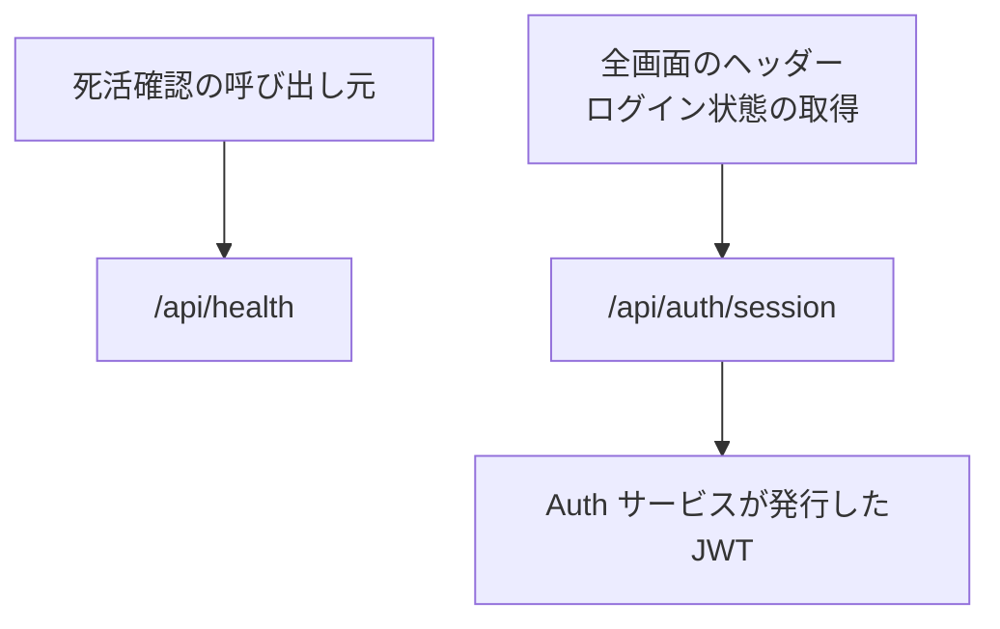

# システム系の API

業務の機能ではない 2 つの API。死活確認と、画面が使う認証セッション。

## エンドポイント

| メソッド | パス | 権限 |
|---|---|---|
| GET | `/api/health` | なし |
| GET | `/api/auth/*` (画面が使うのは `/api/auth/session`) | なし (ログインの状態を返す) |

## 入力と出力

- 死活確認は `{ status: 'ok', service: 'admin', version, timestamp }` を返す。`version` は環境変数 `APP_VERSION`、なければ `1.0.0`
- 認証は next-auth の GET だけを公開する。POST は公開しない (サインアウトは Auth サービスの URL へ遷移する)。Admin には認証の提供元 (プロバイダー) がなく、Auth サービスが発行した JWT を検証するだけ
- 環境変数 `SKIP_AUTH_CHECK` が `true` のテスト用の設定では、`/api/auth/session` が認証せずにテスト用のセッションを返す
    - ロールは、リクエストヘッダ `x-test-user-roles` (`,` 区切り)、環境変数 `TEST_USER_ROLES`、既定の `admin` の順で決まる
    - サーバー側のセッションの取得も同じ順で決まるので、画面の中でロールの見え方が食い違わない

## エラー

- どちらも、ここで返すエラーを決めていない
- `/api` 以外の画面は、未ログインだと Auth サービスのサインイン画面 (`/signin`) へリダイレクトされる。`/api` はこのリダイレクトの対象外で、各 API が自分で 401 を返す。`SKIP_AUTH_CHECK` が `true` のときは、画面もリダイレクトしない
- サインイン画面の場所は、環境変数 `NEXT_PUBLIC_AUTH_URL`、なければ `NEXTAUTH_URL`。どちらもなければ、設定の誤りとして 500 を返す

## つながり

