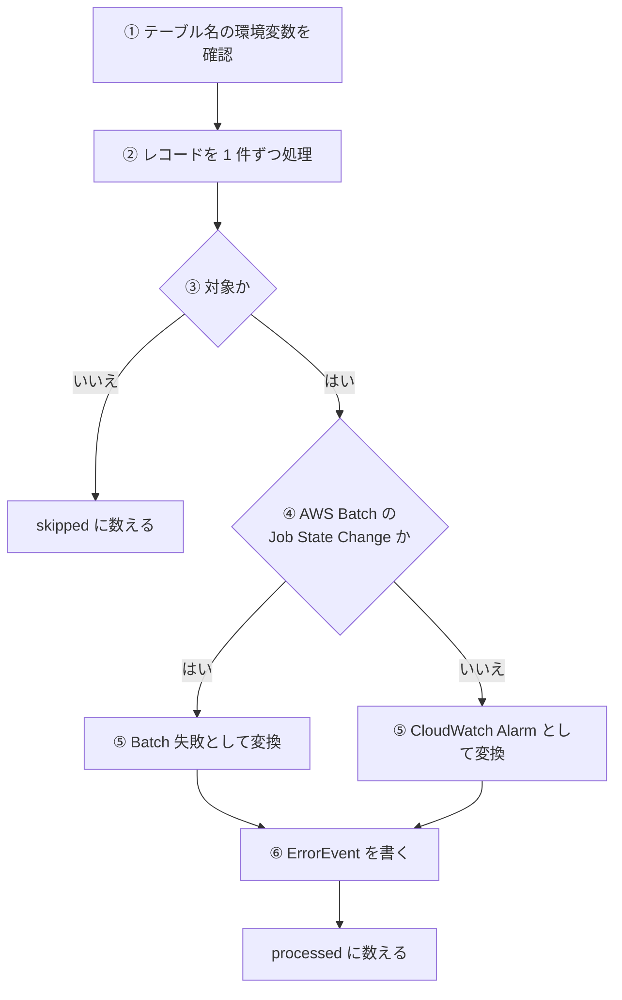
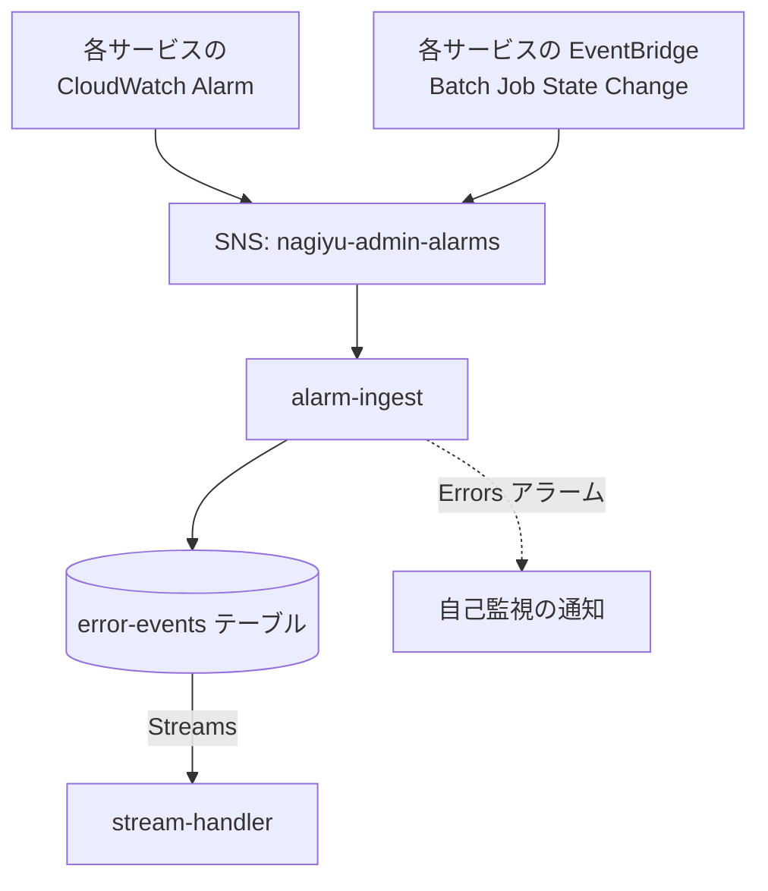

# alarm-ingest

SNS で届いた CloudWatch Alarm と AWS Batch ジョブ失敗の通知を、[ErrorEvent](../../platform/term/error-event.md) に変えて error-events テーブルに書く Lambda。書いたあとの通知は[stream-handler](./stream-handler.md)が受け持つ。

## 起点

- SNS トピック `nagiyu-admin-alarms-{env}` へのメッセージの発行 (Lambda の SNS サブスクリプション)。スケジュールはない
- 発行するのは、各サービスの CloudWatch Alarm のアクションと、AWS Batch の `Batch Job State Change` を流す EventBridge のルール。トピックは、同じアカウントからの発行と EventBridge からの発行を許している
- Lambda は `nagiyu-admin-alarm-ingest-{env}` (コンテナイメージ)、メモリ 256 MB、タイムアウト 30 秒
- 書き込み先のテーブル名 (`ERROR_EVENTS_TABLE_NAME`) は、Lambda を作る共通部品が環境変数と書き込み権限を付ける

## 対象から外れる条件

| 条件 | 外れる範囲 |
|---|---|
| レコードの `EventSource` が `aws:sns` でない | そのレコード |
| SNS の `Type` が `Notification` でない | そのレコード |
| メッセージ本文が JSON として読めない | そのレコード |
| AWS Batch のイベントで、ジョブの状態が `FAILED` でない | そのレコード |
| CloudWatch Alarm で、新しい状態 (`NewStateValue`) が `ALARM` でない (`OK`、`INSUFFICIENT_DATA`)、または `AlarmName` がない | そのレコード |

## 処理

届いたレコードを順に処理する。

変換の規則。

| 項目 | CloudWatch Alarm | AWS Batch ジョブ失敗 |
|---|---|---|
| `source` | `cloudwatch-alarm` | `batch-event` |
| `severity` | `error` | `critical` |
| `serviceId` | アラーム名から決める | ジョブ名から決める |
| `title` | `{AlarmName} ({NewStateValue})` | `AWS Batch ジョブ失敗: {jobName}` (ジョブ名がなければ「AWS Batch ジョブ失敗」) |
| `message` | `NewStateReason` (なければ空) | `statusReason` (なければ空) |
| `occurredAt` | `StateChangeTime` (なければ SNS の `Timestamp`) | イベントの `time` (なければ SNS の `Timestamp`) |

- `eventId` は書くたびに UUID を新しく作る。`context` は SNS のメッセージ本文をそのまま入れる
- `serviceId` は、名前を `-` で分け (空の要素は除く)、2 つ以上あれば先頭の 2 つを `-` でつなぐ。1 つならその 1 つ、何もなければ `unknown`。例: `livetalk-batch-acquire-errors-dev` は `livetalk-batch`
- 戻り値は `{ processed, skipped }`

## 失敗したとき

- テーブル名の環境変数がなければ、レコードを読む前に例外を投げる
- 書き込みに失敗したときは、例外を投げて Lambda を失敗にする。それより前に書けたレコードは残り、あとのレコードは処理されない。時刻が日時として読めない通知も、書き込みの検証で例外になる
- 同じ通知が再配信されると、`eventId` が別なので、同じ内容が 2 件書かれる。重複は取り除かない
- この Lambda の失敗は、アプリの報告の骨格を通らないので、Admin の履歴には報告されない。Lambda の Errors アラーム (`admin-alarm-ingest-errors-{env}`、5 分間に 1 件以上) が自己監視のトピックに送り、[SNS 受信 API](../api/notify-sns.md) から Web Push になる
- 再試行の設定は、コードでは指定していない

## つながり

