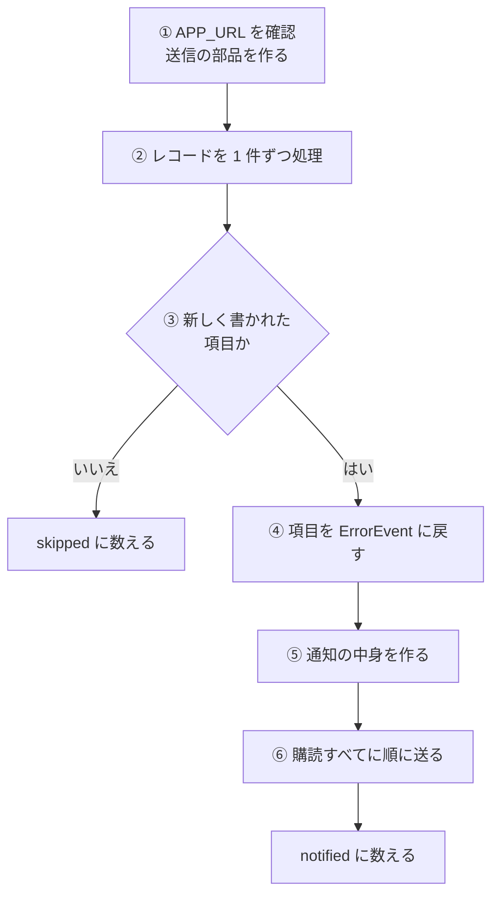
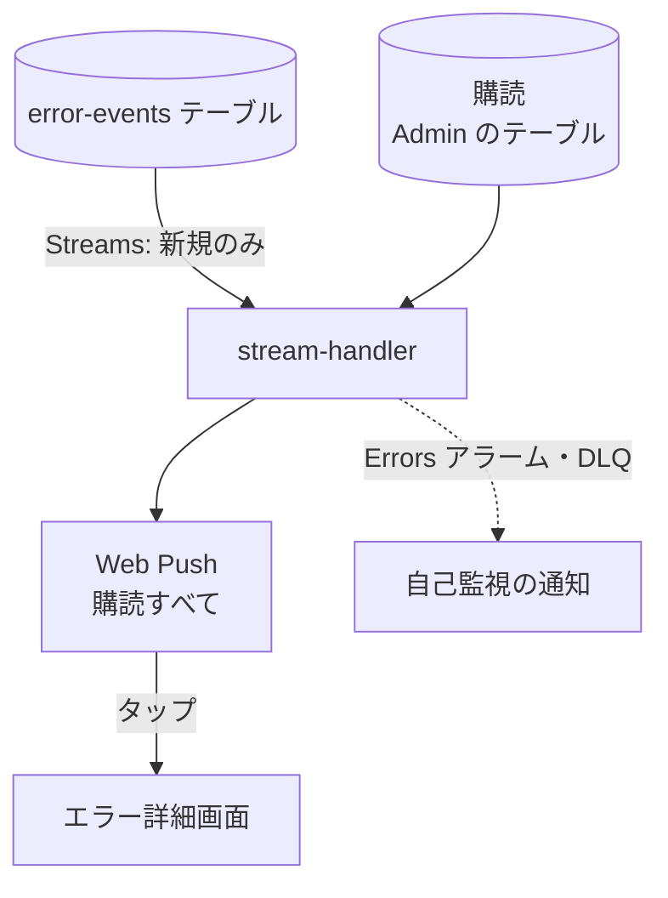

# stream-handler

error-events テーブルに新しく書かれた [ErrorEvent](../../platform/term/error-event.md) ごとに、Web Push を [購読](../term/push-subscription.md)すべてに送る Lambda。通知をタップすると、そのエラーの詳細画面が開く。

## 起点

- error-events テーブルの DynamoDB Streams (イベントソース)。スケジュールはない
    - 受け取りの単位は最大 100 件、または 5 秒の窓
    - 読み始めは最新の位置 (`LATEST`)。再試行は 2 回で、失敗したバッチは二分割して再試行する
- Lambda は `nagiyu-admin-stream-handler-{env}` (コンテナイメージ)、メモリ 256 MB、タイムアウト 30 秒
- 環境変数は `APP_URL` (Admin 自身の URL)、`DYNAMODB_TABLE_NAME` (Admin のテーブル)、VAPID 鍵。この関数は error-events に書かないので、書き込みの環境変数と権限は付けない
- 関数に SQS の DLQ (`nagiyu-admin-stream-handler-dlq-{env}`、保持 14 日) を付けている

## 対象から外れる条件

| 条件 | 外れる範囲 |
|---|---|
| レコードの種類が `INSERT` でない (更新、削除) | そのレコード |
| `INSERT` でも、新しい項目の内容 (`NewImage`) がない | そのレコード |

## 処理

| 段 | 内容 |
|---|---|
| ① | `APP_URL` がなければ例外。VAPID 鍵が空でも、送信の部品を作る時点で例外 |
| ④ | 必須の項目がない、`source` や `severity` が許可外のときは例外にする (読み飛ばすと、通知が出ないまま気づけないため) |
| ⑤ | 題名は `title`、本文は `message` (空なら「エラー通知を受信しました」)、アイコンは `/icon-192x192.png` |
| ⑥ | 通知の `data.url` は `{APP_URL}/errors/{eventId}?at={発生時刻のミリ秒}&serviceId={serviceId}` ([エラー詳細のキー](../term/error-event-key.md))。購読がなければ何も送らない |

- 無効 (404、410) と分かった購読は、送ったあとに削除する。それ以外の送信の失敗は、警告ログに残して次の購読へ進む
- `notified` は、通知の中身を作って送りに行った件数で、購読が 0 件でも数える
- 戻り値は `{ notified, skipped }`

## 失敗したとき

- 例外を投げると、バッチ全体が失敗になり、Streams が再試行する。先に送った分の通知は取り消せないので、再試行で同じ通知が重ねて届くことがある。Streams は少なくとも 1 回の配信なので、再試行がなくても、まれに重なる
- 関数に DLQ を付けているが、再試行を使い切ったレコードの送り先 (`onFailure`) は設定していない
- Lambda の Errors (5 分間に 1 件以上) と DLQ の滞留は、自己監視アラームが別のトピックに送り、[SNS 受信 API](../api/notify-sns.md) から Web Push になる
- この Lambda の失敗は、Admin の履歴には報告されない

## つながり

