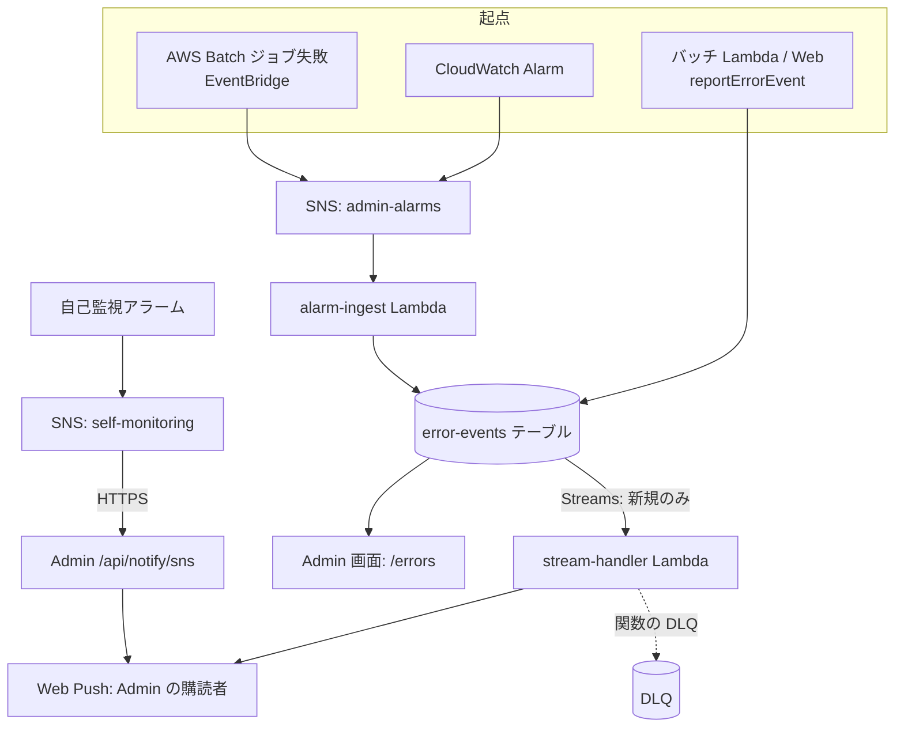

# エラー通知の経路

バッチやサービスで失敗が起きてから、Admin の画面と Web Push に届くまでの流れ。[ErrorEvent](../../platform/term/error-event.md) を共有のテーブルに集め、そこから通知を出す。

## 起点

失敗の集め方は 3 通りある。

| 経路 | 仕組み | source / severity |
|---|---|---|
| アプリの報告 | バッチ Lambda の共通の骨格 (`createScheduledHandler`) が、例外を受けて自分で報告する。Web の API ルートも、同様に例外を報告する | `application` / `error` |
| CloudWatch Alarm | サービスの infra が定義したアラームが ALARM になる | `cloudwatch-alarm` / `error` |
| AWS Batch のジョブ失敗 | EventBridge が失敗を検知して、同じ SNS に流す。サービス側の infra が検知のルールを持つ | `batch-event` / `critical` |

- バッチ Lambda の報告は、例外の種類で題名を変えられる。部分失敗は `ScheduledHandlerError` を投げ、題名と失敗した対象の ID を指定する。報告は 1 回で、骨格が元の例外を再送出する
- 骨格は、報告のあとに元の例外を再送出して Lambda を失敗にする。これにより Lambda の Errors メトリクスが増え、アラームと DLQ が働く
- 報告に使うテーブル名は、Lambda を作る共通部品が環境変数と書き込み権限を付ける

## 経路

1. **書き込み**: error-events テーブル (`nagiyu-error-events-{env}`) に、1 件ずつ書く
    - アプリの報告: Lambda や Web が、直接書く
    - アラームと Batch の失敗: 本流の SNS トピック (`nagiyu-admin-alarms-{env}`) から alarm-ingest が受け、書く。ALARM への遷移だけを書き、OK や INSUFFICIENT_DATA は捨てる。Batch のジョブ状態は、失敗したものだけを書く
    - serviceId は、アラーム名・ジョブ名の先頭 2 つの区切り (`-` で分ける) をつなげて決める。例: アラーム `livetalk-batch-acquire-errors-dev` は `livetalk-batch`。アプリの報告は、バッチ自身が指定した ID (livetalk など) を使う
2. **保存**: テーブルは 180 日で自動削除し、DynamoDB Streams (新しい項目の内容を流す) を有効にしている
3. **通知**: stream-handler が Streams を受ける。新しく書かれた項目だけを対象にし、更新と削除は無視する
    - 受け取りの単位は最大 100 件、または 5 秒の窓
    - 失敗したときは 2 回まで再試行する。バッチは二分割して再試行する
4. **送信**: Admin に登録された Web Push の購読すべてに送る。無効になった購読 (404、410) は削除する
    - 題名は ErrorEvent の title、本文は message (空なら固定の文)
    - タップすると、`/errors/{eventId}?at={発生時刻}&serviceId={serviceId}` の詳細画面が開く

## 届く先

- **Web Push**: Admin の購読者全員
- **Admin の画面**: `/errors` で、期間 (24 時間、7 日、30 日、指定なし) とサービスを絞った一覧を見られる。`/errors/{eventId}` が詳細。見るには `errors:read` 権限が要る

## 失敗・取りこぼしのとき

- 報告の書き込みに失敗しても、例外は伝えず、ログだけ残す。アプリの本処理は止めない。テーブル名の環境変数がないときも、報告できずログだけ残る
- 同じ失敗が 2 件届くことがある。アプリの報告と、Lambda の Errors アラーム (5 分間に 1 件以上で発火) が、別の serviceId で記録されるため。アラームは次のとおり
    - livetalk のバッチ Lambda 4 本 (活動時間学習、通知、集約、勉強) の Errors
    - livetalk の活動時間学習と通知の DLQ の滞留。集約と勉強の DLQ にはアラームがない
- プロセスが即死してアプリが報告できない失敗 (タイムアウトなど) は、アラームか Batch のイベントの経路が拾う
- Streams は少なくとも 1 回の配信で、まれに同じ通知が 2 通届く
- stream-handler の関数には DLQ を付けているが、Streams の再試行を使い切ったレコードの送り先 (onFailure) は設定していない
- Admin に購読がなければ、Push は送られない。テーブルと画面には残る
- 通知の仕組み自身の障害は、別の SNS トピック (`nagiyu-admin-self-monitoring-{env}`) で知らせる。alarm-ingest と stream-handler の Errors、stream-handler の DLQ の滞留、テーブルの SystemErrors と ThrottledRequests が対象。このトピックは Admin の `/api/notify/sns` に HTTPS で送り、そこから Push を出す。記録は残さない。受け付けるのはこのトピックからのメッセージだけ

## 図

