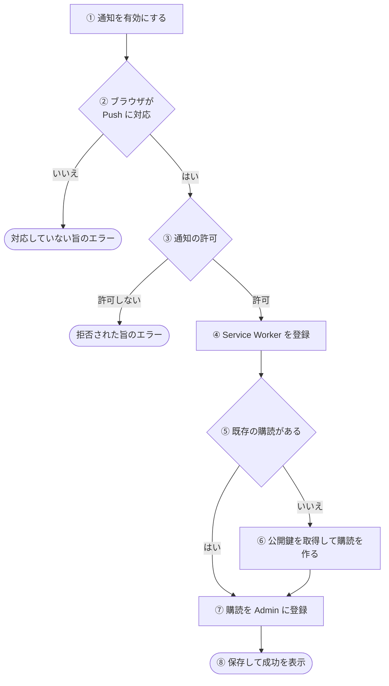
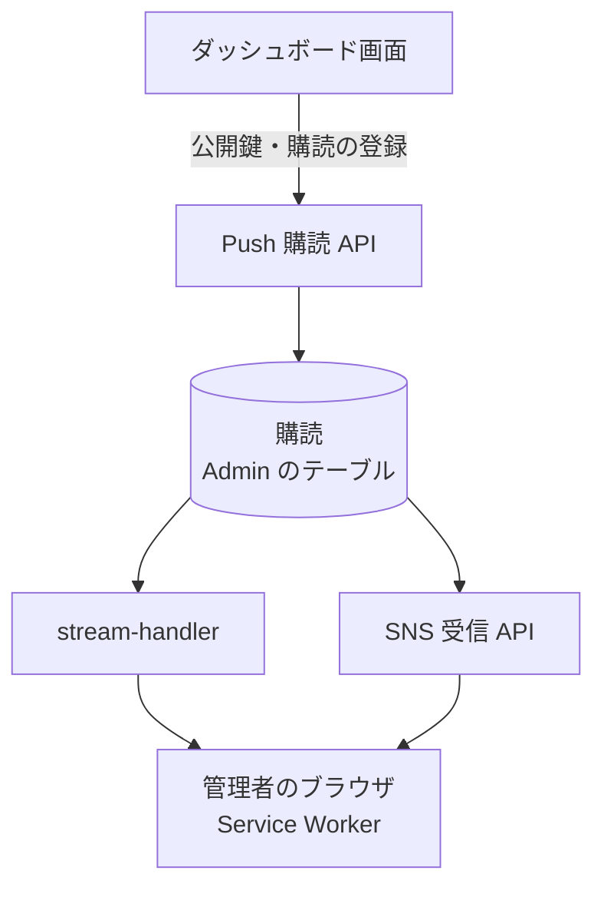

# Push 購読の経路

管理者のブラウザが [Web Push の購読](../term/push-subscription.md)を作って Admin に登録し、通知を受け取れるようになるまでの流れ。通知を出す側は[エラー通知の経路](./error-notification.md)にある。

## 起点

- 管理者が、ダッシュボードの「通知設定」カードの「通知を有効にする」を押す。カードは `notifications:write` を持つ利用者にだけ出る ([権限とロール](../term/permission.md))
- 購読の解除を呼ぶ画面はない。API だけがある ([Push 購読 API](../api/notify.md))

## 経路

| 段 | 内容 |
|---|---|
| ② | 通知、Service Worker、Push の 3 つの API がそろっていれば対応とみなす |
| ③ | ブラウザの許可ダイアログを出す。許可されなければ「通知が拒否されました。ブラウザ設定から通知を許可してください」 |
| ④ | `/sw-push.js` を登録する。すでに登録があれば再利用し、有効になるのを待つ |
| ⑥ | `/api/notify/vapid-key` で公開鍵を取り、ブラウザに購読を作らせる (利用者に見える通知のみ) |
| ⑦ | 既存の購読があっても、毎回サーバーへ登録し直す。購読は `endpoint` と鍵だけを本文に置く |
| ⑧ | 「通知を有効化しました」を出す。保存は、同じ `endpoint` なら上書き |

- 通知が届いたときは、Service Worker が題名・本文・アイコンで通知を出す。タップすると、通知の `data.url` を開く
    - URL が相対のパス (SNS 受信 API の通知の `/dashboard`) で、同じパスのタブがあれば、そのタブを前面に出す
    - エラー通知の URL は絶対 URL なので、同じパスのタブがあっても、毎回新しく開く
- 通知の中身が JSON として読めなければ、題名は「Admin 通知」のまま、本文に受け取った文字列を出す。中身がなければ、題名「Admin 通知」、本文「エラー通知を受信しました」

## 届く先

- 購読は Admin 自身のテーブルに保存され、通知を出すときに全件が読まれる
    - 本流のエラー通知は [stream-handler](../batch/stream-handler.md)
    - 自己監視の通知は [SNS 受信 API](../api/notify-sns.md)

## 失敗・取りこぼしのとき

- ブラウザが対応していない、許可されない、または登録 API が失敗したときは、画面にエラー (「通知を有効にする」の下) を出す
- 登録 API は、権限がなくて 403 のときも、500 のときも、画面には「サブスクリプションの登録に失敗しました」を出す。ブラウザ側の購読は残るので、もう一度押すと、その購読で登録し直す
- 送信のときに無効 (404、410) と分かった購読は、その場で削除される。ブラウザ側が購読を取り消しても、サーバーには次の送信まで残る
- 購読が 1 件もなければ、通知は送られない

## つながり

