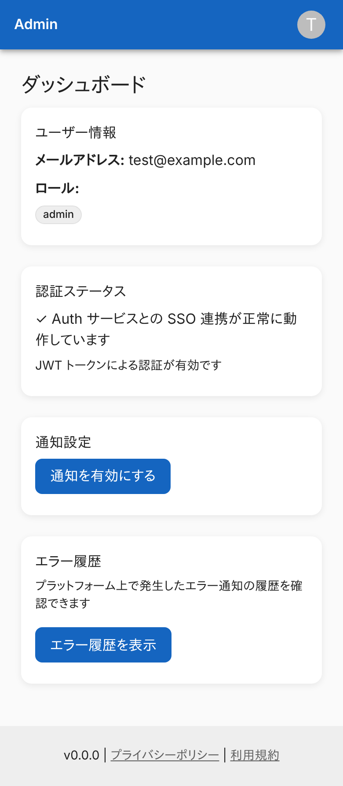
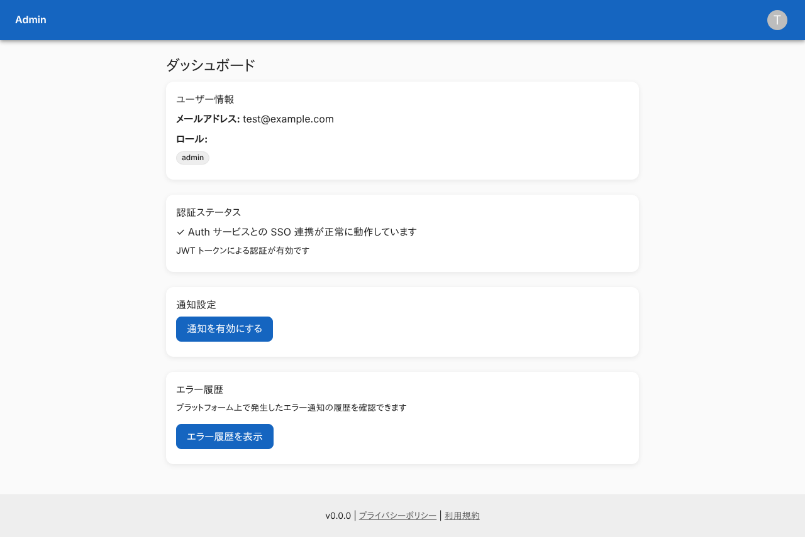
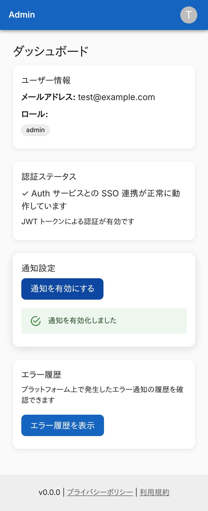
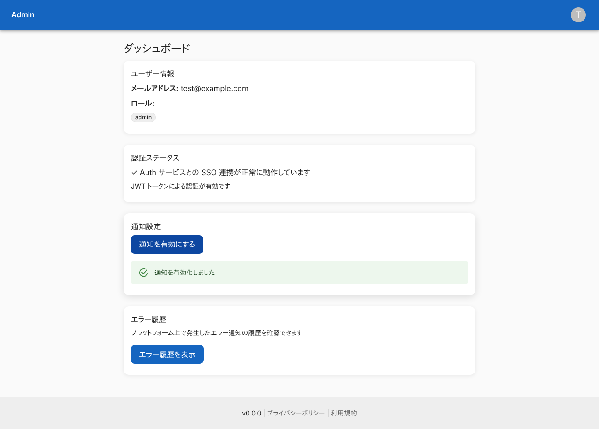
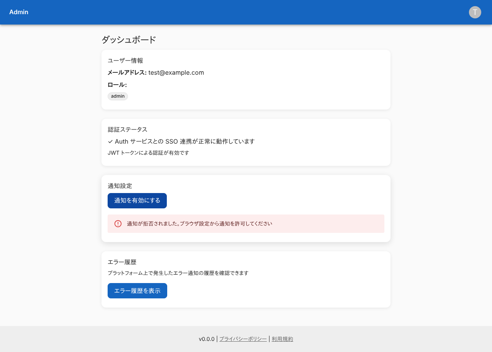
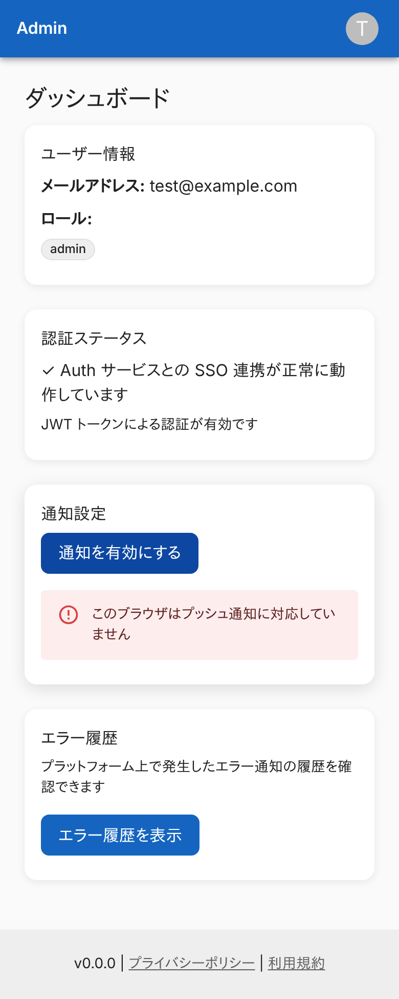
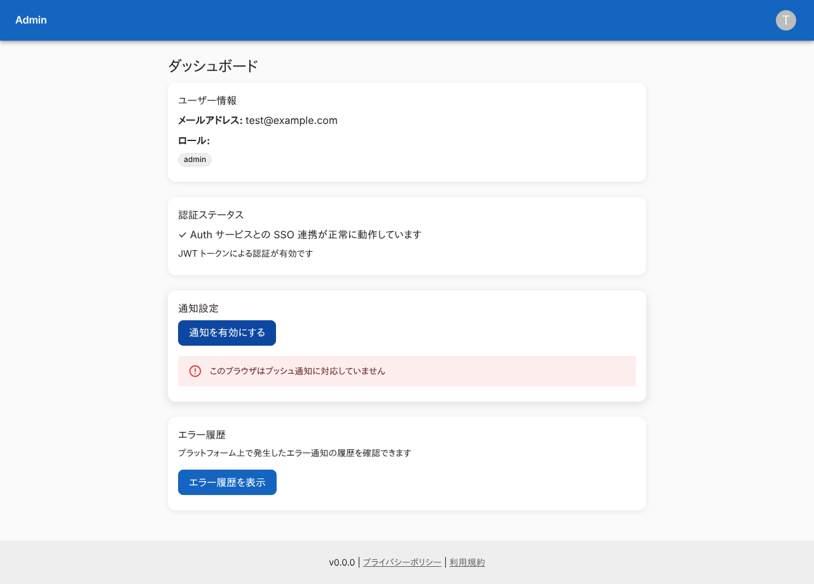
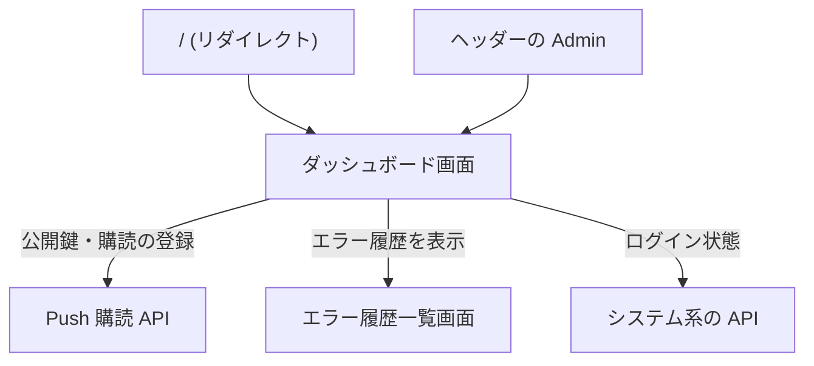

# ダッシュボード画面

ログインしている利用者の情報を見て、通知の有効化とエラー履歴への入口を使う、Admin の最初の画面。

## 入口

- パスは `/dashboard`。`/` を開くと、ここへリダイレクトする
- ヘッダーの「Admin」(ホームに戻るリンク) から来る
- 未ログインのときは、Auth サービスのサインイン画面 (`/signin`) へリダイレクトされ、ログイン後に戻る ([システム系の API](../api/system.md))

## 表示の条件

- ログインしていれば、権限がなくても開ける
- カードは権限で出し分ける ([権限とロール](../term/permission.md))
    - 「通知設定」は `notifications:write` を持つときだけ
    - 「エラー履歴」は `errors:read` を持つときだけ

## 表示するもの

| カード | 内容 | 出る条件 |
|---|---|---|
| ユーザー情報 | メールアドレスと、持っているロールの一覧 (ロールごとのバッジ) | 常に |
| 認証ステータス | 「✓ Auth サービスとの SSO 連携が正常に動作しています」と「JWT トークンによる認証が有効です」。固定の文言で、実際の状態は確かめていない | 常に |
| 通知設定 | 「通知を有効にする」ボタン | `notifications:write` |
| エラー履歴 | 説明と、「エラー履歴を表示」のリンク | `errors:read` |

- ヘッダーは「Admin」のタイトルとアカウントメニュー (ログアウト)。フッターはバージョン (環境変数 `APP_VERSION`、なければ `1.0.0`)、プライバシーポリシー、利用規約

## 状態

- 「通知を有効にする」を押している間は、ボタンに読み込みの表示を出す
- 結果は、ボタンの下に出す
    - 成功は「通知を有効化しました」(成功の表示)
    - 失敗は、エラーの表示。文言は、ブラウザが対応していないなら「このブラウザはプッシュ通知に対応していません」、拒否されたなら「通知が拒否されました。ブラウザ設定から通知を許可してください」、登録 API の失敗なら「サブスクリプションの登録に失敗しました」。理由が分からない失敗は「通知設定中にエラーが発生しました」
- 押すたびに、前の結果は消える。有効にしたあとも、ボタンは「通知を有効にする」のままで、購読済みの表示や解除の操作はない

## 操作

| 操作 | 結果 |
|---|---|
| 通知を有効にする | ブラウザの許可を求め、公開鍵と購読の登録に [Push 購読 API](../api/notify.md) を使う。流れは[Push 購読の経路](../flow/push-subscription.md) |
| エラー履歴を表示 | [エラー履歴一覧画面](./errors.md) (`/errors`) を開く |

## 画面の見た目

### 通常表示

`admin` ロール。ユーザー情報、認証ステータス、通知設定、エラー履歴の 4 つのカードが出る。

| スマホ | PC |
|---|---|
|  |  |

### 通知・履歴の権限がないロール (`user-manager`)

ユーザー情報と認証ステータスだけが出る。

| スマホ | PC |
|---|---|
|  |  |

### 通知を有効にできたとき

「通知を有効化しました」を緑で出す。

| スマホ | PC |
|---|---|
|  |  |

### ブラウザで通知を拒否したとき

拒否された旨のエラーを出す。

| スマホ | PC |
|---|---|
|  |  |

### ブラウザが Push に対応していないとき

対応していない旨のエラーを出す。

| スマホ | PC |
|---|---|
|  |  |

### 購読の登録 API が失敗したとき

「サブスクリプションの登録に失敗しました」を出す。

| スマホ | PC |
|---|---|
|  |  |

## つながり

