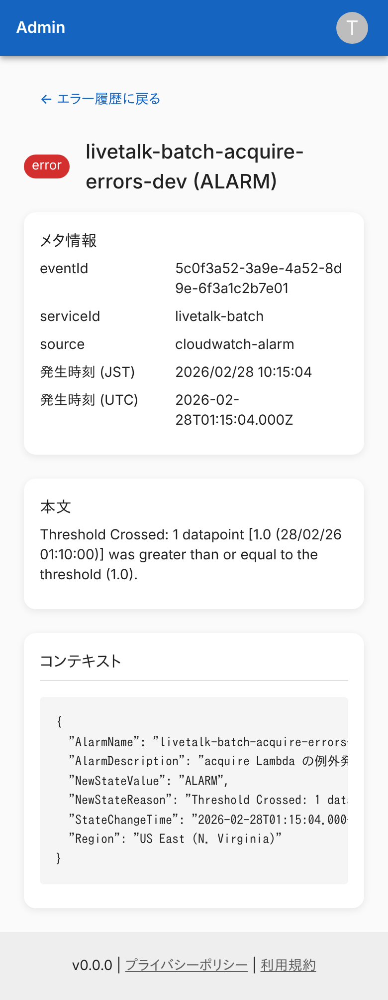
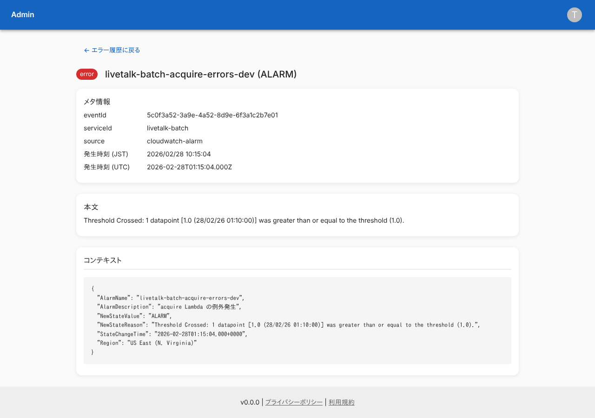
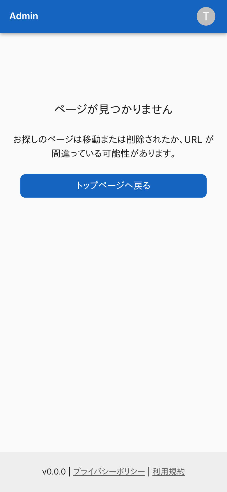
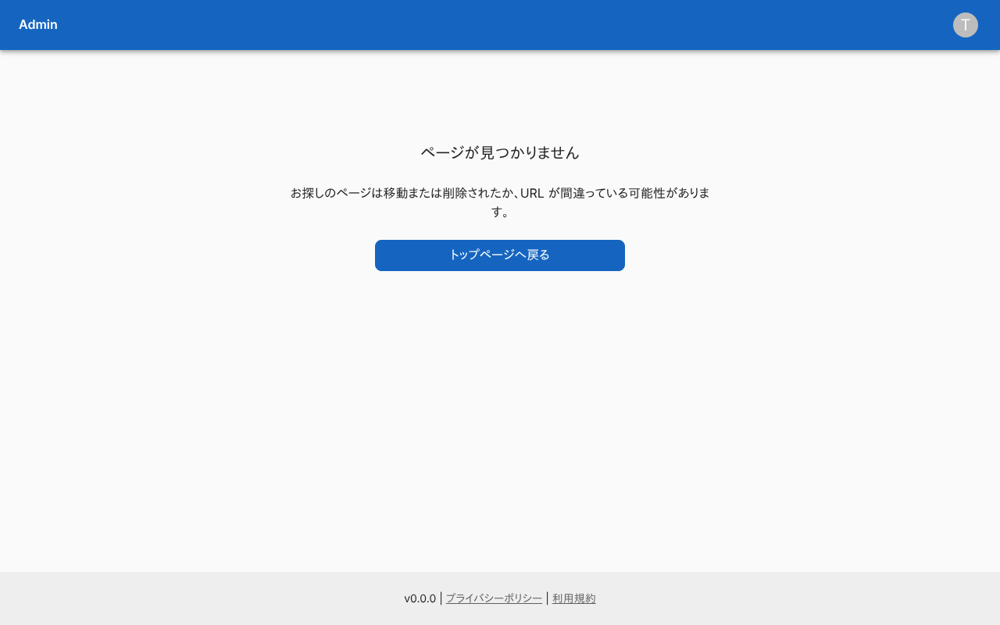
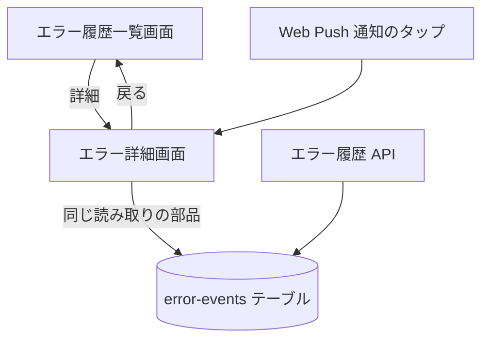

# エラー詳細画面

[エラーイベント](../../platform/term/error-event.md) 1 件の、メタ情報・本文・コンテキストを見る。

## 入口

- パスは `/errors/{eventId}`。問い合わせに `at` (発生時刻) と `serviceId` が要る ([エラー詳細のキー](../term/error-event-key.md))
- 一覧の「詳細」と、エラーの Web Push 通知のタップから来る ([stream-handler](../batch/stream-handler.md))

## 表示の条件

- `errors:read` を持つ利用者だけ。権限がなければ「アクセス権限がありません」を出し、履歴は読まない ([権限とロール](../term/permission.md))
- `at` が読めない (数字でも ISO 8601 でもない)、または `serviceId` がないときは、履歴を読まずに「ページが見つかりません」を出す

## 表示するもの

| 部分 | 内容 |
|---|---|
| 見出し | 重大度のバッジと、タイトル |
| メタ情報 | `eventId`、`serviceId`、`source` (`application` など)、発生時刻 (JST。秒まで)、発生時刻 (UTC。ISO 8601) |
| 本文 | メッセージ。改行はそのまま出し、長い文は折り返す |
| コンテキスト | JSON として読めれば、2 スペースで整形して出す。読めなければ、文字列のまま出す |

- 重大度の色は一覧と同じ (`info` は青、`warning` は橙、`error` と `critical` は赤)
- 上に「← エラー履歴に戻る」がある

## 状態

- 該当の履歴がないとき (期限の 180 日を過ぎて消えたものを含む) は、「ページが見つかりません」を出す
- 履歴の読み込みが失敗したとき (保存された項目が読めない、テーブル名の環境変数がないなど) は、共通のエラー画面「エラーが発生しました」を出す

## 操作

| 操作 | 結果 |
|---|---|
| エラー履歴に戻る | [エラー履歴一覧画面](./errors.md)を開く。絞り込みは引き継がない |

- 画面は [エラー履歴 API](../api/errors.md) を呼ばず、API と同じ読み取りの部品をサーバーで直接使う

## 画面の見た目

### 通常表示

CloudWatch Alarm 由来の例。コンテキストは JSON を整形して出す。

| スマホ | PC |
|---|---|
|  |  |

### 指定した履歴がないとき

「ページが見つかりません」を出す。リンクの `at` や `serviceId` が足りないときも同じ。

| スマホ | PC |
|---|---|
|  |  |

### 権限がないとき (`user-manager`)

「アクセス権限がありません」を出し、履歴は読まない。

| スマホ | PC |
|---|---|
|  |  |

## つながり

