# エラー履歴一覧画面

プラットフォーム上で起きた[エラーイベント](../../platform/term/error-event.md)を、新しい順に一覧する。サービスと期間で絞り込み、行から詳細へ進む。

## 入口

- パスは `/errors`
- ダッシュボードの「エラー履歴を表示」と、詳細画面の「← エラー履歴に戻る」から来る
- 問い合わせの `serviceId`、`period`、`cursor` で、絞り込みとページを決められる

## 表示の条件

- `errors:read` を持つ利用者だけ。権限がなければ、一覧を読まずに「アクセス権限がありません」を出す ([権限とロール](../term/permission.md))。画面には「アクセスを更新」と「再ログイン」のボタンが付く (Auth サービスへ遷移する)

## 表示するもの

| 部分 | 内容 |
|---|---|
| 絞り込み | サービス ID (文字列。完全一致)、期間 (直近 24 時間・直近 7 日・直近 30 日・指定なし)、「絞り込み」ボタン |
| 一覧 | 列は発生時刻 (JST。秒まで)、サービス、重大度、タイトルと概要、「詳細」のリンク |
| 次のページ | 続きがあるときに、一覧の下に出すボタン |

- 期間の初期値は直近 24 時間。`period` が 4 つの値 (`24h`、`7d`、`30d`、`all`) のどれでもなければ、直近 24 時間として扱う。期間は、画面を開いた (サーバーが描画した) 時刻から数える。「指定なし」は期間で絞らない
- 一覧は発生時刻の新しい順で、1 ページ 50 件。総件数は出さない
- 重大度は色分けする (`info` は青、`warning` は橙、`error` と `critical` は赤)
- 概要は、本文を 80 文字までで切り、超えると `…` を付ける。タイトルは太字
- 「次のページ」は、`serviceId`、`period`、続きの位置 (`cursor`) を引き継ぐ。ちょうど 50 件で終わるときも出ることがあり、その次のページは空になる
- 「絞り込み」は、フォームの内容で `/errors` を開き直す。`cursor` は引き継がず、1 ページ目に戻る
- 画面の下に「← ダッシュボードへ戻る」がある

## 状態

- 0 件のときは「エラー履歴がありません」。期間や `serviceId` の絞り込みで 0 件のときも同じ
- 読み込みはサーバーで済ませてから描画するので、読み込み中の表示はない
- 履歴の読み込みが失敗したとき (保存された項目が読めない、テーブル名の環境変数がない、`cursor` が読めないなど) は、共通のエラー画面「エラーが発生しました」を出す。「もう一度試す」と「トップページへ戻る」のボタンが付く

## 操作

| 操作 | 結果 |
|---|---|
| 絞り込み | サービス ID と期間を問い合わせに付けて、`/errors` を開き直す |
| 詳細 | [エラー詳細画面](./error-detail.md)を開く。リンクは `eventId`、発生時刻、`serviceId` を持つ ([エラー詳細のキー](../term/error-event-key.md)) |
| 次のページ | 続きの位置を付けて `/errors` を開く。前のページに戻るボタンはない |
| ダッシュボードへ戻る | [ダッシュボード画面](./dashboard.md)を開く |

- 画面は [エラー履歴 API](../api/errors.md) を呼ばず、API と同じ読み取りの部品をサーバーで直接使う

## 画面の見た目

### 既定の期間 (直近 24 時間) に履歴がないとき

「エラー履歴がありません」を出す。絞り込みで 0 件のときも同じ文言になる。

| スマホ | PC |
|---|---|
| 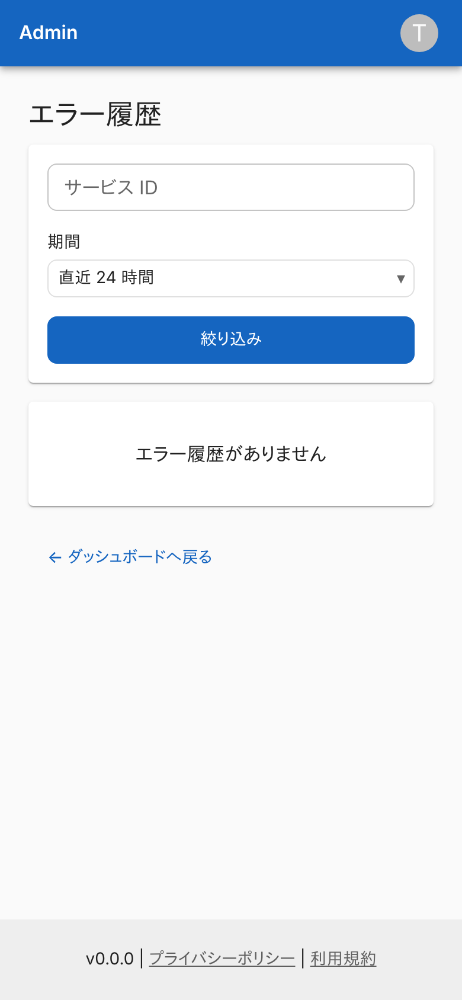 | 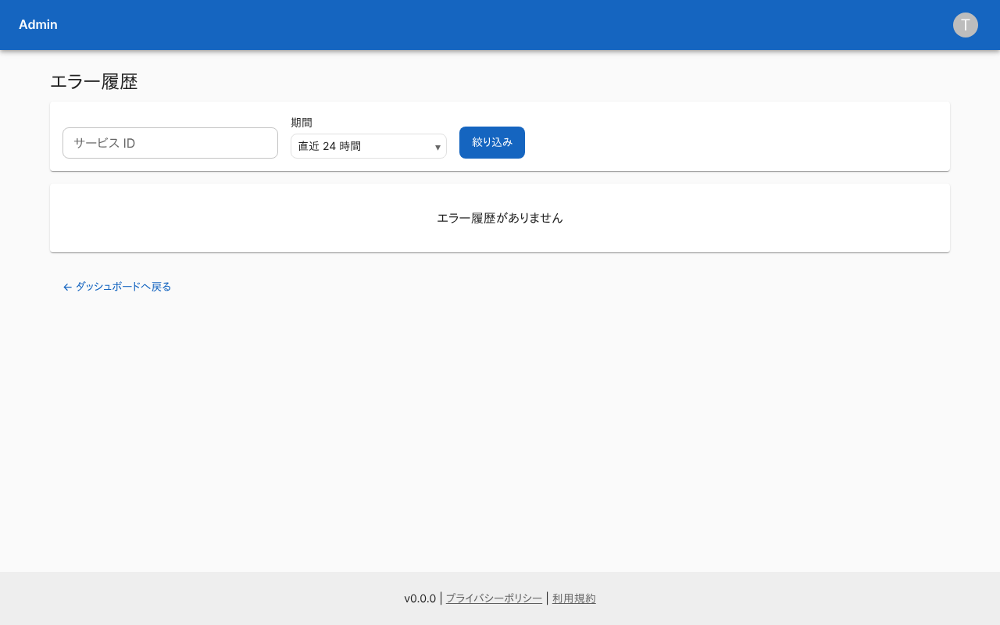 |

### 通常表示

期間を「指定なし」にした例。重大度、発生元のサービス、題名と概要が並ぶ。

| スマホ | PC |
|---|---|
| 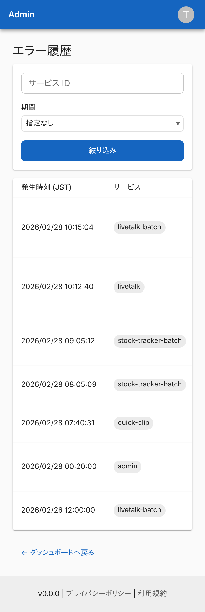 | 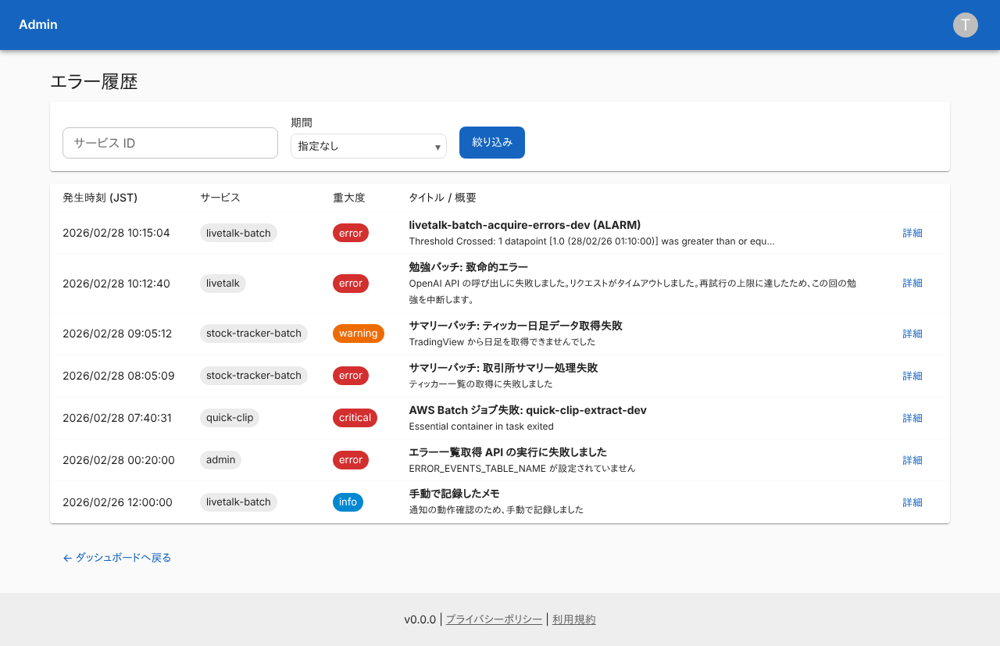 |

### サービス ID で絞り込んだとき

`livetalk-batch` だけを出す。

| スマホ | PC |
|---|---|
| 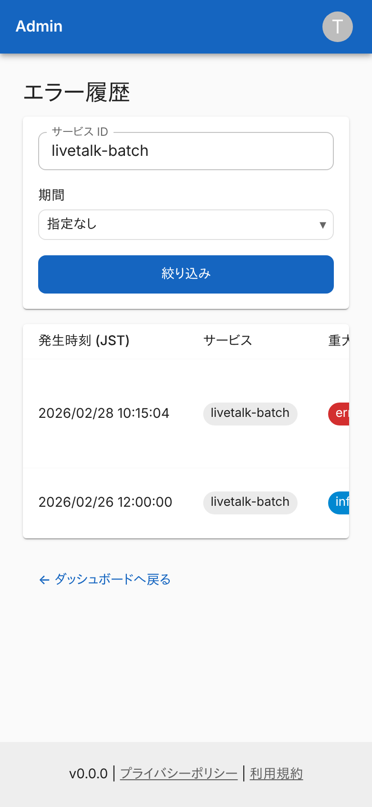 | 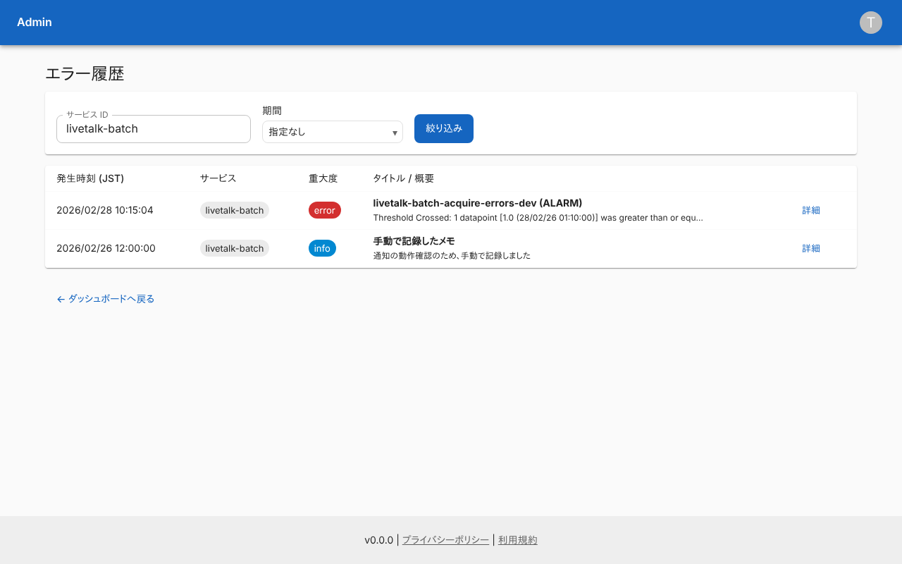 |

### 履歴が 1 ページに収まらないとき

50 件を超える履歴の末尾。一覧の下に「次のページ」を出す。

| スマホ | PC |
|---|---|
| 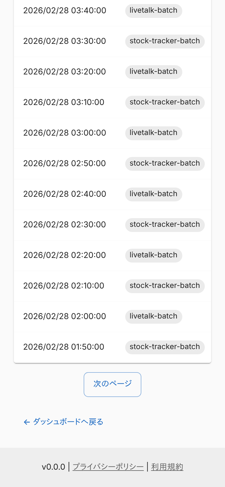 | 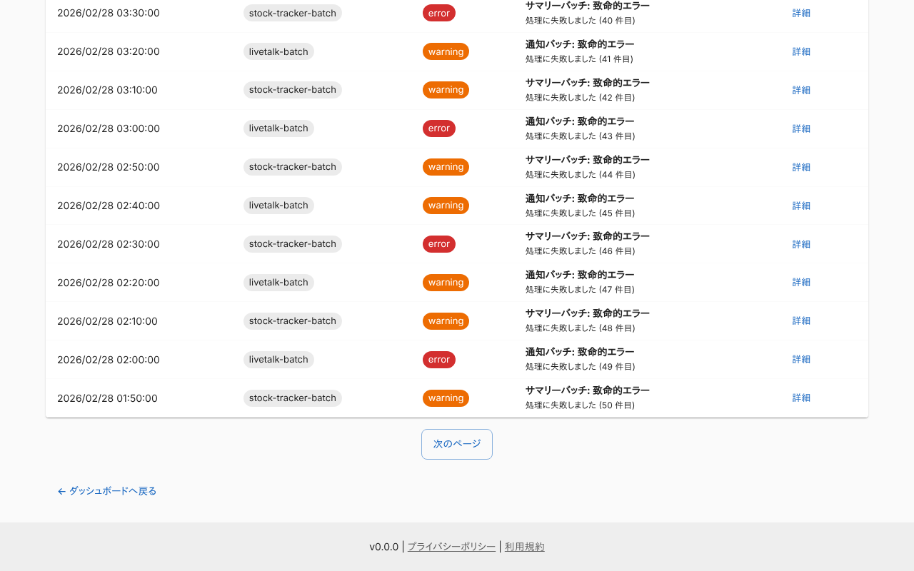 |

### 権限がないとき (`user-manager`)

「アクセス権限がありません」を出し、一覧は読まない。

| スマホ | PC |
|---|---|
|  |  |

### 履歴の読み込みが失敗したとき

保存された項目が読めないときの例。共通のエラー画面を出す。

| スマホ | PC |
|---|---|
| 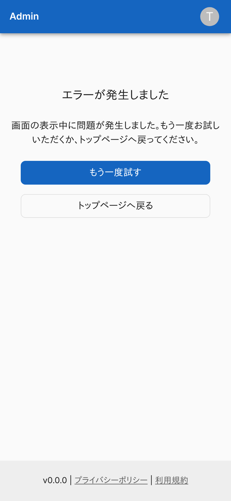 | 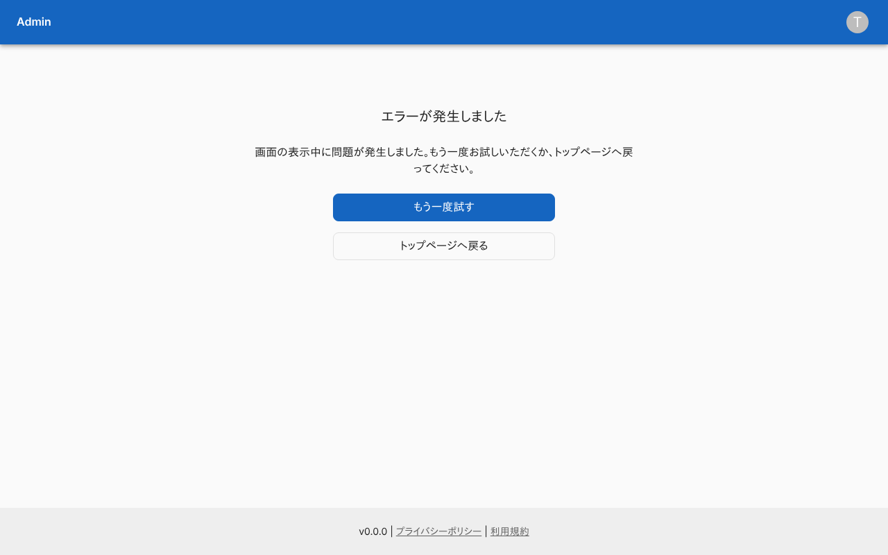 |

## つながり

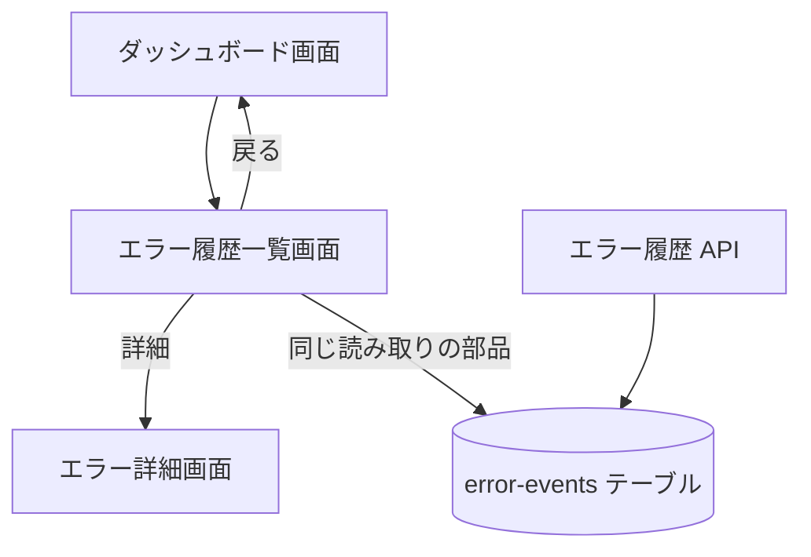
