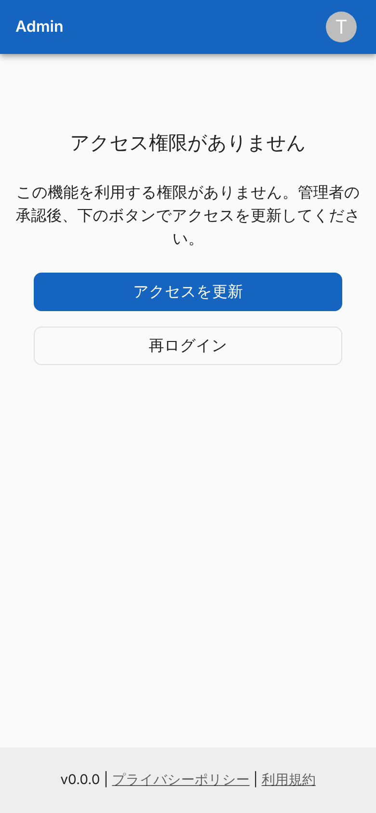
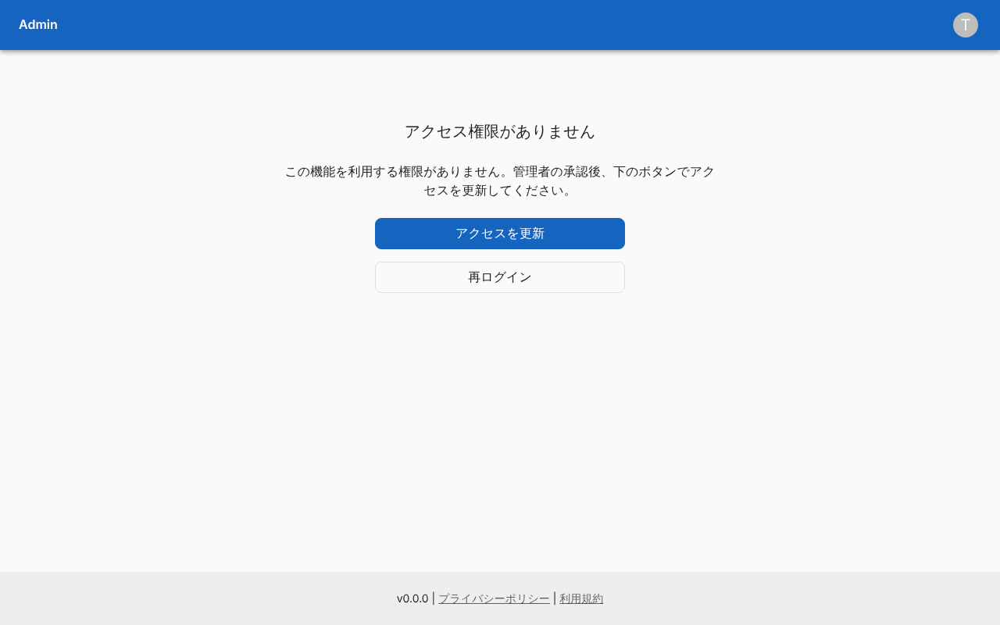
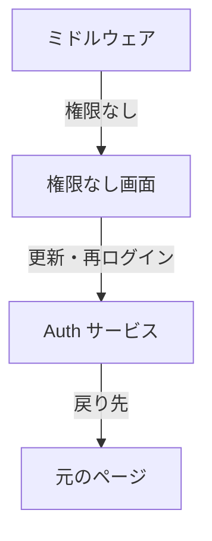

# 権限なし画面

ログインしているが、Admin を使う権限 (`users:read`) がない利用者に、権限を更新するか、ログインし直す導線を出す画面。

## 入口

- パスは `/forbidden`。ミドルウェアが、権限のない利用者のページへのアクセスを、元のパスと検索文字列を `from` に付けて移す ([権限とロール](../term/permission.md))
- ログインと権限の判定の対象外で、ログインしていなくても開ける

## 表示するもの

- 見出し「アクセス権限がありません」、説明「この機能を利用する権限がありません。管理者の承認後、下のボタンでアクセスを更新してください。」、「アクセスを更新」と「再ログイン」のボタン
- ヘッダーとフッターは、ほかの画面と同じ
- Auth サービスの URL は、リクエストのたびにサーバーが環境変数 `NEXT_PUBLIC_AUTH_URL` から決めて渡す

## 操作

| 操作 | 結果 |
|---|---|
| アクセスを更新 | Auth サービスの更新へ移る。戻り先は、開いている Admin のオリジンに `from` を付けたもの。`from` がなければ Admin のトップ |
| 再ログイン | Auth サービスのサインアウトへ移る。戻り先は同じ |

## 画面の見た目

### 通常表示

`/dashboard` から移された例。

| スマホ | PC |
|---|---|
|  |  |

## つながり

