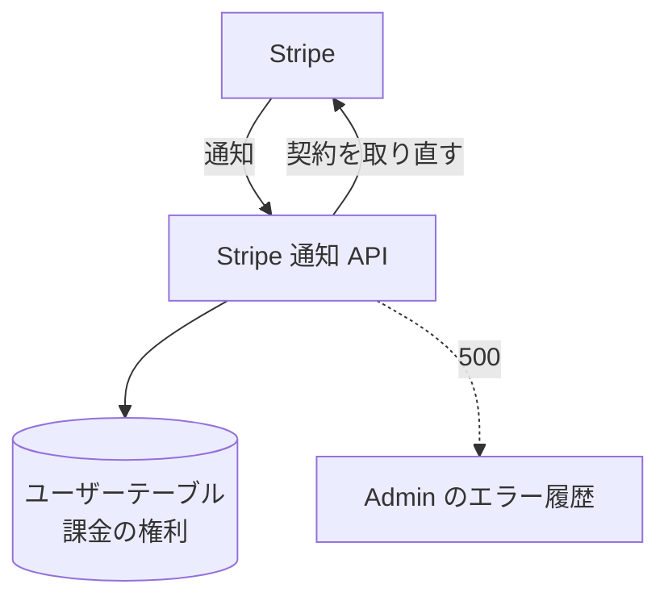

# Stripe 通知 API

Stripe が契約の変化を知らせてくる受け口。通知を合図に、その顧客の契約を Stripe から取り直して課金の権利へ反映する。

## エンドポイント

| メソッド | パス | 権限 |
|---|---|---|
| POST | `/api/billing/webhook` | なし (ログインではなく Stripe の署名で守る) |

## 入力と出力

- 本文は Stripe の通知。加工しないまま署名を検証するので、本文はそのまま読む。ヘッダー `Stripe-Signature` が要る
- 通知の種類は問わない。通知の対象 (`customer`) から顧客 ID を取り、取れなければ何もせず `{ received: true, ignored: true }` を返す
- 顧客 ID が取れたら、[課金の権利への同期](../flow/billing-entitlement.md)を行い、`{ received: true }` を返す。同期の結果が「同期しなかった」(顧客が削除済み、対応するユーザーがいない、顧客 ID が一致しない) のときも同じ応答

## エラー

形は[認証 API のエラー応答](../term/api-error.md)。

| 条件 | 状態 | `error` |
|---|---|---|
| 課金が無効 | 503 | 課金は有効になっていません |
| `Stripe-Signature` がない | 400 | Stripe-Signature ヘッダーがありません |
| 署名を検証できない | 400 | 通知の署名を検証できませんでした |
| 同期の失敗 (Stripe や DB の失敗、競合が解けない) | 500 | 通知の処理に失敗しました |

- 500 を返すと Stripe が再送する。500 は Admin のエラー履歴へも報告する

## つながり

