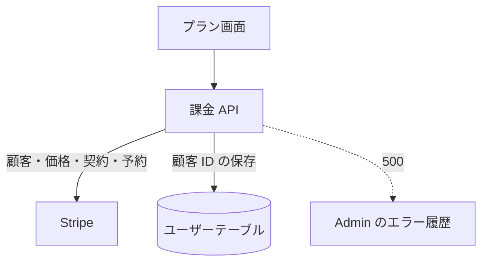

# 課金 API

プラン画面が使う、申し込み・段の切り替え・契約の管理・下げの予約の取り消し。Stripe の画面の URL を返すか、Stripe に予約を作る。

## エンドポイント

すべて POST で、ログインが要る。権限 (ロールの権限) は、申し込みの `billing:test` を除いて見ない。

| パス | 内容 |
|---|---|
| `/api/billing/checkout` | 申し込みの決済画面 (Stripe Checkout) の URL を返す |
| `/api/billing/plan-change` | 上げは確認画面 (Customer Portal) の URL を返し、下げは請求期間の終わりに切り替わる予約を作る |
| `/api/billing/portal` | 契約の管理画面 (Customer Portal) の URL を返す |
| `/api/billing/scheduled-change/cancel` | 下げの予約を取り消す |

## 入力と出力

| パス | 本文 | 出力 |
|---|---|---|
| checkout | `roleId` (有料ロール)、`callbackUrl` (任意) | `{ url }` |
| plan-change | `roleId` (有料ロール)、`callbackUrl` (任意) | 上げ: `{ url }`。下げ: `{ scheduled: true, startsAt }` (`startsAt` は切り替わる Unix ミリ秒) |
| portal | `callbackUrl` (任意。本文なしでもよい) | `{ url }` |
| scheduled-change/cancel | `serviceId` (有料のサービス) | `{ ok: true }` |

- `callbackUrl` は[戻り先](../term/callback-url.md)として検証し、許可されない値は無いものとして扱う。文字列以外ならエラー
- 申し込み: Stripe の顧客がなければ作ってユーザーに保存する。同じサービスの有効な契約が Stripe にあれば、段が違っても断る。価格は有料ロール ID をキーに Stripe から引く。決済のあとの戻り先は `/plans?checkout=success` (`callbackUrl` があれば引き継ぐ)、中止の戻り先は `/plans`
- 段の切り替え: 契約は Stripe から取り直して判定する。上げは、行き先の価格へ切り替える確認画面へ送り、確認のあとは申し込みと同じ `/plans?checkout=success` へ戻る。下げは、今の期間の終わりに下の段へ切り替わる予約を作り、返金や日割りのクレジットは出さない。予約の作成に失敗したら予約を元に戻す
- 契約の管理: 戻り先は `/plans` (`callbackUrl` があれば引き継ぐ)
- 取り消し: 本人の契約に付いた予約だけを Stripe から引いて外す。契約は今の段のまま残る
- 戻り先の基準 (自サービスの origin) は、環境変数 `AUTH_URL` (なければ `NEXTAUTH_URL`)、なければリクエストのヘッダーから決める

## エラー

形は[認証 API のエラー応答](../term/api-error.md)。

| 条件 | 状態 | `error` | 対象 |
|---|---|---|---|
| 未ログイン | 401 | 認証が必要です | 全部 |
| 本番以外で `billing:test` がない | 403 | この環境では、テスト用のロールを持つ人だけが申し込めます | checkout |
| 課金が無効 (鍵が空か仮の値) | 503 | 課金は有効になっていません | 全部 |
| `roleId` が有料ロールでない | 400 | 申し込めないプランです / 切り替えられないプランです | checkout / plan-change |
| `callbackUrl` が文字列でない | 400 | リクエストの内容が正しくありません | checkout、plan-change、portal |
| `serviceId` が有料のサービスでない | 400 | 取り消せない対象です | scheduled-change/cancel |
| ユーザーが DB にいない | 404 | ユーザーが見つかりません | 全部 |
| 契約の管理で Stripe の顧客がない | 404 | 契約の情報がありません | portal |
| 同じサービスに有効な契約がある | 409 | このサービスは既に契約中です。段の変更はプランの画面から行えます | checkout |
| そのサービスの契約がない | 409 | このサービスは契約していません | plan-change |
| 今の段と同じ | 409 | 既にこのプランを契約中です | plan-change |
| 解約を予約中 | 409 | 解約を予約中のため切り替えられません。解約の取り消しは「契約を管理」から行えます | plan-change |
| 支払いを確認できていない (`past_due`) | 409 | 支払いを確認できていないため段を変えられません。「契約を管理」から支払い方法を更新してください | plan-change |
| 下げの予約が付いている | 409 | 変更を予約中のため切り替えられません。先に予約を取り消してください | plan-change |
| 取り消せる予約がない | 409 | 取り消せる予約がありません | scheduled-change/cancel |
| Stripe に行き先の価格がない | 503 | プランの価格を取得できませんでした | checkout、plan-change |
| 想定外の失敗 | 500 | 申し込みの準備に失敗しました など、経路ごとの固定の文 | 全部 |

- 申し込みの `billing:test` の確認は、Stripe に顧客や決済画面を作る前に行う。plan-change、portal、cancel にはこの制限がない

## つながり

