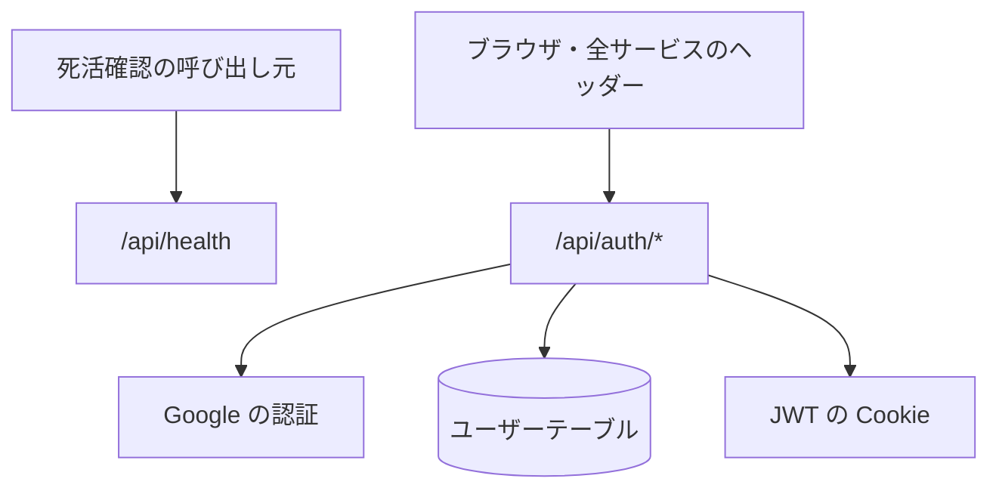

# システム系の API

死活確認と、認証ライブラリ (next-auth) の受け口。サインイン・サインアウト・セッションの取得はここを通る。

## エンドポイント

| メソッド | パス | 権限 |
|---|---|---|
| GET | `/api/health` | なし |
| GET、POST | `/api/auth/*` | なし (ログインの状態を扱う) |

`/api/auth/*` のうち使われるもの

| パス | 内容 |
|---|---|
| `/api/auth/signin`、`/api/auth/signin/google` | サインインの開始。Google の認証へ送る |
| `/api/auth/callback/google` | Google からの戻りを受ける。ユーザーを保存して JWT の Cookie を発行する |
| `/api/auth/session` | ログインの状態 (ユーザー ID、メール、名前、画像、ロール) を返す。全画面のヘッダーが使う |
| `/api/auth/csrf` | CSRF トークンを返す (サインアウト確認画面が使う) |
| `/api/auth/signout` | GET は確認画面へ移す。POST (CSRF トークン付き) でサインアウトする |

## 入力と出力

- 死活確認は `{ status: 'ok', service: 'auth', version, timestamp }`。`version` は環境変数 `APP_VERSION`、なければ `1.0.0`
- 認証の画面は `/signin`、`/auth/error`、`/auth/signout` に差し替えてある ([サインイン画面](../screen/signin.md)など)
- セッションは JWT 方式で、有効期間は 30 日。Cookie は環境ごとに名前とドメインを分ける (本番 `.nagiyu.com`、dev `.dev.nagiyu.com` で名前に `.dev` が付く、ローカル開発はドメインなし)。全サービスがこの Cookie を読んで SSO する ([サインインの経路](../flow/sign-in.md))
- ログイン時に Google の `prompt=consent`、`access_type=offline` を付ける
- 環境変数 `SKIP_AUTH_CHECK` が `true` のテスト用の設定では、画面のセッションはテスト用のユーザー (ロールは `x-test-user-roles` ヘッダー、`TEST_USER_ROLES`、既定の `admin` の順) で決まり、ミドルウェアも未ログインを通す。`/api/auth/session` はこの設定でも本物の認証ライブラリの応答を返す (テスト用のセッションにならない)

## エラー

- 死活確認はエラーを決めていない
- 認証の失敗は、[認証エラー画面](../screen/auth-error.md)へ移す
- ミドルウェアは `/api`、`_next`、`favicon.ico`、`/auth` 配下を対象にしない。`/signin`、`/plans`、`/legal` 配下は通し、それ以外の画面は未ログインだと `/signin?callbackUrl=<パス>` へ移す

## つながり

