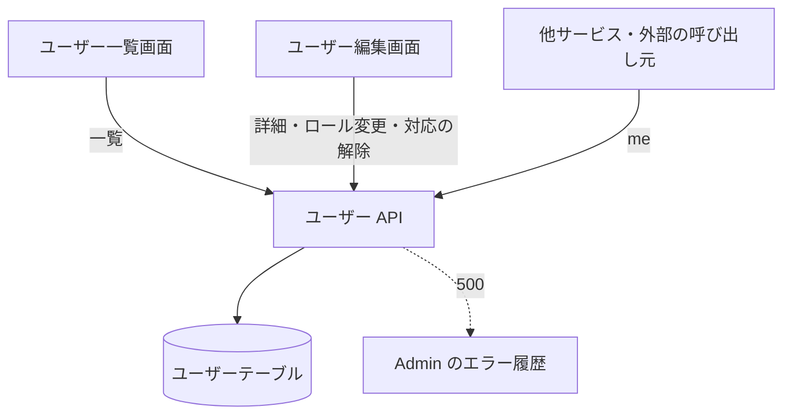

# ユーザー API

ユーザーの一覧と取得、名前とロールの更新、削除、課金の権利の変更、Stripe の顧客との対応の解除。

## エンドポイント

| メソッド | パス | 権限 |
|---|---|---|
| GET | `/api/users` | `users:read` |
| GET | `/api/users/me` | ログインのみ (権限は見ない) |
| GET | `/api/users/{userId}` | `users:read` |
| PATCH | `/api/users/{userId}` | `users:write`。`roles` を変えるなら `roles:assign` も |
| DELETE | `/api/users/{userId}` | `users:write` |
| POST | `/api/users/{userId}/roles` | `roles:assign` |
| DELETE | `/api/users/{userId}/stripe-customer` | `roles:assign` |

## 入力と出力

一覧 (`GET /api/users`)

| 項目 | 条件 |
|---|---|
| `limit` | 任意。1〜100、省略すると 50。先頭の数字を読むので `10abc` は 10 |
| `lastKey` | 任意。前の応答の `pagination.lastKey`。読めない値は無視して先頭から返す |

- 出力は `{ users, pagination: { count, lastKey? } }`。並び順は決まっていない (DB の読み出し順)。`lastKey` は続きがあるときに付く (続きがなくても付くことがあり、次のページが空になる)
- `stripeCustomerId` を含めるのは、詳細 (`GET /api/users/{userId}`) と対応の解除の応答だけ (管理画面が対応の有無を出すため)。ほかの応答は含めない

自分の情報 (`GET /api/users/me`)

- セッションのユーザー ID で DB を読んで返す。権利の `sourceRef` と `grantedBy` は運営者の内部のメモなので外し、`stripeCustomerId` も含めない

更新 (`PATCH /api/users/{userId}`)

| 項目 | 条件 |
|---|---|
| `name` | 任意。1〜100 文字 |
| `roles` | 任意。手動ロールの ID の配列。定義済みの ID だけで、重複と有料ロールは入れられない。手動ロールを丸ごと置き換える |

- これ以外の項目は受け付けない。本文は JSON のオブジェクトで、課金の権利は変えられない
- 出力は更新後のユーザー

削除 (`DELETE /api/users/{userId}`)

- 自分自身は消せない。成功すると `{ message: 'ユーザーが正常に削除されました' }`
- Stripe の契約には触れない (契約中のユーザーを消すときは、先に Stripe で解約する運用)

ロールと権利の変更 (`POST /api/users/{userId}/roles`)

| 項目 | 条件 |
|---|---|
| `roles` | 必須。手動ロールの配列。定義済みの ID だけで、重複と有料ロールは入れられない (有料ロールは `grantChanges.add` で付ける)。手動ロールを丸ごと置き換える |
| `grantChanges.add` | 任意。`{ roleId, expiresAt, sourceRef? }` の配列。`roleId` は有料ロールだけ。`expiresAt` は現在より後の Unix ミリ秒 (整数)。`sourceRef` は 200 文字まで |
| `grantChanges.extend` | 任意。`{ grantId, expiresAt }` の配列。期限を変える |
| `grantChanges.revoke` | 任意。`grantId` の配列。取り消す |

- 手動ロールと権利の変更は、読み直した最新のユーザーに対して 1 回の書き込みで反映する。書き込みが重なったら読み直してやり直す (初回を含めて最大 3 回)
- 権利を変えられるのは、手動で付けた、取り消し済みでない権利だけ。Stripe 由来の権利は変えられない。同じ権利を 1 回の依頼で 2 度触ることはできない
- 適用の順は、期限の変更、取り消し、追加。追加した権利には、操作した人のユーザー ID (`grantedBy`) を付ける
- 出力は更新後のユーザー

対応の解除 (`DELETE /api/users/{userId}/stripe-customer`)

- Stripe の顧客との対応 (`stripeCustomerId`) を外し、同じ書き込みで Stripe 由来の有効な権利を取り消す。Stripe 上の顧客や契約は変えない
- 出力は更新後のユーザー

## エラー

形は[認証 API のエラー応答](../term/api-error.md)。

| 条件 | 状態 | `error` |
|---|---|---|
| 未ログイン | 401 | 認証が必要です |
| 権限がない | 403 | この操作を実行する権限がありません (`details` に必要な権限) |
| 一覧の `limit` が範囲外・数字でない | 400 | リクエストパラメータが不正です (`details` に `limit` の文) |
| 本文が JSON のオブジェクトでない、項目の検証に失敗 (更新・ロール変更) | 400 | リクエストボディが不正です (`details` に項目ごとの文) |
| `roles` に定義にないロール (ロール変更) | 400 | 無効なロールが含まれています: {ID} (`validRoles` に手動ロールの一覧を付ける) |
| `roles` に重複したロール (更新・ロール変更) | 400 | ロールが重複しています: {ID}。更新では `details` の文、ロール変更では `error` |
| `roles` に有料ロール (更新・ロール変更) | 400 | 有料ロールは手動ロールでは付けられません。課金の権利から付けてください: {ID}。更新では `details` の文、ロール変更では `error` |
| 権利の変更が今の状態に合わない (対象なし、手動でない、取り消し済み、重複、期限が過去、有料でないロール) | 400 | 原因ごとの文 |
| 自分自身を削除 | 400 | 自分自身を削除することはできません |
| 対象のユーザーがいない | 404 | ユーザーが見つかりません |
| 対応の解除で、Stripe の顧客との対応がない | 404 | このユーザーは Stripe の顧客と対応していません |
| 書き込みの競合が解けなかった (ロール変更・対応の解除) | 409 | 他の更新と競合しました。再読み込みしてください |
| 想定外の失敗 | 500 | 経路ごとの固定の文 (ユーザー情報の取得に失敗しました、ロールの割り当てに失敗しました など) |

## つながり

