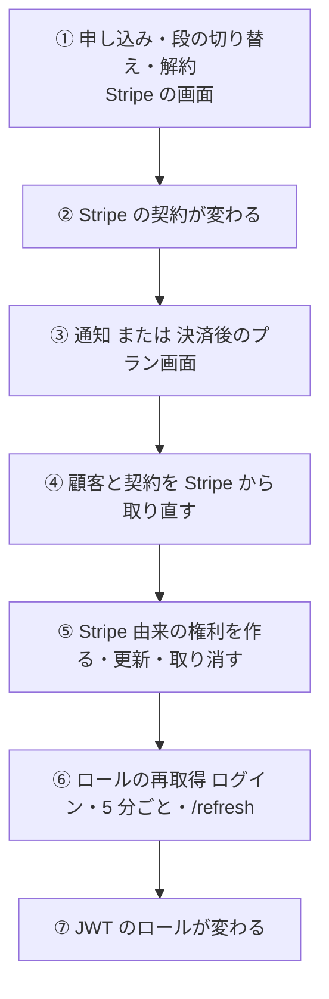
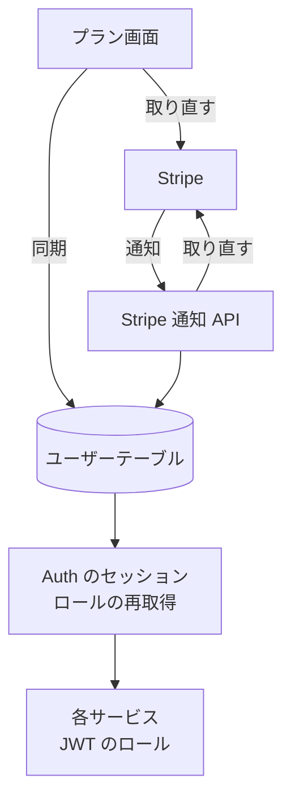

# 契約がロールになる経路

Stripe での申し込み・更新・解約が、[課金の権利](../term/role-grant.md)を通って、各サービスが読むロールになるまでの流れ。

## 起点

| きっかけ | 同期のしかた |
|---|---|
| 決済を終えてプラン画面へ戻る (`checkout=success`) | プラン画面がその場で同期し、`/refresh` へ送る |
| Stripe の通知 (契約の作成・更新・解約など) | [Stripe 通知 API](../api/billing-webhook.md)が同期する |
| ログイン中の利用者がプラン画面を開く | Stripe の顧客があれば、取り直して同期する (通知の取りこぼしの保険) |

## 経路

| 段階 | 内容 |
|---|---|
| ④ 取り直し | 通知の中身は合図としてだけ使い、毎回 Stripe から取り直す。顧客のメタデータの `userId` が指すユーザーが、同じ顧客 ID を持っていなければ何もしない (顧客が削除済み、ユーザーがいない場合も同じ) |
| ④ 対象の契約 | 状態が `active`、`trialing`、`past_due` の契約の品目のうち、価格の `lookup_key` が有料ロール ID のもの。ほかの `lookup_key` は無視して警告を出す |
| ⑤ 権利の期限 | 契約の今の請求期間の終わり + 3 日 |
| ⑤ 権利の作り方 | 有料ロールごとに、期限が最も遅い契約 (同じなら契約 ID の小さい方) の 1 件にそろえる。今ある有効な Stripe 由来の権利は、契約が残っていれば期限と契約 ID を更新し、なければ取り消す。契約はあるが権利がなければ作る。手動の権利には触れない |
| ⑤ 書き込み | 読んだときの更新日時を条件にして書く。競合したらユーザーも Stripe も読み直してやり直す (最大 3 回)。変化がなければ書かない |
| ⑥ 再取得 | Auth がセッションを読むときに、ログイン時、前回から 5 分を過ぎたとき、`/refresh` の更新のときに DB から読み直す。[セッションのロール](../term/session-roles.md)を参照 |

- 申し込み前に、Stripe の顧客がなければ作ってユーザーに保存する。顧客のメタデータにユーザー ID を持たせる ([課金 API](../api/billing.md))
- 決済直後は、通知より先に戻ることがあるので、プラン画面が同期してから `/refresh` へ送る。戻り先は `callbackUrl` か、プラン画面
- 手動の権利は管理画面から付ける ([ユーザー編集画面](../screen/user-edit.md))。ロールの算出では Stripe 由来と同じに扱う

## 届く先

- ユーザーテーブルの課金の権利 (`roleGrants`)
- 利用者の JWT のロール。各サービスは有料ロールの権限を確かめるだけで出し分ける

## 失敗・取りこぼしのとき

- 同期が失敗したら、通知 API は 500 を返して Stripe に再送させ、Admin のエラー履歴へ報告する。プラン画面の同期は失敗しても画面を壊さない
- 解約や期限切れの反映は遅れうる。権利の期限は ⑤ のとおり期間の終わり + 3 日で、ロールの外れは次の再取得のときになる。Auth の外のサービスは JWT を読むだけで、DB を読み直さない
- 更新の通知を取りこぼしても、3 日の猶予の間にプラン画面の同期か次の通知で追いつく

## つながり

