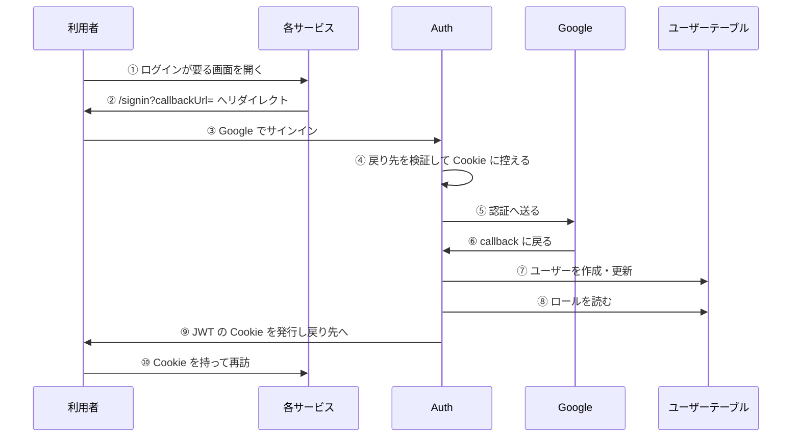
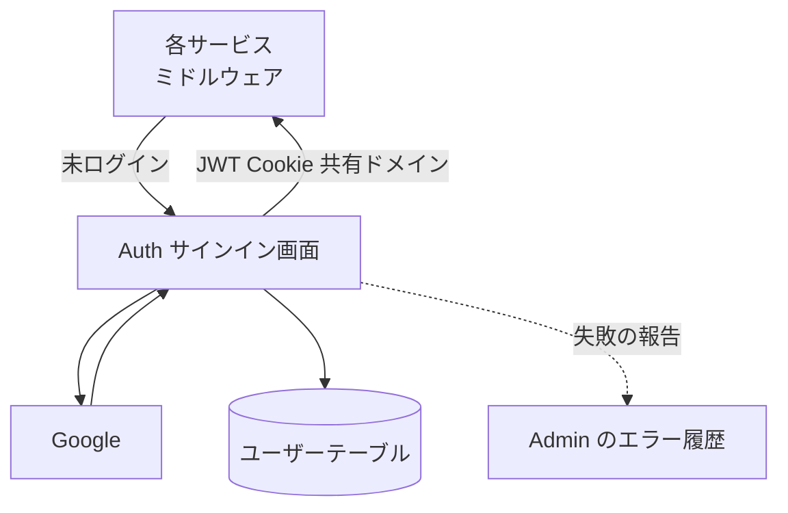

# サインインの経路

どのサービスの画面からでも、未ログインの利用者を Auth のサインインへ送り、Google の認証のあとに元の画面へ戻す流れ。サインインの結果は共有の Cookie で、全サービスへ届く。

## 起点

- ログインが要る画面を未ログインで開く。各サービスのミドルウェア (`createAuthMiddleware`) が、Auth のサインイン画面 (`NEXT_PUBLIC_AUTH_URL` の `/signin`) へ、`callbackUrl=<開いた画面>` を付けてリダイレクトする
    - 戻り先の既定は、環境変数 `APP_URL` があれば `{APP_URL}{パス}{検索語}`、なければパスだけ。Auth 自身は常にパスと検索語 (相対パス)
- ログインが任意のサービスは、画面の中の導線から `buildSignInUrl` で同じサインイン画面へ送る

## 経路

| 段階 | 内容 |
|---|---|
| ④ 戻り先の検証 | 同一オリジン、または nagiyu.com とそのサブドメインの絶対 URL と、Auth 内の相対パスを通す。相対パスは絶対 URL にする。通らない値は Auth のトップ (`/`。そこからダッシュボード) にする。[戻り先](../term/callback-url.md)を参照 |
| ⑦ ユーザーの保存 | Google のアカウント ID で探す。いなければ手動ロールなしで作り、いれば名前と画像を更新する。メールアドレスと名前が Google から返らなければサインインを拒否する |
| ⑧ ロールの取得 | 手動ロールと、有効な課金の権利のロールを合わせた[セッションのロール](../term/session-roles.md)を JWT に入れる。最終ログイン時刻も更新する |
| ⑨ Cookie | `.nagiyu.com` (dev は `.dev.nagiyu.com`) 全体で共有する。戻り先の Cookie も同様で、環境ごとに名前を分ける |
| ⑩ 再訪 | 各サービスは JWT の署名だけを検証してロールを読む。Auth へ問い合わせない |

- サインアウトは逆向きで、各サービスが `/api/auth/signout?callbackUrl=` へ送り、[サインアウト確認画面](../screen/signout.md)で確認してから Cookie を消す
- 管理者がロールを変えても、利用者の JWT はすぐには変わらない。[権限更新画面](../screen/refresh.md)かセッションの再取得で受け取る

## 届く先

- 利用者のブラウザの JWT Cookie。全サービスのミドルウェアとサーバー側のセッション取得が読む
- ユーザーテーブルのユーザー (新規作成・名前と画像の更新・最終ログイン時刻)

## 失敗・取りこぼしのとき

| 失敗 | 結果 |
|---|---|
| メールアドレスまたは名前がない | サインインを拒否し、[認証エラー画面](../screen/auth-error.md)へ (`AccessDenied`)。Admin のエラー履歴へ報告する |
| ユーザーの保存に失敗 | サインインを拒否する。Admin のエラー履歴へ報告する |
| ログイン時のユーザー情報の取得に失敗 | 例外が認証ライブラリに握られてログインに失敗する。Admin のエラー履歴へ報告する |
| 戻り先が許可されない | Auth のトップへ戻す (失敗にはしない) |

- 報告は[エラー通知の経路](../../admin/flow/error-notification.md)の「アプリの報告」にあたり、`serviceId` は `auth`

## つながり

