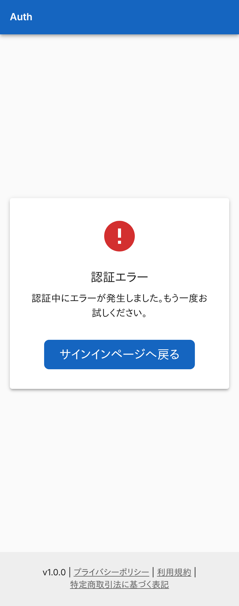
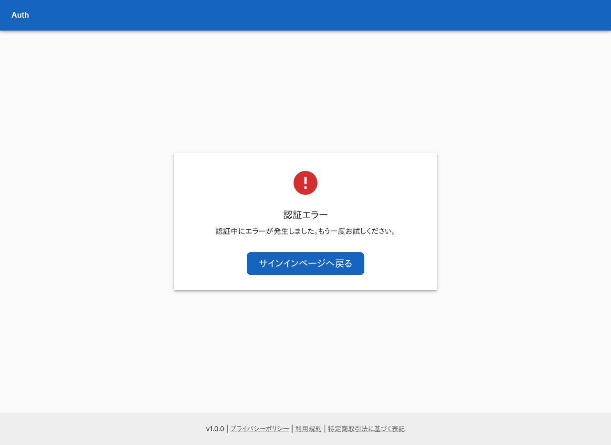
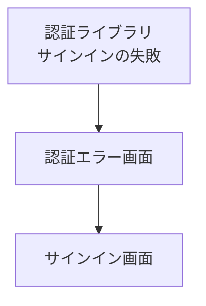

# 認証エラー画面

サインインに失敗したとき、エラーの種類に応じた文を出し、サインイン画面へ戻す。

## 入口

- パスは `/auth/error`。サインインの途中で認証ライブラリが失敗を返すと、`?error=<種類>` を付けてここへ移す
- 種類は問い合わせで任意の値を渡せる。ログインなしで開ける (ミドルウェアの対象外)

## 表示するもの

| 部分 | 内容 |
|---|---|
| 見出し | 「認証エラー」 |
| 説明 | `error` の値に応じた文 |
| ボタン | 「サインインページへ戻る」 |

| `error` の値 | 説明の文 |
|---|---|
| `Configuration` | サーバー設定に問題があります。管理者にお問い合わせください。 |
| `AccessDenied` | アクセスが拒否されました。 |
| `Verification` | 認証トークンの有効期限が切れています。 |
| それ以外・なし | 認証中にエラーが発生しました。もう一度お試しください。 |

- 表の 3 つの値の完全一致だけを拾い、`__proto__` のようなオブジェクト自身の名前を渡されても既定の文にする
- メールアドレスやユーザー名が Google から返らないとき、ユーザーの保存に失敗したときは、サインインを拒否する。そのとき認証ライブラリが `AccessDenied` を付けてこの画面へ移す

## 状態

- `error` を読み込むまでの間は「読み込み中...」を出す

## 操作

| 操作 | 結果 |
|---|---|
| サインインページへ戻る | [サインイン画面](./signin.md)を開く (戻り先は付かない) |

## 画面の見た目

### `Configuration`

サーバー設定の問題を伝える。

| スマホ | PC |
|---|---|
|  |  |

### `AccessDenied`

サインインを拒否したときの文。

| スマホ | PC |
|---|---|
|  |  |

### `Verification`

認証トークンの期限切れを伝える。

| スマホ | PC |
|---|---|
|  |  |

### それ以外の値

知らない値のときの既定の文。

| スマホ | PC |
|---|---|
|  |  |

## つながり

