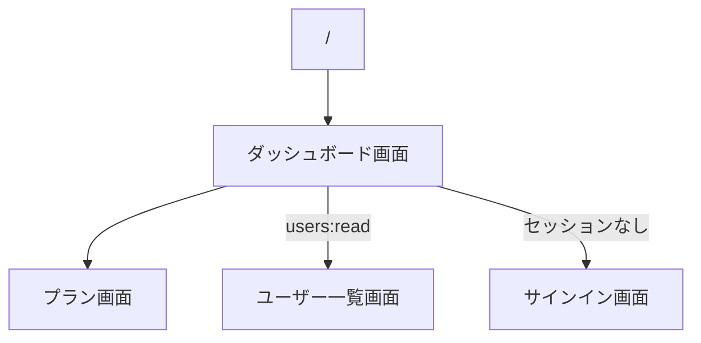

# ダッシュボード画面

サインインしたあとの着地点。自分のユーザー情報とロールを見せ、プランと管理機能へ案内する。

## 入口

- パスは `/dashboard`。ルート (`/`) は、ここへリダイレクトするだけの画面
- サインイン後の戻り先が決まっていないときの行き先になる ([サインインの経路](../flow/sign-in.md))
- セッションがなければ[サインイン画面](./signin.md)へリダイレクトする

## 表示の条件

- ログインしていれば、権限がなくても開ける
- 「管理機能」のカードは `users:read` を持つ利用者にだけ出す ([ロールと権限](../../platform/term/role.md))

## 表示するもの

| 部分 | 内容 |
|---|---|
| ユーザー情報 | 名前、メール、ユーザー ID、ロール |
| プラン | 「プランを見る」 |
| 管理機能 | 「ユーザー管理」 (`users:read` があるとき) |

- ロールは名前の札で並べる。ロールがなければ「なし」。ここに出すのは[セッションのロール](../term/session-roles.md)で、DB の今の値とは限らない
- 開発サーバー (`NODE_ENV` が `development`) のときだけ、セッションの中身を JSON で出す「セッション情報 (デバッグ用)」が付く

## 操作

| 操作 | 結果 |
|---|---|
| プランを見る | [プラン画面](./plans.md)を開く |
| ユーザー管理 | [ユーザー一覧画面](./users.md)を開く |

## 画面の見た目

### 通常表示 (`admin`)

ユーザー管理への案内が出る。

| スマホ | PC |
|---|---|
|  |  |

### ユーザー管理の権限がないとき (`stock-viewer`)

「管理機能」のカードが出ない。

| スマホ | PC |
|---|---|
|  |  |

## つながり

