# プラン画面

有料の[段](../term/plan-tier.md)の料金を示し、ログイン中の利用者が自分の契約の状態を確かめ、申し込み・段の切り替え・契約の管理へ進む画面。料金の画面を兼ね、ログインなしでも開ける。

## 入口

- パスは `/plans`。ダッシュボードの「プランを見る」と、各サービスの案内から来る
- 問い合わせ
    - `callbackUrl`: 操作のあとに戻る先 ([戻り先](../term/callback-url.md))。許可されない値は無いものとして扱う。同じキーを重ねて渡した値も無いものとして扱う
    - `checkout=success`: 決済を終えて戻ってきた印。下の「操作」を参照

## 表示の条件

- ログインなしで開ける。セッションがあるとき (ユーザーが DB にいるとき) だけ契約と権利の状態を出す。ユーザーが DB に見つからない利用者は、未ログインと同じ扱いになる
- 申し込みの導線 (「申し込む」「ログインして申し込む」) は、`NAGIYU_ENV` が `prod` の環境か、`billing:test` を持つ利用者にだけ出す。それ以外は「この環境ではテスト用の申し込みに限っています」を出す。段の切り替えと契約の管理は、この制限の対象にならない
- Stripe の鍵が空か仮の値のままなら、課金は無効として「準備中です」を出す

## 表示するもの

| 部分 | 内容 |
|---|---|
| サービスの見出し | 有料のサービスごと。出す段が 1 つもないサービスは見出しごと出さない |
| 段のカード | 下の段から順。段の名前、商品の説明 (空なら出さない)、価格と周期 (税込)、状態、操作 |
| 契約を管理 | Stripe の顧客を持つ利用者にだけ、画面に 1 つ |
| 注記 | 契約は自動更新されること、解約は「契約を管理」から行うこと、解約しても支払い済みの期間の終わりまで使えること |
| 表記へのリンク | 「特定商取引法に基づく表記」([特定商取引法画面](./tokushoho.md))。準備中でも出す |

段のカードの状態と操作は、契約の状態で決まる。

| 状態 | 見せるもの | 操作 |
|---|---|---|
| 未ログイン | 価格 | 「ログインして申し込む」 |
| 未契約 (サービスに契約がない) | 価格 | 「申し込む」 |
| 契約中 | 「契約中」の札、「次の更新日: 日付」 | なし |
| 解約予約中 | 「解約予約中」の札、「日付に終了します」 | なし |
| 同じサービスの他の段 (契約があり、解約予約も下げの予約もない) | 価格 | 上の段は「この段に変える」(上げ)、下の段は「この段に変える」(下げ。確認ダイアログを出す) |
| 下げの予約中の段 (契約中の段) | 「日付から{段の名前}に変わります」 | 「予約を取り消す」 |
| 運営による付与がある | 「運営による付与があります (日付まで)」または「(期限なし)」を、状態に足して出す | 付与は契約ではないので、契約の状態で決まる操作 (「申し込む」など) もそのまま出る |

- 価格のない段は、売っていないものとして枠を出さない。ただし契約中か、有効な手動の権利があれば出す
- 価格の取得に失敗したときは、売っているかが分からないので全部の枠を出し、価格の代わりに「価格を取得できませんでした」を出す。このとき「申し込む」「この段に変える」は出ない
- 契約の状態を Stripe から取れなかったときは、同期済みの権利から「契約中」かどうかだけを決める (日付は出ない)
- 日付は日本時間で「2026年3月15日」の形。価格は通貨の最小単位から換算し、周期に応じて「月額」「年額」などを付ける

## 状態

- 「準備中です」を出すのは、課金が無効のとき、出す段が 1 つもなく Stripe の顧客もいないとき、Stripe の顧客はいるが出す段が 1 つもないとき (このときは「契約を管理」も出る)
- 操作のボタンは、通信中は押せない。失敗したら、ボタンの下にエラーの帯を出す。応答の `error` の文を使い、読めなければ「予期しない応答でした。時間をおいてもう一度お試しください」、通信できなければ「通信に失敗しました。時間をおいてもう一度お試しください」

## 操作

| 操作 | 結果 |
|---|---|
| ログインして申し込む | `/signin` へ移る。戻り先はプラン画面 (`callbackUrl` を引き継ぐ) |
| 申し込む | `POST /api/billing/checkout` で Stripe の決済画面の URL をもらい、そこへ移る ([課金 API](../api/billing.md)) |
| この段に変える (上げ) | `POST /api/billing/plan-change` で Stripe の確認画面の URL をもらい、そこへ移る |
| この段に変える (下げ) | 確認ダイアログ「プランの変更を予約します」を出す。本文は、切り替わる日、それまでは今の段のまま使えること、返金がないこと。「変更を予約する」で `POST /api/billing/plan-change` を送り、画面を読み直す。「やめる」で閉じる |
| 予約を取り消す | `POST /api/billing/scheduled-change/cancel` を送り、画面を読み直す |
| 契約を管理 | `POST /api/billing/portal` で Stripe の Customer Portal の URL をもらい、そこへ移る |

- `checkout=success` で開き、ログインしていて課金が有効なときは、画面を出さずに Stripe の契約を権利へ同期し、`/refresh` へリダイレクトする。戻り先は `callbackUrl`、なければこの画面。[課金の経路](../flow/billing-entitlement.md)を参照
- 開くたびに、ログイン中でユーザーに Stripe の顧客があれば、契約を Stripe から取り直して権利へ同期する (失敗しても画面は壊さない)

## 画面の見た目

### 出せる段がないとき

Stripe に価格がないので、準備中を出す。

| スマホ | PC |
|---|---|
| 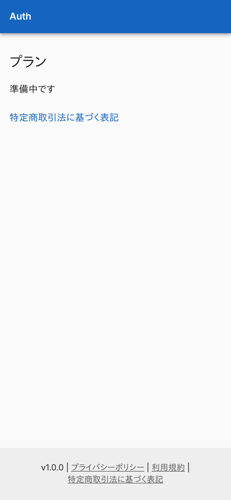 | 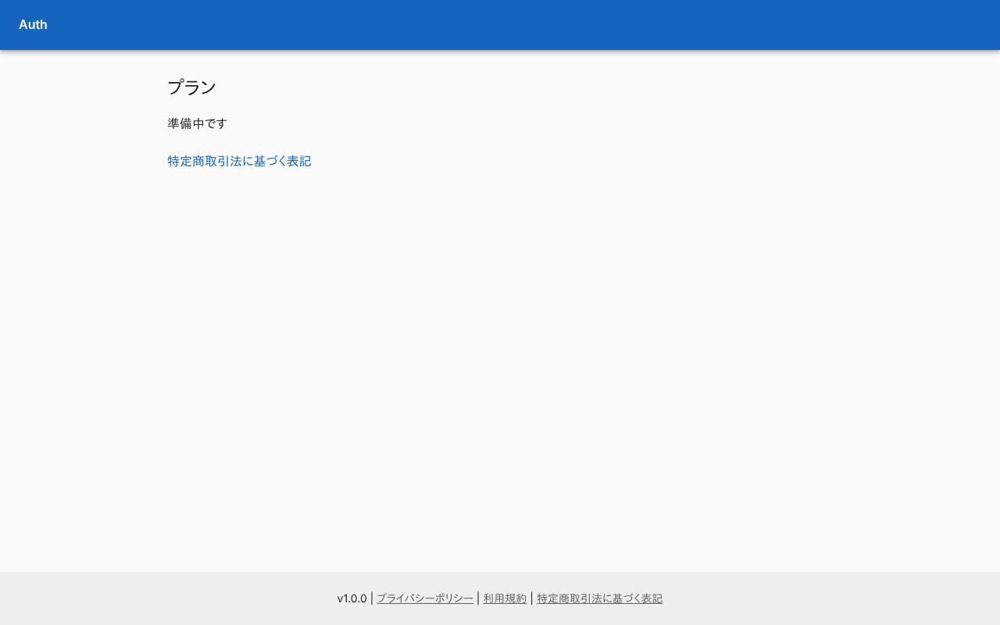 |

### ユーザーが見つからないとき

未ログインと同じ扱いで、「ログインして申し込む」を出す。

| スマホ | PC |
|---|---|
| 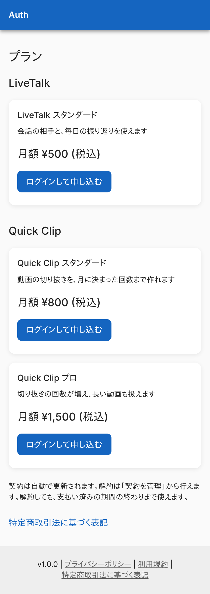 | 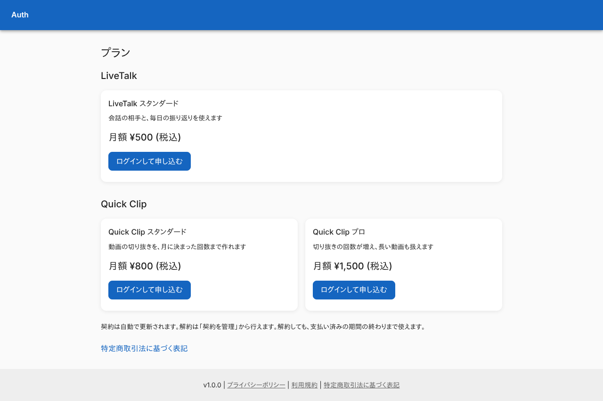 |

### 申し込みが制限されている環境 (`admin`)

`billing:test` がないので、制限の注記を出し、申し込みの導線は出さない。

| スマホ | PC |
|---|---|
|  |  |

### 契約がないとき

「申し込む」を出す。

| スマホ | PC |
|---|---|
| 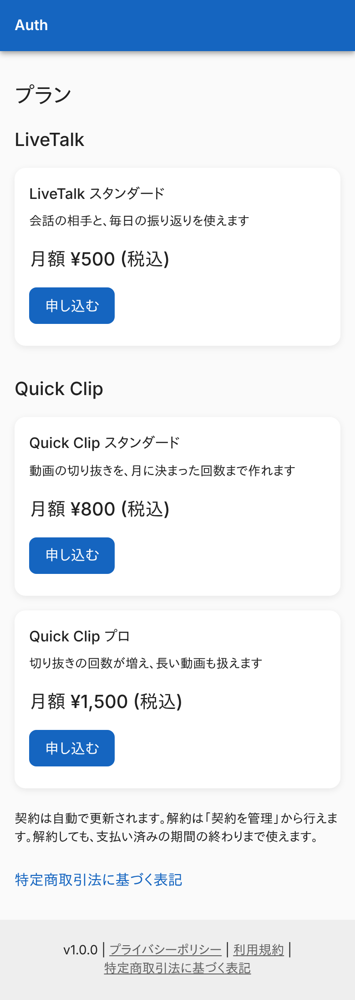 | 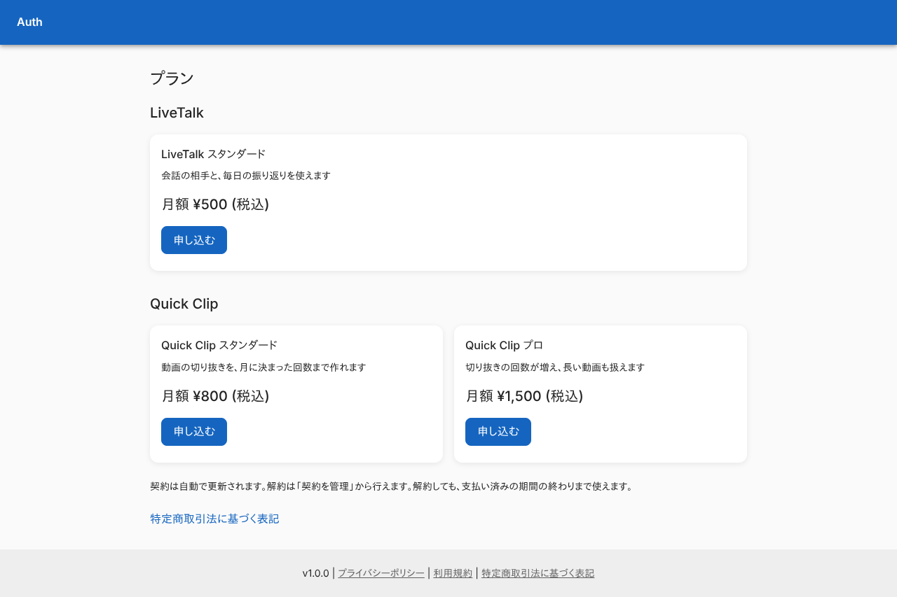 |

### 契約中

次の更新日と、同じサービスの他の段への切り替え、契約の管理が出る。

| スマホ | PC |
|---|---|
| 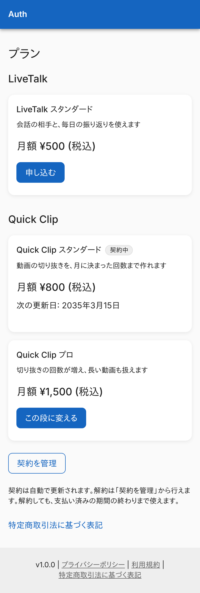 | 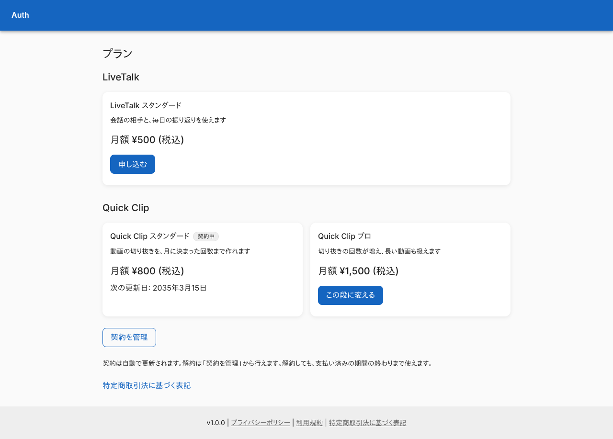 |

### 下げの確認ダイアログ

ダイアログを写している。

| スマホ | PC |
|---|---|
| 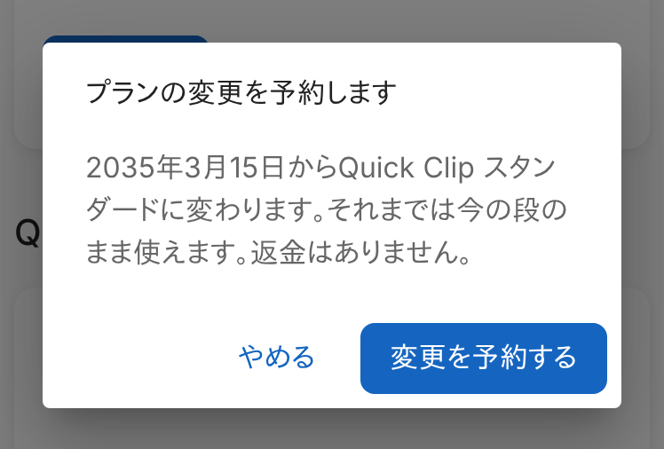 | 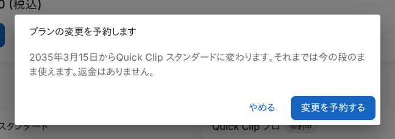 |

### 下げの予約中

予約の内容と「予約を取り消す」が出て、他の段への切り替えは出ない。

| スマホ | PC |
|---|---|
| 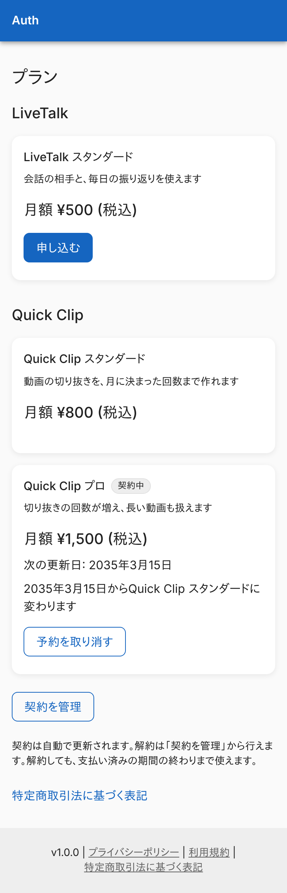 | 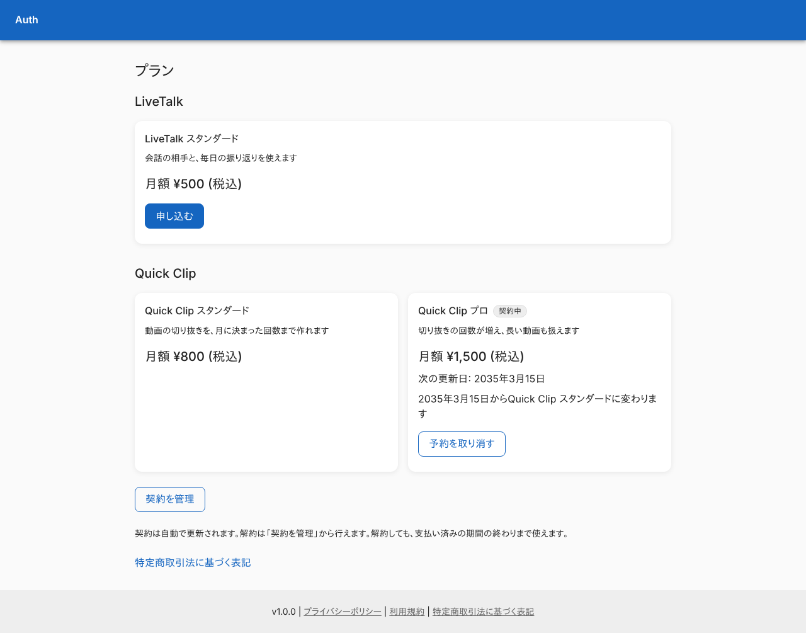 |

### 解約予約中

終了日が出て、他の段への切り替えは出ない。

| スマホ | PC |
|---|---|
| 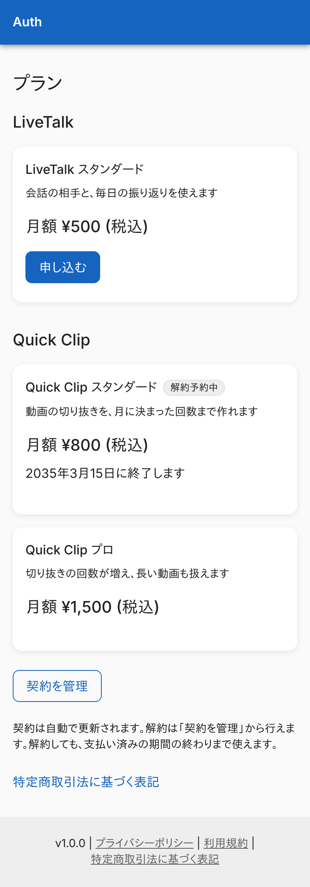 | 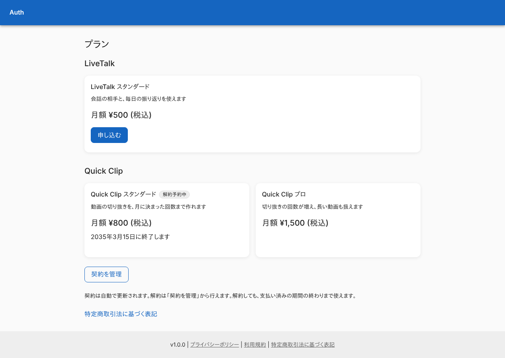 |

### 運営による付与があるとき

Stripe の契約とは別に、付与の期限を出す。

| スマホ | PC |
|---|---|
| 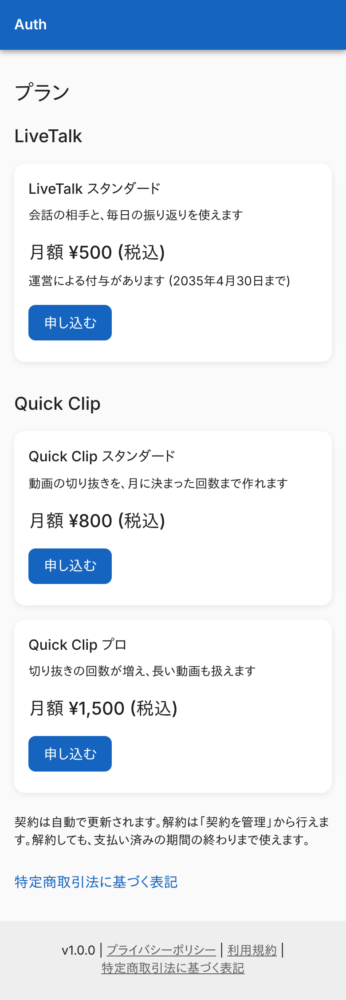 | 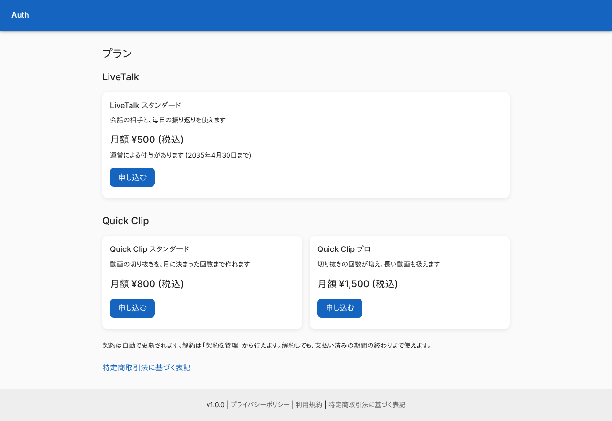 |

### 価格を取得できなかったとき

全部の段の枠に、価格を取得できなかった旨を出す。

| スマホ | PC |
|---|---|
| 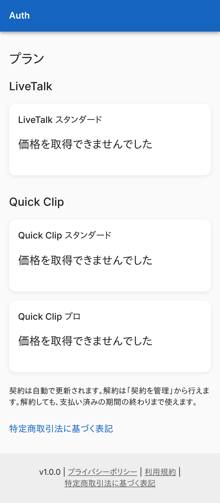 | 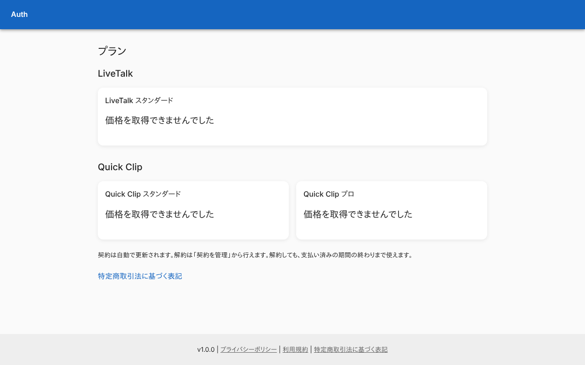 |

### 申し込みの準備に失敗したとき

ボタンの下にエラーの帯を出す。

| スマホ | PC |
|---|---|
| 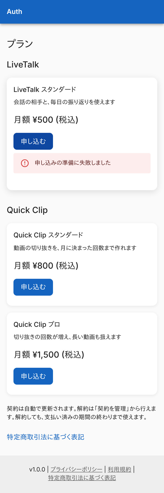 | 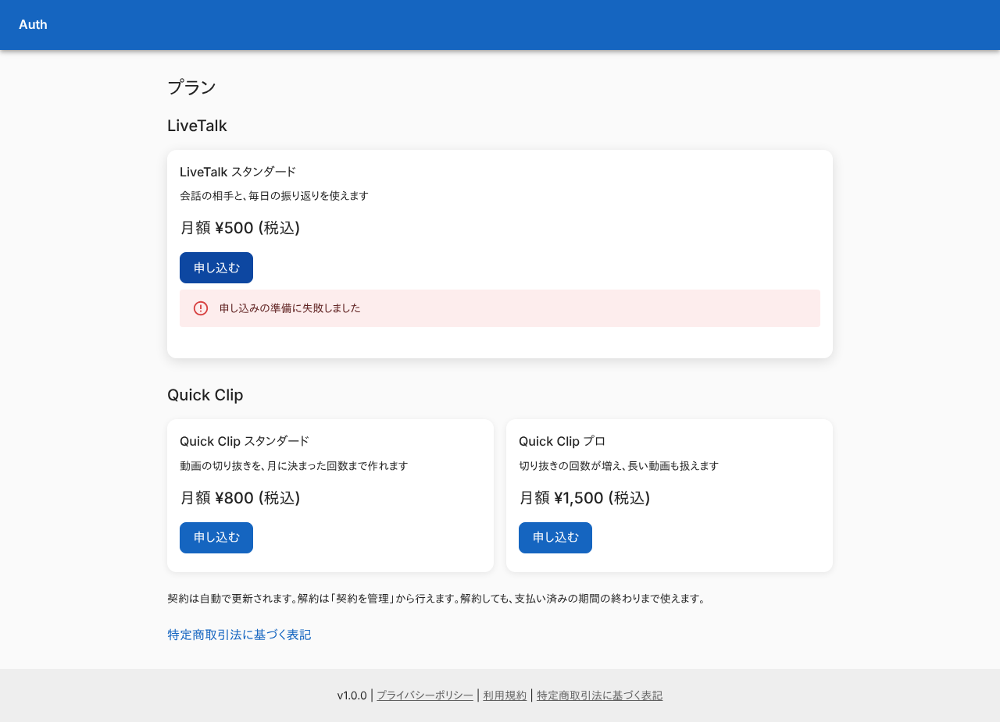 |

## つながり

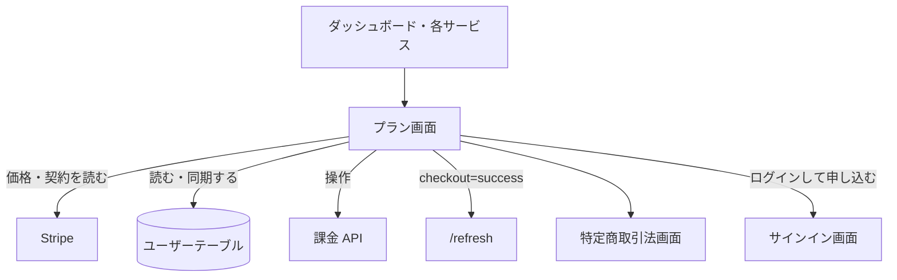
