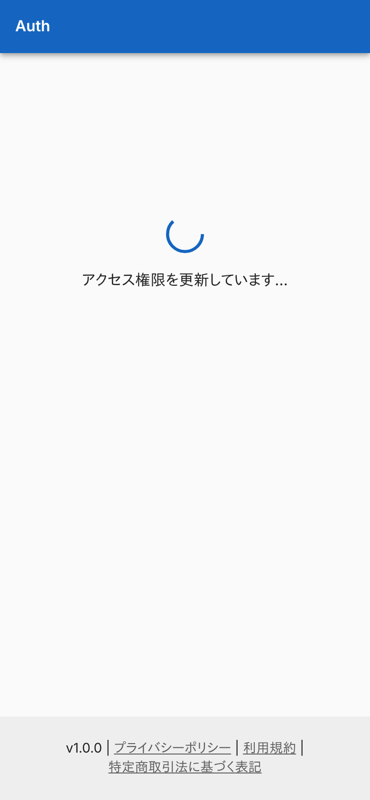
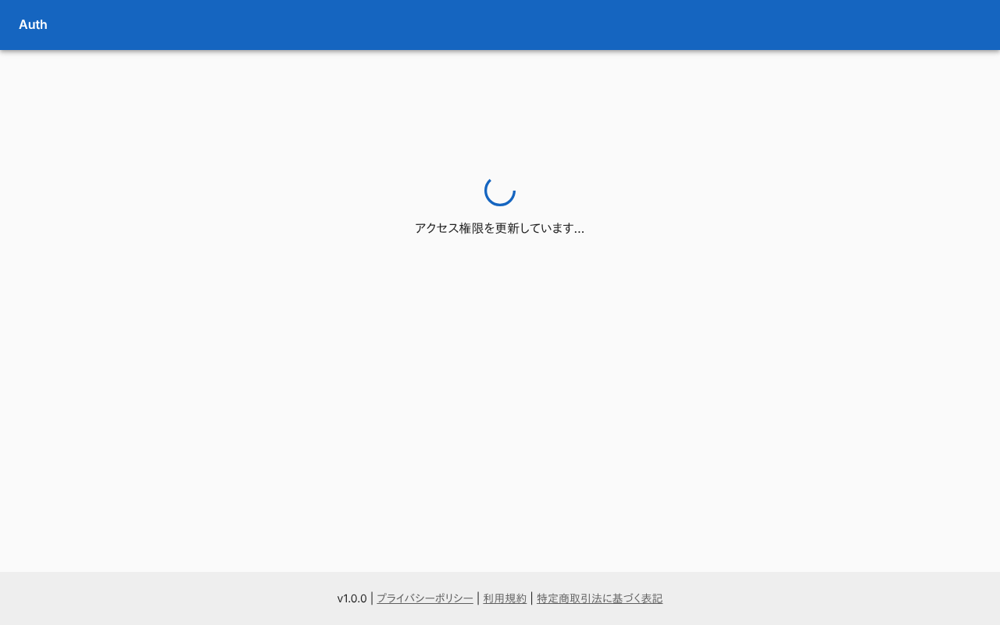
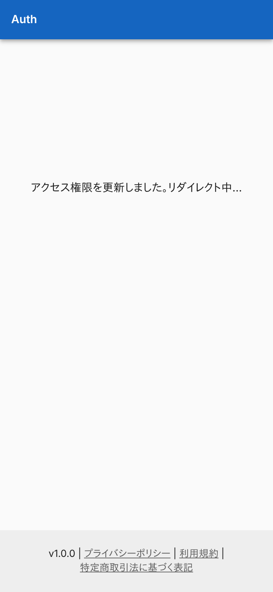
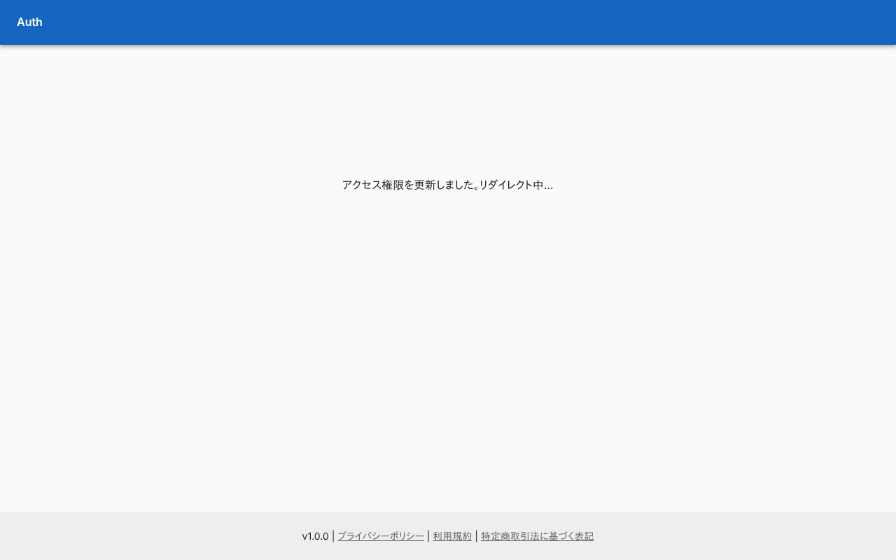
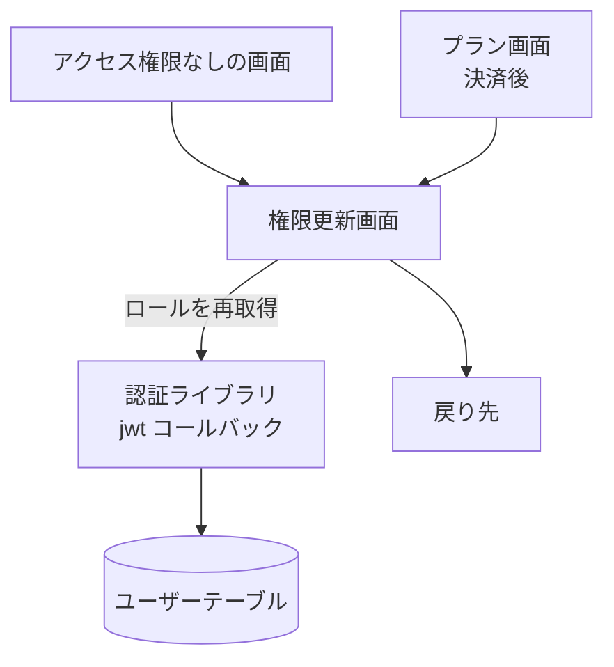

# 権限更新画面

セッションのロールを DB から読み直し、元の画面へ戻す中継画面。管理者がロールを付けたあと、利用者が最新のロールを受け取るために使う。

## 入口

- パスは `/refresh?callbackUrl=<戻る先>`。次のところから来る
    - 各画面の「アクセス権限がありません」の「アクセスを更新」
    - 決済を終えたあとのプラン画面 ([課金の経路](../flow/billing-entitlement.md))
- ログインが要る (ミドルウェアが未ログインをサインインへ送る)

## 表示するもの

| 状態 | 文 |
|---|---|
| 更新中 | 読み込みの印と「アクセス権限を更新しています…」 |
| 更新できた | 「アクセス権限を更新しました。リダイレクト中…」 |
| 更新に失敗した | 「更新中にエラーが発生しましたが、リダイレクト先へ移動します…」 |

## 処理

- セッションの読み込みが終わってから、1 回だけ更新を呼ぶ。更新はロールの強制再取得を起こす ([セッションのロール](../term/session-roles.md))
- 更新が終わったら、成功でも失敗でも[戻り先](../term/callback-url.md)へ移る。`callbackUrl` が同一オリジンか nagiyu.com 配下の絶対 URL、または Auth 内の相対パス (絶対 URL にして使う) でなければ、Auth のトップ (`/`。そこからダッシュボード) へ移る
- 更新の通信が失敗しても、認証ライブラリがその失敗を握るので、画面は「更新できた」になる (「失敗した」の文は、更新の呼び出しが例外を投げたときだけ出る)

## 画面の見た目

### 更新中

更新の応答を待っている。

| スマホ | PC |
|---|---|
|  |  |

### 更新できたとき

移動の直前の表示。

| スマホ | PC |
|---|---|
|  |  |

## つながり

